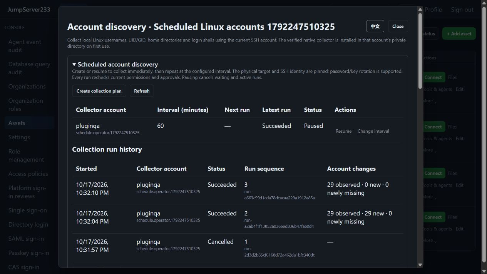

# Scheduled account discovery

> English | [中文](./SCHEDULED-ACCOUNT-DISCOVERY.md)

Linux SSH discovery supports interval plans, per-run approvals and encrypted run archives. Standalone comes first, with PostgreSQL active/standby takeover. The full competitor target remains [JumpServer Enterprise](https://www.jumpserver.org/enterprise.html); see [PLAN](./PLAN.en.md) for overall progress and [Account discovery](./ACCOUNT-DISCOVERY.en.md) for native collection fields and human review.

## Web and CLI

Assets → SSH host “More” → “Collected accounts” → expand “Scheduled account discovery”. Choose an interval from 1–1440 minutes. Creation and resumption collect immediately, then repeat at the interval. Missed executions coalesce and an active or waiting run prevents overlap. The browser need not stay open.

Within an organization, each platform user may have one enabled collection plan per physical host, including named SSH credentials. A plan pins the physical target, host key, collector username and credential endpoint. Each run refreshes current password/key and gateway revisions, supporting seven-day rotation. Pause the old plan and create another when changing the physical target or collector identity.

```powershell
cd server
go run ./cmd/jms accounts plans <asset-id>
go run ./cmd/jms accounts schedule <asset-id> --interval 3600 --request-id unique-schedule-001
go run ./cmd/jms accounts plan <asset-id> <plan-id> --enabled=false --revision 1
go run ./cmd/jms accounts plan <asset-id> <plan-id> --enabled=true --revision 2 --interval 7200
go run ./cmd/jms accounts collections <asset-id> --limit 50
```

Use a platform Token/AccessKey and optional `JMS_ORG_ID`. Select named credentials with the global prefix `--account <username-or-id>` or `JMS_ACCOUNT`; no target password is needed. CLI intervals use seconds, 60–86400. Updates require explicit `--enabled` and the current configuration revision. Reuse the request ID after an ambiguous creation response and refresh before editing revisions. CLI management can pause a plan using a disabled named credential, while operational connections still reject that credential.

## Permissions, approvals and pause

| Action | Required authority |
|---|---|
| Create or resume | Independent `accounts.schedule`, `accounts.discover` and current owner target connection authority; resumption also checks the caller's scheduling/discovery authority |
| Read host run archives | `accounts.view`, current host visibility and access policies |
| Pause | Owner or `plans.manage_all`; owners can inspect and pause their plans after losing collection authority |
| Read other users' plan metadata | `plans.view_all` or `plans.manage_all`, without acquiring connections or discovery access |

Plans retain the trusted source address captured at creation. Every run and ongoing execution recheck platform identity, identity source, organization, grants, source/time, target and pinned gateways. Live revocation cancels transport and prevents publishing that result. Failed authority/target checks or denied/expired approvals pause the plan; fix the cause and explicitly resume.

Login approvals use a dedicated `account_discovery` action bound to the plan ID and run sequence. Ordinary SSH approvals, other plans and older sequences cannot authorize that run. Command-filter approval remains separate and rechecks current authority before approval.

Pausing cancels waiting, dispatching and active collections and expires unused login permits for that run. A review ID returned late during dispatch enters the cancellation/archive outbox and retries after persistence failures. Result publication and pause are ordered by the authorization lock: already committed results remain, while new results cannot publish after pause returns.

## Archives, HA and upgrades

Every run persists an encrypted receipt before pruning hot jobs/runs. An archive failure retains pending records. At 1000 hot records, collectors wait for archive recovery without silently discarding history; ordinary manual jobs retain their existing capacity limit. Each organization permits four concurrent collections, with different credentials sharing one reservation per physical host.

Archives use independent `account-collections` documents and AES-GCM authentication data, separate from BanHack233 events. Segments contain 128 records, with an index bounded to 5000 sources and 1000 plans. Segmented history continues to grow; retention and automatic cleanup remain open. Web pages contain 10 records, API/CLI pages 1–100, using `next_before`. Read older runs through archive pages; generic job/run detail fallback only covers each plan's most recently archived receipt.

Periodic discovery updates finding/presence snapshots and revisions without consuming the bounded 2000-entry manual collection/review activity history. Human reviews still retain their complete activity. Finding-count and 16 MiB per-asset limits remain. Receipts hold metadata summaries and platform execution details, without target passwords or `/etc/shadow`.

PostgreSQL active/standby shares encrypted plans, jobs, snapshots and archives within isolated organization namespaces. Takeover links an already persisted identical job; uncertain SSH dispatches become interrupted and are never replayed automatically. Pending approvals retain their type and sequence and still require current authority. Live SSH transports do not migrate; active/active scheduling remains open.

Encrypted `operations`/`ssh-jobs` documents containing scheduled discovery use format version 2 with version-bound authentication data. Older binaries refuse these documents instead of executing them as ordinary commands. The new review action also requires a compatible binary. Keep consistent state/key backups before upgrading. Rollback requires matching pre-upgrade backups; never rewrite an encrypted envelope header.

## Verification and remaining scope

On 2026-10-17, a real OpenSSH case against production Docker passed in 20.9 seconds: Web creation, both approvals, pause invalidation, new sequences on resume, native collection, CLI, credential revisions, archives, revocation, both languages and 390px layout. The in-app browser separately inspected three real run receipts. See [TESTING](./TESTING.en.md) for complete results.



See [Remote account lifecycle](./REMOTE-ACCOUNTS.en.md) for Linux system account changes. Bulk import, Windows/directory/database discovery, weak-password inspection, cron/calendar plans and archive retention remain open. Overall Enterprise parity is still in progress.
