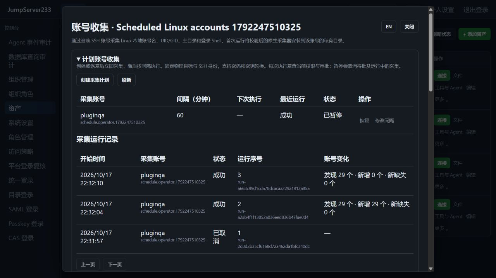

# 计划账号收集

> 中文 | [English](./SCHEDULED-ACCOUNT-DISCOVERY.en.md)

Linux SSH 账号收集支持间隔计划、逐轮审批和加密运行归档。默认单机，也支持 PostgreSQL 单活接管；完整竞品目标仍是 [JumpServer 企业版](https://www.jumpserver.org/enterprise.html)，总体状态见 [PLAN](./PLAN.md)。采集字段、原生组件和人工确认规则沿用 [账号收集](./ACCOUNT-DISCOVERY.md)。

## Web 与 CLI

资产 → SSH 主机“更多” → “账号收集” → 展开“计划账号收集”。创建计划时选择间隔，范围 1–1440 分钟。创建、恢复后立即采集，此后按间隔执行；错过次数合并，前一轮待批或运行时避免重叠。后台不依赖浏览器保持打开。

每个组织中，同一平台用户在同一物理主机最多有一个启用的采集计划，具名 SSH 凭据也计入该限制。计划固定物理目标、指纹、采集用户名和凭据端点；每轮刷新当前密码/密钥及网关修订，兼容七天轮换。修改物理目标或采集身份需暂停旧计划并创建新计划。

```powershell
cd server
go run ./cmd/jms accounts plans <asset-id>
go run ./cmd/jms accounts schedule <asset-id> --interval 3600 --request-id unique-schedule-001
go run ./cmd/jms accounts plan <asset-id> <plan-id> --enabled=false --revision 1
go run ./cmd/jms accounts plan <asset-id> <plan-id> --enabled=true --revision 2 --interval 7200
go run ./cmd/jms accounts collections <asset-id> --limit 50
```

CLI 使用平台 Token/AccessKey 和可选 `JMS_ORG_ID`；具名身份使用全局前缀 `--account <username-or-id>` 或 `JMS_ACCOUNT`。无需输入远端密码。`--interval` 单位为秒，范围 60–86400；修改必须显式提供 `--enabled` 与当前配置版本。提交结果不明确时复用请求 ID，刷新后再修改版本。CLI 可暂停已停用的具名凭据计划，操作类连接仍拒绝该凭据。

## 权限、审批与暂停

| 操作 | 权限要求 |
|---|---|
| 创建或恢复 | 独立 `accounts.schedule`、`accounts.discover`，当前拥有者仍有目标连接权；恢复还检查当前操作者的调度/收集权 |
| 查看主机运行归档 | `accounts.view` 与当前主机可见权、访问策略 |
| 暂停 | 拥有者或 `plans.manage_all`；拥有者撤权后仍可暂停、查看自己的计划 |
| 跨用户计划元数据 | `plans.view_all` 或 `plans.manage_all`；不授予连接或读取账号发现权限 |

计划沿用创建时可信来源地址，每轮和运行中重新检查平台身份、身份源、组织、授权、来源/时段、目标和固定网关策略。运行中撤权会取消传输，并阻止该次结果入库。权限/目标校验失败或审批拒绝、过期后暂停计划；修复原因后显式恢复。

登录审批使用独立 `account_discovery` 动作，绑定计划 ID 和轮次。普通 SSH 的审批、其它计划及旧轮次均不能放行该次采集。命令过滤的审批继续独立进行，批准时再检查当前权限。

暂停会取消待批、派发中和运行中的采集；尚未使用的该轮登录许可被作废。派发中晚返回的审批 ID 进入取消归档流程，写入失败会重试。结果提交与暂停在授权锁上排序：暂停返回前已完成的结果保留，暂停之后不能发布新的结果。

## 归档、HA 与升级

每轮先保存加密运行回执，再清理热作业/运行索引；归档失败保留待归档记录。热记录达到 1000 条时等待归档恢复，避免静默丢失历史；普通手动作业仍沿用原容量限制。每组织最多四个采集并发，同一物理主机的不同凭据共用一个采集占位。

归档使用独立 `account-collections` 命名空间与 AES-GCM 认证数据，不混入 BanHack233 事件。128 条一段，索引最多 5000 个来源、1000 个计划；分段历史持续增长，尚无保留策略或自动清理。Web 每页 10 条，API/CLI 每页 1–100 条，通过 `next_before` 游标翻页。旧轮次从归档页读取；通用作业/运行详情接口只提供每计划最近一次已归档回执的回退。

周期采集更新发现/缺失快照与修订，不消耗最多 2000 条的人工作业/确认活动历史。人工确认仍保存完整活动；账号身份数量及单资产 16 MiB 状态限制不变。轮次只记录元数据摘要与平台执行信息，不存放目标密码或 `/etc/shadow`。

PostgreSQL 单活共享加密计划、作业、快照和归档；组织命名空间独立。接管时关联已持久化的相同作业；不明确的 SSH 派发标记中断，不自动重放。审批中的作业保留类型和轮次，仍需当前授权。在线 SSH 传输不迁移，多活调度不在当前范围。

包含计划收集元数据的 `operations`/`ssh-jobs` 加密文档使用版本 2，认证数据绑定该版本；旧程序会拒绝读取，不能降级执行为普通命令。新增审批动作也要求对应程序版本。升级前保留一致的状态与密钥备份；需要回退时恢复匹配的升级前备份，不改写密文头。

## 验证与剩余范围

2026-10-17，生产 Docker 真实 OpenSSH 用例 20.9 秒通过，覆盖 Web 创建、两类审批、暂停作废旧轮次、恢复、原生采集、CLI、凭据修订、归档、撤权、中英文和 390px 页面；内置浏览器另外核对三轮真实回执。完整自动化结果见 [TESTING](./TESTING.md)。



远端系统账号创建/删除、批量导入、Windows/目录/数据库发现、弱口令检测、cron/日历计划及归档保留策略仍待完成，不代表企业版全部功能已齐。
