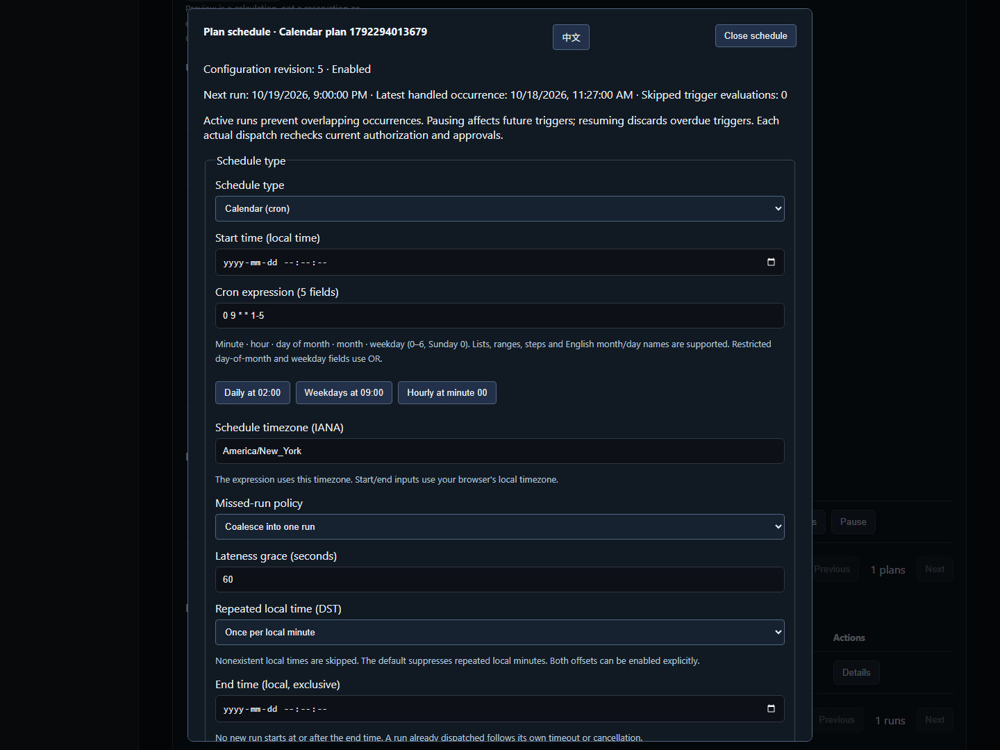

# SSH calendar schedules

> English | [中文](./SCHEDULING.md)

“Batch commands and schedules” in the workbench supports five-field cron, IANA timezones, start/end windows, missed-run policies, time previews, revisioned editing and change audit. Standalone comes first, with organization encryption and PostgreSQL single-active takeover. Actual commands use existing SSH jobs, current authorization and approvals.

2026-10-18, isolated Docker acceptance with real synthetic OpenSSH, English desktop:



The competitor is [JumpServer Enterprise](https://www.jumpserver.org/enterprise.html). Its [official job-management guide](https://docs.fit2cloud.com/jumpserver/v3/guide/user/ops/job_management/) includes commands, Playbooks and periodic execution. This feature implements SSH command scheduling. Playbook/Ansible, scheduled reports and production active-active operation remain on the roadmap. Full Enterprise parity remains in progress.

## Time and execution semantics

| Setting | Contract |
| --- | --- |
| `kind` | `batch`, `once`, `interval`, `cron`; calendar editing applies to unfinished ordinary plans |
| `cron_expression` | Minute, hour, day of month, month, weekday; lists, ranges, steps and English month/day names; weekdays 0–6, Sunday 0 |
| Day of month and weekday | OR when both are restricted, matching the selected POSIX cron parser |
| `timezone` | Required IANA name such as `Asia/Shanghai`, `America/New_York` or `UTC`; implicit machine `Local` is rejected |
| `run_at` | Optional UTC lower bound, inclusive at an aligned minute. A new/changed start must be in the future within ten years; editing may retain an existing past recurring start |
| `end_at` | Optional exclusive UTC upper bound. No new runs at or after it; dispatched commands follow their own timeout/cancellation |
| `misfire_policy` | Default `coalesce` creates one overdue run; `skip` skips triggers beyond grace |
| `grace_seconds` | Default 60, range 1–3600 seconds; separate from execution timeout |
| `fold_policy` | Default `once` handles each local minute at most once; `both` explicitly allows both offsets during a DST fold |

Seconds, aliases such as `@daily` and inline timezones are rejected. [robfig/cron v3.0.1](https://pkg.go.dev/github.com/robfig/cron/v3) calculates times; this service owns claiming, persistence, authorization and execution. Preview is strictly after `after`, defaults to five occurrences and allows ten. It reserves no execution rights and consumes no approvals.

Nonexistent local times during forward transitions are skipped. A persisted civil-minute high-water mark suppresses the entire repeated hour by default. A UTC high-water mark also prevents repeated handling after clock rollback. Changing timezone resets the civil mark and retains the UTC mark. Browser start/end inputs use the browser timezone and convert to UTC; cron uses its explicit schedule timezone. Preview displays UTC and schedule-local offsets.

Recurring plans do not overlap: an active run or review skips the due trigger and advances to a future occurrence without building a backlog. `skipped_triggers` counts skipped scheduler evaluations, rather than every theoretical trigger during downtime. Pause affects future triggers; resume discards overdue triggers. Runs retain `scheduled_for`, `plan_revision`, `lateness_seconds` and `coalesced` to distinguish scheduled time from actual creation.

## Editing, authorization and recovery

- `config_revision` starts at 1. Calendar editing and pause/resume require the current revision; conflicts return 409. Legacy interval/once requests may omit it for compatibility; new Web/SDK/CLI clients always provide it.
- Editing changes only time configuration. Command, targets, template snapshot, owner and submission origin remain fixed. A separate immutable creation digest lets the original `request_id` return the existing plan after editing, the original start time passing or template deletion. Changed parameters or origin return 409 without dispatching again.
- Owners can read/manage their ordinary plans. `plans.view_all` reads other plans and time audit; `plans.manage_all` manages them. Editing/resuming also checks that the original owner is active, belongs to the organization and currently has execution access to every original target. Actual dispatch rechecks authorization, login review and command rules.
- Account-discovery and Agent-plugin collectors retain their typed interval APIs. General calendar editing cannot convert them into shell plans. Completed one-time plans and immediate batches are read-only.
- Created, updated, paused, resumed and automatically ended events commit atomically with plans in the same AES-GCM encrypted state. Organization-wide retention is 4000 events and one year, pruning oldest events. Migration does not invent historical events.
- Storage format is v3, reading/migrating v1/v2. Old services cannot read v3. Preserve a compatible data snapshot before downgrading. Existing single-active election, former-leader write rejection, claim-before-dispatch and no replay of ambiguous execution remain in force.
- Server paging allows 100 records; the workbench uses pages of 50 and polls while visible. The editor and feature translations load on demand, using native dialogs, Escape and focus restoration.

## API and CLI

| Endpoint | Payload/result |
| --- | --- |
| `POST /api/v1/ops/schedules/preview` | Schedule configuration, optional `after` and `limit` |
| `GET /api/v1/ops/plans?offset=0&limit=50` | `{results,total}`; no paging parameters retains the legacy array |
| `GET /api/v1/ops/plans/{id}` | Current plan and revision |
| `PUT /api/v1/ops/plans/{id}/schedule` | `{revision,kind,cron_expression,timezone,...}`, replaces time configuration |
| `PUT /api/v1/ops/plans/{id}` | `{revision,enabled}` |
| `GET /api/v1/ops/plans/{id}/events?offset=0&limit=20` | Currently authorized time-change events, newest first |

Existing plan creation at `POST /api/v1/ops/plans` accepts the calendar fields. Templates, run lookup and cancellation are documented in [SSH jobs](./JOBS.en.md). CLI/SDK use the existing four platform authentication methods and `X-JMS-ORG`; they never retrieve remote passwords.

```powershell
# schedule.json: {"kind":"cron","cron_expression":"0 2 * * *","timezone":"Asia/Shanghai"}
jms ops preview --file schedule.json
jms ops create --file plan.json
jms ops plans --offset 0 --limit 50
jms ops plan PLAN_ID
jms ops schedule PLAN_ID --file schedule-update.json
jms ops disable PLAN_ID --revision 2
jms ops enable PLAN_ID --revision 3
jms ops events PLAN_ID
jms ops runs
jms ops run RUN_ID
jms ops cancel RUN_ID
jms ops templates
jms ops template-create --file template.json
jms ops template-update TEMPLATE_ID --file template-update.json
jms ops template-delete TEMPLATE_ID --revision 2
```

`--file -` reads stdin. JSON is limited to 64 KiB; unknown fields, null and multiple values are rejected. Creation requires `name`, `asset_ids`, command or `template_id`, and a unique `request_id`. Editing JSON requires the current `revision`. Structured input is never composed through a shell.

## Automated acceptance entry points

Testify cases cover syntax, zones, DST gaps/full-hour and half-hour folds, century leap years, windows, misfires, concurrent claims, clock rollback, atomic audit, creation idempotency, legacy migration and PostgreSQL organization takeover. API/SDK/CLI cases cover current rights, revisions, paging, bounds and structured input. `calendar-schedules.spec.ts` uses real synthetic OpenSSH for Web creation/preview, actual minute dispatch, conflict reload, editing, pause/resume, CLI, revocation and bilingual narrow screens. Unified results belong in [Testing](./TESTING.en.md); source presence alone is not passing evidence.
