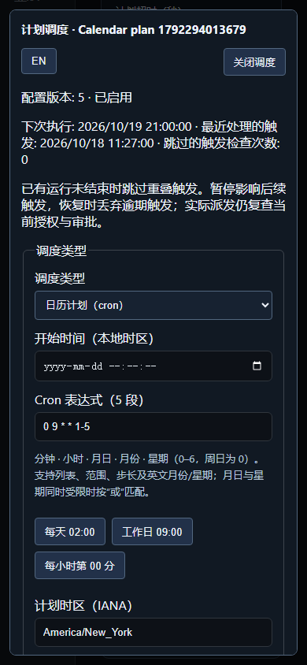

# SSH 日历调度

> 中文 | [English](./SCHEDULING.en.md)

工作台的“批量命令与定时任务”支持五段 cron、IANA 时区、起止窗口、错过触发策略、时间预览、带版本编辑和变更审计。单机优先，沿用组织加密存储与 PostgreSQL 单活接管；实际命令仍经过原有 SSH 作业、当前授权和审批。

2026-10-18，隔离 Docker 与真实合成 OpenSSH 验收的中文 390px 页面：



竞品明确为 [JumpServer 企业版](https://www.jumpserver.org/enterprise.html)。[官方作业管理说明](https://docs.fit2cloud.com/jumpserver/v3/guide/user/ops/job_management/)包含命令、Playbook 与周期执行；这里实现 SSH 命令调度。Playbook/Ansible、定时报表及生产多活仍在路线图中，完整企业版目标保持进行中。

## 时间与执行语义

| 配置 | 约定 |
| --- | --- |
| `kind` | `batch`、`once`、`interval`、`cron`；日历编辑适用于未完成的普通计划 |
| `cron_expression` | 分钟、小时、月日、月份、星期；支持列表、范围、步长和英文月份/星期；星期 0–6，周日为 0 |
| 月日与星期 | 两者同时受限时按“或”匹配，与所用 POSIX cron 解析器一致 |
| `timezone` | 必填 IANA 名称，如 `Asia/Shanghai`、`America/New_York` 或 `UTC`；不接受本机隐式 `Local` |
| `run_at` | 可选 UTC 起点；分钟对齐时包含起点。创建或修改起点时需为未来，最多十年后；编辑时可保留原有已过去的周期起点 |
| `end_at` | 可选 UTC 截止点，不包含该时刻；不创建新的运行，已派发命令仍按自身超时/取消结束 |
| `misfire_policy` | `coalesce` 默认只为逾期触发创建一次运行；`skip` 在超过容忍时间时跳过 |
| `grace_seconds` | 默认 60，范围 1–3600 秒；不是执行超时 |
| `fold_policy` | 默认 `once`，每个本地分钟最多处理一次；`both` 显式允许夏令时回拨的两个偏移 |

不接受秒字段、`@daily` 等别名或表达式内嵌时区。使用 [robfig/cron v3.0.1](https://pkg.go.dev/github.com/robfig/cron/v3) 计算时间；服务自身负责领取、持久化、授权和执行。预览严格晚于 `after`，默认五次，最多十次；它不预留执行资格，也不消费审批。

夏令时前进中不存在的本地时间跳过。默认持久化本地分钟高水位，抑制整个重复小时；UTC 高水位还防止进程时钟回拨时重复处理。修改时区重置本地高水位，保留 UTC 高水位。浏览器起止输入使用浏览器本地时间并转为 UTC；cron 始终使用显式计划时区。预览同时显示 UTC 和含偏移的计划本地时间。

周期调度不重叠：上次运行或复核未结束时跳过当前触发，推进到下一个未来时间，不积压补跑。`skipped_triggers` 统计跳过的调度检查次数，不是停机期间每个理论触发点的总数。暂停只影响后续触发；恢复丢弃逾期触发。运行保留 `scheduled_for`、`plan_revision`、`lateness_seconds` 和 `coalesced`，区分计划时间和实际创建时间。

## 编辑、权限与恢复

- `config_revision` 从 1 开始；日历编辑和暂停/恢复要求当前版本，冲突返回 409。旧间隔/一次性接口保留未传版本的兼容性；新 Web/SDK/CLI 一律传版本。
- 编辑只改变时间配置，保留原命令、目标、模板快照、所有者和提交来源。创建请求的不可变摘要单独保留，同一 `request_id` 的原始请求在编辑、原起点经过或模板删除后仍只返回原计划；改变参数或来源返回 409，不重新派发。
- 所有者可查看和管理自己的普通计划；`plans.view_all` 可查看其他计划及其时间审计，`plans.manage_all` 可管理。编辑和恢复还检查原所有者目前有效、组织成员关系和对全部原目标的当前执行权限。实际派发再次校验授权、登录复核与命令规则。
- 账号收集和 Agent 插件采集继续使用各自的带类型间隔接口，不能通过通用日历编辑改成普通 shell 任务。已完成的一次性计划和立即批量任务只读。
- 创建、编辑、暂停、恢复和自动结束事件，与计划在同一份 AES-GCM 加密状态中原子提交。审计最多 4000 条、保留一年，按组织共享上限滚动淘汰最早记录。旧计划迁移不伪造历史事件。
- 存储格式升级为 v3，支持读取 v1/v2 并迁移；旧版本服务不能读取 v3。降级前需保留兼容版本的数据快照。现有单活选主、失主停止写入、派发前领取和不明确结果不重放规则不变。
- 列表使用服务器分页，最多 100 条；工作台每页 50 条，仅可见页面轮询。编辑器与功能语言资源按需加载，沿用原生对话框、键盘 Escape 和焦点返回。

## API 与 CLI

| 接口 | 内容 |
| --- | --- |
| `POST /api/v1/ops/schedules/preview` | 时间配置、可选 `after` 与 `limit` |
| `GET /api/v1/ops/plans?offset=0&limit=50` | `{results,total}`；无分页参数保留旧数组响应 |
| `GET /api/v1/ops/plans/{id}` | 当前计划和版本 |
| `PUT /api/v1/ops/plans/{id}/schedule` | `{revision,kind,cron_expression,timezone,...}`，完整替换时间配置 |
| `PUT /api/v1/ops/plans/{id}` | `{revision,enabled}` |
| `GET /api/v1/ops/plans/{id}/events?offset=0&limit=20` | 当前权限下的时间变更审计，最新在前 |

创建计划的 `POST /api/v1/ops/plans` 沿用原接口，增加日历字段。普通模板、运行查询与取消接口见[SSH 作业](./JOBS.md)。CLI 和 SDK 共用原有四种平台认证与 `X-JMS-ORG` 作用域，不获取远端密码。

```powershell
# schedule.json: {"kind":"cron","cron_expression":"0 2 * * *","timezone":"Asia/Shanghai"}
jms ops preview --file schedule.json
jms ops create --file plan.json
jms ops plans --offset 0 --limit 50
jms ops plan PLAN_ID
jms ops schedule PLAN_ID --file schedule-update.json
jms ops disable PLAN_ID --revision 2
jms ops enable PLAN_ID --revision 3
jms ops events PLAN_ID
jms ops runs
jms ops run RUN_ID
jms ops cancel RUN_ID
jms ops templates
jms ops template-create --file template.json
jms ops template-update TEMPLATE_ID --file template-update.json
jms ops template-delete TEMPLATE_ID --revision 2
```

JSON 可使用 `--file -` 从 stdin 读取，最多 64 KiB，拒绝未知字段、空值与多段 JSON。创建需提供 `name`、`asset_ids`、命令或 `template_id` 和唯一 `request_id`；编辑 JSON 需当前 `revision`。结构化输入不经过 shell 拼接。

## 自动化验收入口

Testify 用例覆盖日历语法、时区、夏令时缺口/整小时及半小时回拨、世纪闰年、窗口、逾期策略、并发领取、时钟回拨、原子审计、创建幂等、旧格式迁移和 PostgreSQL 组织接管。API/SDK/CLI 用例覆盖当前权限、版本、分页、边界与结构化输入。`calendar-schedules.spec.ts` 使用真实合成 OpenSSH，覆盖网页创建/预览、实际分钟触发、冲突重载、编辑、暂停恢复、CLI、撤权和中英文窄屏。统一运行结果记录在[自动化验证](./TESTING.md)，源码存在本身不代表测试通过。
