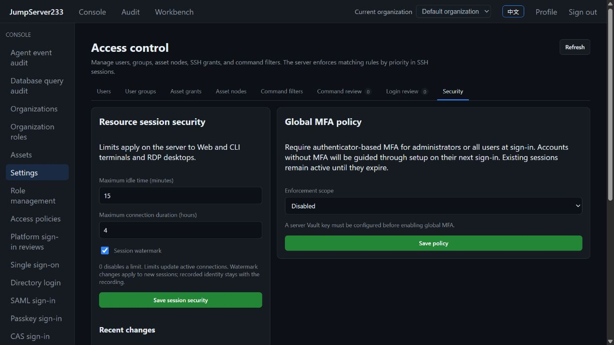

# Interactive session security

> [中文](./SESSION-SECURITY.md) | English

System settings → Security → Resource session security configures idle limits, maximum duration and watermarks for SSH, Telnet, Kubernetes terminals and RDP. Web and Agent CLI share server-side limits.

Actual interface from an isolated production Docker instance on 2026-10-17:

## Settings and permissions

- Defaults are 30 idle minutes, eight connection hours and enabled watermarks. Zero disables the corresponding time limit. Idle values range from 0–1440 minutes; maximum duration ranges from 0–168 hours.
- Activity means user input successfully accepted and forwarded by the server. Remote output, browser resizing and read-only viewers do not keep the primary session alive.
- Limit changes affect existing sessions: terminals check every second and RDP every 500 ms. These are check intervals, not disconnect latency guarantees. Input also checks deadlines before forwarding. Termination closes the remote transport before waiting for blocked input and audit cleanup.
- Watermarks are captured at session creation. Toggle changes affect new sessions; existing recordings retain their original identity.
- System security.manage or global administrator privileges are required to read/write settings and audit. Organization administrators cannot change this global policy. Revisions prevent concurrent edits from overwriting state in the active process.

## Watermarks and recordings

Markers contain platform user ID, session ID and UTC creation time, without target credentials.

Web terminals display the marker; asciinema v2 recordings preserve it in env.JMS_WATERMARK and the built-in replay renders that field. Terminal I/O stays unchanged, so Agent CLI receives no decoration characters. Other asciinema players may ignore the extension.

RDP burns an ASCII identity footer into server-side PNGs. Web, CLI captures and encrypted graphical recordings use the same image. Results are cached by source sequence, avoiding repeated decode/encode for unchanged frames. Rendering uses Go image/png and self-contained [golang.org/x/image/font/basicfont](https://pkg.go.dev/golang.org/x/image/font/basicfont), requiring no target fonts or external image program.

Watermarks support attribution. Cropping, covering or rerecording can remove them; they do not establish tamper resistance or data loss prevention.

## API and storage

- GET /api/v1/settings/security/sessions reads settings.
- PUT /api/v1/settings/security/sessions accepts idle_minutes, max_hours, watermark and the current revision. Success increments the revision; conflict returns 409.
- GET /api/v1/settings/security/sessions/audit returns the latest 200 changes, including actor, time and before/after values, saved atomically with settings.
- Standalone mode stores JMS_DATA_DIR/session-security.json with 0600 permissions and synced temporary-file replacement. Failed writes leave in-memory settings unchanged. Single-active HA uses the PostgreSQL session-security document, reloaded with audit at takeover.
- Time-based termination records idle_timeout or duration_limit in session audit. Read-only viewers disconnect with their primary session.

This scope covers interactive terminals and RDP. SFTP, database requests and jobs retain their separate session/execution lifetimes. Multi-active writes, production HA drills and complete Enterprise parity remain under [PLAN](./PLAN.en.md). Requirements follow [JumpServer session security settings](https://docs.jumpserver.org/zh/latest/guide/system/security/).
