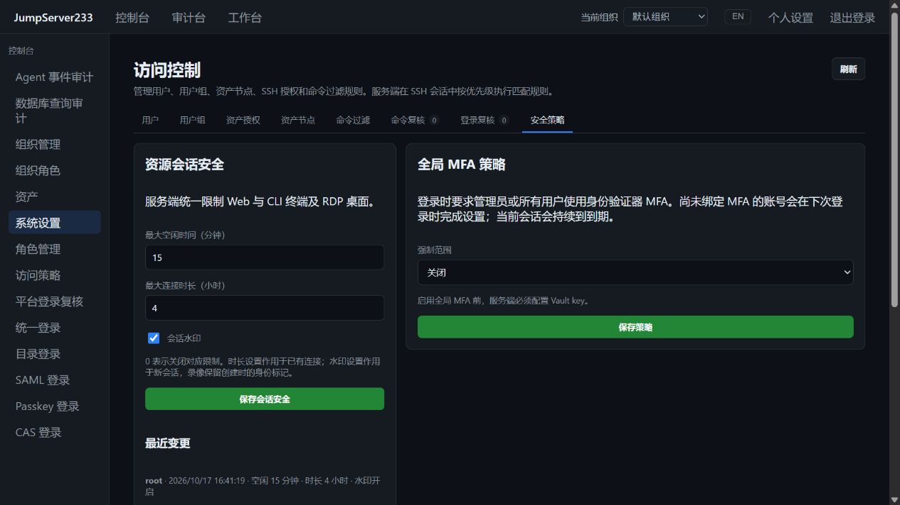

# 交互会话安全

> 中文 | [English](./SESSION-SECURITY.en.md)

系统设置 → 安全 → 资源会话安全，统一配置 SSH、Telnet、Kubernetes 终端和 RDP 的空闲时间、最大连接时长与水印。Web 与 Agent CLI 共用服务端限制。

2026-10-17 独立生产 Docker 实例中的实际界面：

## 设置与权限

- 默认最大空闲 30 分钟、最大连接 8 小时、开启水印；`0` 表示关闭对应时长限制。空闲范围 0–1440 分钟，最大时长范围 0–168 小时。
- 会话分享默认关闭，独立于水印和时长开关；启用后的指定用户分享、接管、撤权和资源限额见 [终端会话协作](./SESSION-SHARING.md)。
- 空闲以服务端成功接收并转发的用户输入计算。远端持续输出、浏览器调整窗口及只读监看不能延长主会话。
- 时长修改作用于已有连接：终端每秒检查，RDP 每 500 ms 检查；新输入也会先检查期限。这是检查间隔，不是断开延迟保证。输入阻塞时先关闭远端传输，再等待审计收尾。
- 水印在会话创建时确定。更改开关作用于后续新会话，已创建录像保留原始身份标记。
- 只有系统 `security.manage` 权限或全局管理员可读写设置和变更审计；组织管理员不能修改全局策略。版本号防止覆盖当前活动进程中的并发修改。

## 水印与录像

水印包含平台用户 ID、会话 ID 和 UTC 创建时间，不含目标凭据。

终端 Web 画面显示水印，asciinema v2 录像在 `env.JMS_WATERMARK` 保留身份，内置回放按该字段显示。终端 I/O 不插入水印字符，Agent CLI 不受装饰字符影响。其它 asciinema 播放器可能忽略该扩展字段。

RDP 在服务端把 ASCII 身份写入 PNG 底部，Web、CLI 截图及加密图形录像均使用同一画面。按源画面序号缓存，画面未变化时不重复解码/编码。渲染采用 Go `image/png` 与自包含的 [`golang.org/x/image/font/basicfont`](https://pkg.go.dev/golang.org/x/image/font/basicfont)，无需目标机器字体或外部图像程序。

水印用于溯源，裁剪、覆盖或重新录制仍可能去除它，不作为防篡改或数据防泄漏保证。

## API 与存储

- `GET /api/v1/settings/security/sessions`：读取设置。
- `PUT /api/v1/settings/security/sessions`：提交 `idle_minutes`、`max_hours`、`watermark`、`sharing` 和当前 `revision`；成功递增版本，冲突返回 409。旧配置缺少 `sharing` 时保持关闭。
- `GET /api/v1/settings/security/sessions/audit`：最近 200 次变更，包含操作者、时间及前后值，与设置原子保存。
- 单机写入 `JMS_DATA_DIR/session-security.json`，权限 0600、临时文件同步后替换；失败不修改内存设置。单活 HA 使用 PostgreSQL `session-security` 文档，接管时重新加载设置和审计。
- 时长结束原因分别为 `idle_timeout` 和 `duration_limit`，进入会话审计。只读监看随主会话结束而断开。

当前范围为交互终端和 RDP；SFTP、数据库请求和作业保持各自会话/执行期限。多活配置写入、生产 HA 演练和完整企业版仍按 [PLAN](./PLAN.md) 推进。需求对应 [JumpServer 会话安全设置](https://docs.jumpserver.org/zh/latest/guide/system/security/)。
