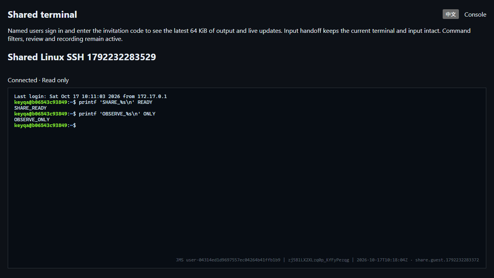

# Terminal session collaboration

> English | [中文](./SESSION-SHARING.md)

Active SSH, Telnet and Kubernetes terminals support named platform users watching or taking input control. Web and `jms share` use the same server authorization, command review and audit path. Participants receive no target password or private key.

English interface from an isolated Docker instance with real Linux OpenSSH, 2026-10-17. The invitation code has been cleared:



## Use

1. A system administrator enables session sharing under Settings → Security → Resource session security; it defaults off. Creators also need system or organization `sessions.share` permission and must own the active session. Existing operators and auditors receive no automatic new permission.
2. Open Session collaboration in the terminal. Choose platform usernames, read-only/read-write access and lifetime. Invitations require 1–20 active named users with current membership when an organization is selected.
3. Deliver the invitation link and code separately. The code is returned once, stays out of URLs and persistent browser storage, and cannot be retrieved after hiding. Revoke and recreate a forgotten invitation.
4. Invitees authenticate to the platform and enter the code. Delegation covers only this active terminal; it grants no independent connection, credential access, SFTP or job permission.
5. A read-write participant may take input control. Only one writer operates at a time; the owner may reclaim it. Explicit reclaim is still required after the writer leaves, is removed or expires, preventing unexpected typing. The existing terminal and partial input survive handoff. Command audit attributes the final submitter and control events record handoffs; it does not attribute every typed character.

Control changes pause during command review. A submission must satisfy both the original owner's and current writer's command policies. Either denial blocks it, and either review requirement waits for review. Both policies and participant authority are checked again during review; late approval cannot execute input from a departed writer.

## Resources and revocation

- Lifetime is 1–1440 minutes. Limits are 8 invitations and 8 pending/connected members per session, and 128 invitations and 64 members per organization Broker. Unconsumed tickets count toward member capacity.
- Codes contain 96 random bits. Only an invitation-bound SHA-256 digest is retained, using constant-time comparison. Five wrong attempts by named invitees pause the invitation for one minute; outsiders cannot consume its error budget.
- Separate random WebSocket tickets expire after 30 seconds, are single-use, and bind platform identity, source and organization. Subprotocol transport keeps tickets out of URLs.
- Checks run at attachment, before every input and every second: active identity, organization membership, platform access policies, original session authority/lifetime and the creator's sharing permission. Removal, revocation and global disable close affected participant connections. Revocation remains effective if its audit write fails.
- Closing a participant normally closes only that connection. If remote input is already blocked and remains blocked 100 ms after revocation, the primary transport closes to unblock it. Bytes already delivered cannot be recalled. Failure to cancel pending review promptly also closes the primary session.
- Join sends at most the latest 64 KiB of recorded output before live output. This is an output tail, not a complete VT screen snapshot, and may contain sensitive remote display content. Each participant queues at most 32 output chunks of up to 16 KiB; slow consumers disconnect. The browser limits pending rendering to 512 KiB. Participants cannot resize the primary terminal.

## Audit, API and CLI

Per-session `JMS_DATA_DIR/sessions/<id>.shares.jsonl` records invitation, join, actual connection/disconnection, control handoff/reclaim, removal and revocation with actor and time. Create, join and control require a synced audit write before taking effect. End events may be absent after storage failure. Logs contain no codes, tickets, terminal bytes or target credentials and use mode 0600. This metadata journal is not encrypted; terminal recordings and commands retain existing encryption. The owner or `audit.sessions.view_all` may page through it in Audit after the session ends.

| API | Purpose |
|---|---|
| `POST /api/v1/sessions/{id}/shares` | Create with `mode`, `minutes` and platform username array `users` |
| `GET /api/v1/sessions/{id}/shares` | Owner reads invitations, members and controller without codes |
| `POST /api/v1/session-shares/{id}/join` | Authenticated user submits `code` for a one-use WebSocket ticket |
| `DELETE /api/v1/session-shares/{id}` | Owner revokes invitation |
| `DELETE /api/v1/session-share-members/{id}` | Owner removes member |
| `POST /api/v1/sessions/{id}/share-control` | Member takes control with their `member_id`; owner reclaims with empty value |
| `GET /api/v1/sessions/{id}/share-events?offset=0&limit=20` | Newest first, 1–100 rows per page |

The separate sharing protocol is `jms233-share-v1`. Primary terminals still select the existing v1 protocol. Only clients advertising `jms233-share-control-v1` receive new control notices, preserving connection compatibility with older terminal clients.

```bash
jms share create SESSION_ID --users colleague --mode read_write --minutes 10
jms share state SESSION_ID
jms share join SHARE_ID --control
jms share reclaim SESSION_ID
jms share kick MEMBER_ID
jms share revoke SHARE_ID
jms share events SESSION_ID --offset 0 --limit 20
```

CLI uses existing platform authentication and `JMS_ORG_ID`. Supply codes through a non-echoing prompt or `JMS_SHARE_CODE`, never command arguments. Creation intentionally returns one-time code JSON; deliver it only to invitees. `Ctrl+]` leaves input mode. Without `--control`, the client watches only.

## Deployment and acceptance limits

Standalone comes first. PostgreSQL single-active HA shares roles, organization state and the global switch; journals require shared file storage. Live terminals, invitations, code digests, tickets and queues belong to the active process and must be recreated after restart/takeover. Session migration and multi-active routing are not implemented.

Testify covers limits, concurrent joins, code digests, revocation, input control, submitter attribution, changed review policies, stalled input and legacy v1 compatibility. Playwright uses real Linux OpenSSH for bilingual invitations/login, read-only viewing, control, removal, CLI, audit and 390px layouts. Final batch results appear in [Testing](./TESTING.en.md). RDP sharing, complete screen synchronization, anonymous participation and complete Enterprise parity remain open. Separate audit monitoring is documented in [Live sessions](./LIVE-SESSIONS.en.md).

Requirements follow [JumpServer terminal sharing](https://docs.jumpserver.org/zh/v2/user-guide/terminal/web-terminal-share/) and [read-write sharing/member removal](https://www.jumpserver.org/blog/release-20230424.html).
