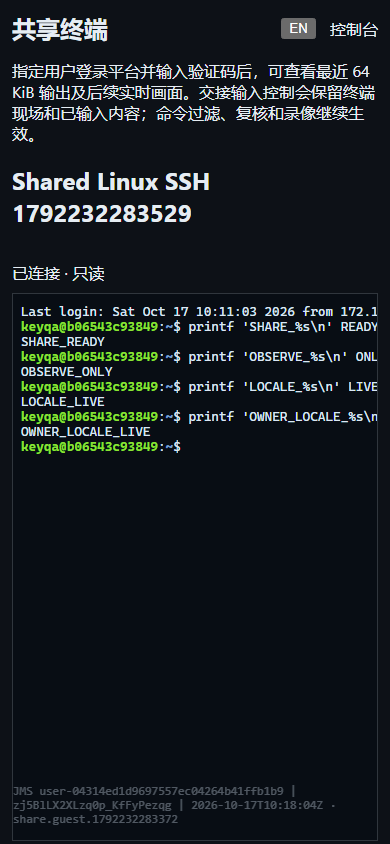

# 终端会话协作

> 中文 | [English](./SESSION-SHARING.en.md)

SSH、Telnet 和 Kubernetes 活动终端支持邀请指定平台用户只读观看或接管输入。Web 与 `jms share` 使用同一服务端授权、命令复核和审计链路；参与者不接触目标账号密码或私钥。

2026-10-17，独立 Docker 实例与真实 Linux OpenSSH 的中文手机界面，验证码已清除：



## 使用

1. 系统管理员在“系统设置 → 安全 → 资源会话安全”开启会话分享，默认关闭。创建者还需系统或组织角色的 `sessions.share` 权限，并拥有该活动会话；现有操作员和审计员不会自动得到新权限。
2. 打开终端的“会话协作”，填写平台用户名、只读或读写模式、有效分钟数。只允许指定的 1–20 个有效平台用户，同组织需具备当前组织资格。
3. 创建后分别传递邀请链接和验证码。验证码仅返回一次，不放入链接或浏览器持久存储；隐藏后无法从列表恢复。忘记时撤销并重新创建。
4. 受邀者登录平台后输入验证码。邀请只委托该活动终端，不授予独立连接、凭据读取、SFTP 或作业权限。
5. 读写参与者可接管输入；同一时刻只有一个写入者。所有者可随时收回，参与者离开、被踢出或邀请到期后仍需显式收回，防止不知情地继续输入。已有终端及未提交输入保留；命令审计记录最终提交者，接管事件记录控制权变化，不提供逐字符贡献者溯源。

主会话等待命令复核时暂停控制权切换。提交命令同时满足原所有者和当前写入者的命令策略；任一拒绝即拒绝，任一要求复核则等待复核。复核期间重新检查两方策略与参与者资格，离开的写入者不能通过迟到的批准继续执行。

## 资源和撤权

- 邀请有效期 1–1440 分钟；每会话最多 8 个邀请、8 个等待或在线成员，每组织 Broker 最多 128 个邀请、64 个成员。成员容量包括未消费的票据。
- 验证码为 96 位随机值，服务端只保留与邀请绑定的 SHA-256 摘要，恒定时间比较。指定用户连续输错 5 次暂停该邀请 1 分钟；非受邀用户不能消耗其错误预算。
- WebSocket 票据为 30 秒、单次使用的独立随机值，绑定当前平台身份、来源和组织，经子协议传输，不进入 URL。
- 连接时、每条输入和每秒检查当前身份、组织资格、平台访问策略、原会话授权与期限，以及创建者的分享权限。踢出、撤销和关闭开关会结束受影响的参与连接；撤销即使审计写入失败也生效。
- 通常关闭参与页面只结束该参与连接。如果远端写入已经阻塞，撤权后等待 100 ms 仍未结束则关闭主传输以解除阻塞，不能撤回已送达远端的字节。未能及时取消待复核输入也会关闭主会话。
- 加入时发送最近最多 64 KiB 的已记录输出，然后发送实时输出。这是输出尾部，不是完整 VT 屏幕快照；可能包含远端显示的敏感内容。每参与者队列最多 32 个 16 KiB 输出块，慢消费者断开；浏览器待渲染队列限制 512 KiB。参与者不能更改主终端尺寸。

## 审计、API 和 CLI

每会话 `JMS_DATA_DIR/sessions/<id>.shares.jsonl` 保存邀请、加入、实际连接/断开、接管、收回、踢出和撤销的身份与时间。创建、加入和接管必须先同步审计，失败即拒绝；结束事件遇到存储故障可能缺失。记录不包含验证码、票据、终端字节或目标凭据，文件权限 0600。该元数据日志未加密；终端录像和命令继续使用既有加密存储。会话所有者或 `audit.sessions.view_all` 可在审计台分页读取，会话结束后保留。

| API | 用途 |
|---|---|
| `POST /api/v1/sessions/{id}/shares` | 创建：`mode`、`minutes`、平台用户名数组 `users` |
| `GET /api/v1/sessions/{id}/shares` | 所有者读取邀请、成员和控制状态，无验证码 |
| `POST /api/v1/session-shares/{id}/join` | 已认证用户提交 `code`，换取一次性 WebSocket 票据 |
| `DELETE /api/v1/session-shares/{id}` | 所有者撤销邀请 |
| `DELETE /api/v1/session-share-members/{id}` | 所有者踢出成员 |
| `POST /api/v1/sessions/{id}/share-control` | 成员提交自己的 `member_id` 接管；所有者空值收回 |
| `GET /api/v1/sessions/{id}/share-events?offset=0&limit=20` | 最新在前，单页 1–100 条 |

独立共享协议为 `jms233-share-v1`。原终端继续选择原有 v1 协议；仅声明 `jms233-share-control-v1` 能力的客户端接收新增控制通知，旧版终端客户端仍可连接。

```bash
jms share create SESSION_ID --users colleague --mode read_write --minutes 10
jms share state SESSION_ID
jms share join SHARE_ID --control
jms share reclaim SESSION_ID
jms share kick MEMBER_ID
jms share revoke SHARE_ID
jms share events SESSION_ID --offset 0 --limit 20
```

CLI 使用既有平台身份和 `JMS_ORG_ID`。验证码通过无回显交互提示或 `JMS_SHARE_CODE` 提供，禁止放在命令参数中；创建命令有意输出一次性验证码 JSON，应只交付给受邀者。输入模式按 `Ctrl+]` 离开；不带 `--control` 时保持观看模式。

## 部署与验收边界

单机优先；PostgreSQL 单活 HA 沿用共享角色、组织和全局开关，审计日志需共享文件存储。在线终端、邀请、验证码摘要、票据和队列保留在活动进程，重启或接管后必须重建；未实现会话迁移或多活路由。

Testify 覆盖限额、并发加入、邀请码摘要、撤权、控制权、命令提交者、复核策略变化、阻塞输入与旧 v1 兼容；Playwright 使用真实 Linux OpenSSH，经过中英邀请/登录、只读观看、接管、踢出、CLI、审计和 390px 布局。最终批次结果见 [自动化验证](./TESTING.md)。RDP 分享、完整屏幕同步、非平台匿名参与和完整企业版仍待完成；独立审计监看见 [在线终端监看](./LIVE-SESSIONS.md)。

需求参考 [JumpServer 终端分享](https://docs.jumpserver.org/zh/v2/user-guide/terminal/web-terminal-share/) 和 [读写分享与成员移除](https://www.jumpserver.org/blog/release-20230424.html)。
