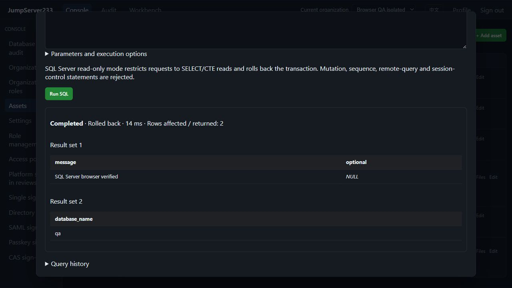

# Native SQL Server access

> English | [中文](./SQLSERVER.md)

Microsoft's official Go TDS driver connects SQL Server to unified inventory, browser SQL console, `jms db`, organization/node grants, login/SQL reviews and encrypted auditing. Single-node deployment is preferred; configuration and query indexes support the existing PostgreSQL active/standby store.

Real local TLS SQL Server acceptance capture from 2026-10-16, using an isolated QA account. The scrolled view shows two result sets and SQL NULL from one bound query:



## Configuration and parameters

Choose SQL Server, default port 1433, and supply a database name. The `sqlserver` object uses `database`, `tls_mode`, `server_name`, `root_ca_pem`, `read_only`. Defaults verify certificates/hostnames and require TLS 1.2 or later; disabling TLS is explicit. Passwords are write-only and stored in the encrypted server vault. Browser/CLI callers use platform identity.

Up to three pinned SSH gateways are supported. The driver uses explicit configuration, without ambient DSNs, integrated Windows/Azure identity, SQL Browser instance discovery or automatic database redirection. Execution is not automatically retried.

Use `@p1`, `@p2` placeholders with a JSON array. Exact numbers retain precision as text; explicitly `CAST` in SQL when required. Objects/arrays are JSON text. Binary values use hexadecimal and SQL NULL remains distinct from text.

```bash
printf 'SELECT @p1 AS message; SELECT DB_NAME() AS database_name' | jms db ASSET_ID --params '["hello"]'
jms db ASSET_ID --write < change.sql
```

## Read-only and writes

The SQL Server driver has no read-only transaction flag, and `ApplicationIntent=ReadOnly` does not prevent writes to ordinary databases. [Official driver](https://github.com/microsoft/go-mssqldb). This console restricts read-only requests to SELECT/CTE reads and rejects mutation, SELECT INTO, transaction/session control, sequence, EXEC and remote-query tokens across the entire batch. A separate transaction is rolled back after execution. Nested comments, Unicode strings, double quotes and bracketed identifiers follow T-SQL rules. Independently configure least-privilege database accounts; this mode does not replace database permission management.

Writes require both asset permission and an explicit per-request choice. Batches/procedures use server transaction semantics, reporting `server_managed` on success and `unknown` after execution errors, cancellation or limits. Earlier changes may remain committed; uncertain writes are never retried automatically. Transactions spanning requests, procedure output parameters and native TCP client proxying remain open.

## Results, authorization and audit

At most 16 result sets are returned. The first table preserves `columns` / `rows`; subsequent tables use `result_sets`, supported by both UI and CLI. Defaults are 500 rows/30 seconds; maxima are 10000 rows, 50000 cells and 1 MiB displayed text across all sets, with 8192 bytes per cell. Each physical connection also limits inbound traffic to 4 MiB, including TLS and truncated fields. The decoder separately caps declared values/accumulated chunks at 4 MiB before allocation; see the [driver patch](../server/third_party/go-mssqldb/UPSTREAM.en.md). Affected/returned counts come from TDS messages; unavailable counts are explicit.

Current access, organization, asset binding and command policies are checked before/during execution and before result delivery. Audit retains redacted SQL, protocol, operator, parameter count, review and transaction state, excluding parameter values, rows from every result set, column names/types and database error bodies. Deep-copied results live only in process memory for at most 15 minutes/16 queries. Restart/takeover does not migrate sessions/results or replay unfinished requests. See [verification](./TESTING.en.md), [PostgreSQL](./POSTGRESQL.en.md) and the [full plan](./PLAN.en.md).
