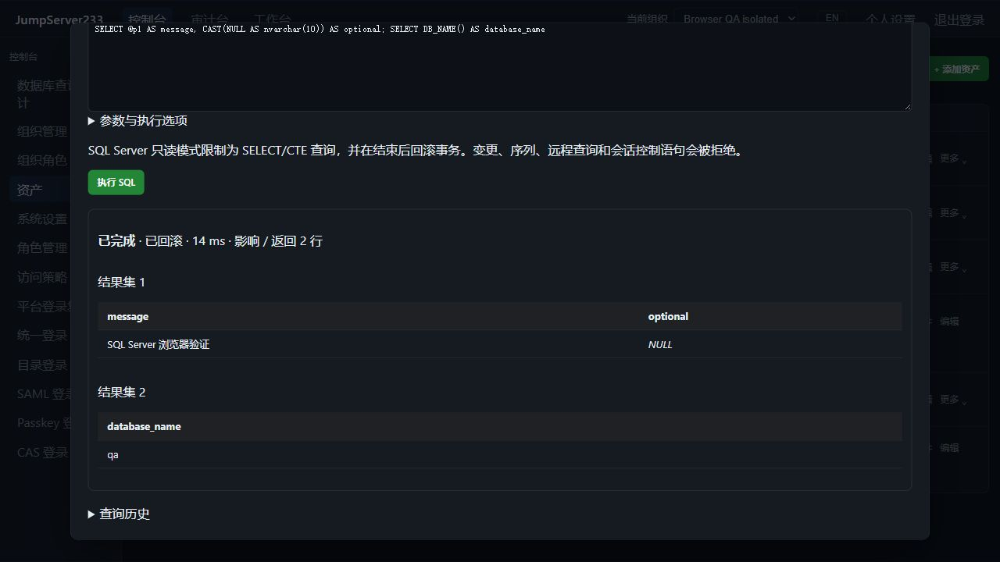

# SQL Server 原生访问

> 中文 | [English](./SQLSERVER.en.md)

SQL Server 使用 Microsoft 官方 Go TDS 驱动，接入统一资产、浏览器 SQL 控制台、`jms db`、组织/节点授权、登录与 SQL 复核和加密审计。默认单机，配置和查询索引支持现有 PostgreSQL 单活 HA。

2026-10-16 本机真实 TLS SQL Server 验收截图，使用隔离 QA 账号。下图向下滚动，展示同一次参数查询的两个结果集和 SQL NULL：



## 配置与参数

协议选择 SQL Server，默认端口 1433，数据库名必填。配置对象为 `sqlserver`，字段与其它 SQL 资产一致：`database`、`tls_mode`、`server_name`、`root_ca_pem`、`read_only`。默认校验证书和主机名、TLS 1.2 起步；禁用 TLS 必须显式配置。账号密码只写入服务端加密保管库，浏览器与 CLI 使用平台身份。

支持最多三跳的固定主机指纹 SSH 网关。驱动使用显式配置，不读取环境 DSN，不启用集成 Windows/Azure 身份、SQL Browser 实例发现或自动数据库跳转；不自动重试执行。

SQL Server 使用 `@p1`、`@p2` 等绑定参数，对应 JSON 数组。精确数值通过文本保留精度，必要时在 SQL 中显式 `CAST`；对象和数组作为 JSON 文本。二进制显示为十六进制，SQL NULL 与文本区分。

```bash
printf 'SELECT @p1 AS message; SELECT DB_NAME() AS database_name' | jms db ASSET_ID --params '["hello"]'
jms db ASSET_ID --write < change.sql
```

## 只读与写入

SQL Server 不支持驱动的只读事务，`ApplicationIntent=ReadOnly` 也不阻止普通数据库写入。[官方驱动说明](https://github.com/microsoft/go-mssqldb)。本项目只读模式限制为 SELECT/CTE 查询，并拒绝整个批次中的 DML/DDL、SELECT INTO、事务/会话控制、序列、EXEC 和远程查询入口；查询在独立事务内执行后回滚。嵌套注释、Unicode 字符串、双引号和方括号标识符按 T-SQL 规则处理。建议数据库账号本身另配置最小只读权限；本模式不替代数据库账号权限管理。

写入须资产允许写入，且本次明确关闭只读。SQL 批次和存储过程按服务端自身事务语义执行，成功状态为 `server_managed`；报错、取消或超限为 `unknown`，不能承诺已撤销之前完成的更改。应用不自动重试不确定写入。跨请求持久事务、存储过程输出参数和原生 TCP 客户端代理仍待完成。

## 结果、授权与审计

最多 16 个结果集，首表保留兼容的 `columns` / `rows`，后续表在 `result_sets` 中；UI 与 CLI 均显示/返回。默认 500 行、30 秒；最多 10000 行、50000 单元格、1 MiB 显示文本，限制对所有结果集合计，单字段 8192 字节；物理连接另有 4 MiB 接收上限，涵盖 TLS 和被截断字段。驱动解码器在内存分配前另限制声明字段和累计块为 4 MiB，维护说明见 [驱动补丁](../server/third_party/go-mssqldb/UPSTREAM.md)。影响/返回行数来自 TDS 消息，不可用时明确标记。

每个请求、执行过程中和返回结果前复查当前授权、组织、资产绑定和命令策略。审计保留脱敏语句、协议、操作人、参数个数、审批与事务状态，排除参数值、所有结果集的行、列名/类型及数据库错误正文。结果只存进程内存，最多 15 分钟、16 次查询，返回值深复制。重启/接管不迁移 SQL 会话或结果，不重放未结束查询。参见 [验证记录](./TESTING.md)、[PostgreSQL](./POSTGRESQL.md) 和 [完整规划](./PLAN.md)。
