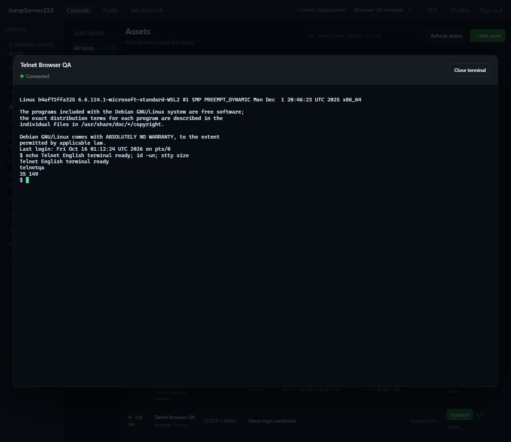

# Telnet terminals

> [中文](./TELNET.md) | English

Telnet assets use the same Web/Agent CLI bastion, organization/node grants, independent login review, command policies, encrypted audit and recordings. The competitor is [JumpServer Enterprise](https://www.jumpserver.org/enterprise.html). Standalone comes first; configuration and audit indexes use existing PostgreSQL single-active hot standby.

## Transport and login

Use protocol `telnet` with a write-only account password in the server vault. The `telnet` object contains `tls_mode`, `server_name`, `root_ca_pem`, `login_prompt`, `password_prompt` and `success_prompt`. Default `verify-full`, port 992, uses direct TLS, minimum TLS 1.2, with mandatory certificate/hostname verification using supplied CA or system trust. STARTTLS is not negotiated. Explicit `disable` defaults to port 23 and exposes credentials/terminal data on the target link. An SSH gateway encrypts its tunnel without guaranteeing confidentiality from the gateway to the target.

Each prompt is a Go/RE2 expression of at most 512 bytes that must not match an empty string. Defaults recognize login/username, password and shell prompts ending in `$`, `#` or `>`. Configure other device prompts explicitly. The success pattern confirms native login; overly broad patterns weaken that confirmation. Username/password and password-only prompts are supported, without additional device MFA, enable-mode switching or scripted login flows.

The server bounds login to 12 seconds and 64 KiB of data. Pre-login interaction stays off the browser/CLI; failures omit remote bodies. Full original-password echoes in subsequent output are redacted across chunk boundaries. This cannot identify arbitrary encoding, transformation or terminal escapes from a malicious server. Use trusted devices/networks and configure TLS/gateways correctly.

## Terminal and authority

```bash
jms telnet ASSET_ID
printf 'echo hello; exit\n' | jms telnet ASSET_ID
```

CLI uses platform `JMS_SERVER_URL`, `JMS_TOKEN` or AccessKey/Secret authentication, with `JMS_ORG_ID` for organization selection. It does not read the remote password. Piped input still enters an interactive terminal and should explicitly exit; structured job exit codes are unavailable. Inventory opens a terminal directly, without SFTP, CPU/memory collection or seven-day Telnet rotation. Probes report confirmed native login and latency. Existing SSH monitoring and seven-day rotation retain their behavior.

Native NVT supports IAC escaping, duplicate-negotiation suppression, binary mode, remote echo, Suppress Go Ahead, fixed xterm-256color and NAWS dimensions (2–500). Interactive Enter becomes an NVT newline; nonbinary output handles CR NUL. Input is capped at 64 KiB, subnegotiation at 1 KiB, with bounded consecutive control sequences without application data. Up to three SSH gateways pin every host fingerprint without local forwarding listeners.

The server checks current organization/identity, connect grants, source/time/method ACLs and every gateway. View alone cannot open a terminal. Telnet login permits are independent of SSH/SFTP/database/Kubernetes and bind operator, asset and account. Checks repeat before/after opening, at WebSocket attach, on input and periodically against current grants and asset/credential/gateway configuration. Revocation or changed bindings invalidate old terminals. Command recognition, filtering, review and redaction retain shared PTY limits and cannot fully interpret shell semantics.

Browser/CLI keeps `jms233-terminal-v1`; asciinema v2 gzip recordings remain compatible and encrypted at rest. Audit records protocol telnet and the server-authenticated operator. Single-active takeover retains configuration/audit but invalidates live connections and one-use tickets; reconnect without replaying commands. Closing a connection cannot undo completed operations or guarantee termination of every remote background process.

## Actual interface

In-app browser verification, 2026-10-16: isolated local Debian/BusyBox Telnet over certificate-verified direct TLS, running `id -un`, `uname -s` and `stty size` to verify account, Linux output and window dimensions. Command audit and complete recording playback were also checked. Chinese captures are in the [Chinese document](./TELNET.md).



## Automation and sources

`node server/testsupport/telnet/run.mjs` starts isolated Debian/BusyBox telnetd plus a socat TLS listener, default loopback plain 16523, TLS 16992, health 16524. Set `JMS_TEST_TELNET_FIXTURE_URL`; cross-container runs also set `JMS_TEST_TELNET_NETWORK_ADDR` and `JMS_TEST_TELNET_PLAINTEXT_NETWORK_ADDR`. E2E uses independent 16525 / 16994 / 16526. CI prepares/cleans owned fixtures automatically. Only synthetic accounts are used; actual acceptance is in [verification records](./TESTING.en.md).

Protocol sources: [RFC 854](https://www.rfc-editor.org/rfc/rfc854.html), [RFC 1073 NAWS](https://www.rfc-editor.org/rfc/rfc1073.html), [RFC 1091 terminal type](https://www.rfc-editor.org/rfc/rfc1091.html); prompt requirements follow [JumpServer Telnet asset requirements (v3)](https://docs.jumpserver.org/zh/v3/guide/asset_requirements/telnet/). See the [roadmap](./PLAN.en.md) for full Enterprise gaps.
