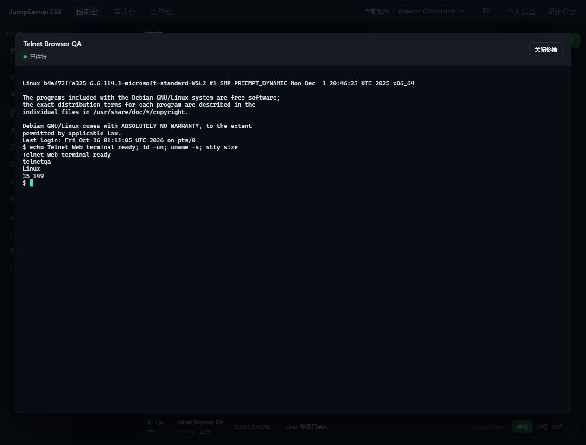

# Telnet 终端

> 中文 | [English](./TELNET.en.md)

Telnet 资产接入同一套 Web/Agent CLI 跳板、组织与节点授权、独立登录复核、命令策略、加密审计和录像。竞品为 [JumpServer 企业版](https://www.jumpserver.org/enterprise.html)，单机优先；配置和审计索引沿用 PostgreSQL 单活热备。

## 连接与登录

协议为 `telnet`，账号密码只写入服务端保管库。配置 `telnet` 对象包含 `tls_mode`、`server_name`、`root_ca_pem`、`login_prompt`、`password_prompt`、`success_prompt`。默认 `verify-full`、端口 992，使用直接 TLS，最低 TLS 1.2，必须校验证书和主机名；可提供 CA 或使用系统信任。它不协商 STARTTLS。显式选择 `disable` 时默认端口 23，凭据及终端数据在目标链路为明文。SSH 网关加密其隧道，不保证网关到目标一段的保密性。

三个提示规则为最多 512 字节的 Go/RE2 正则，不能匹配空串。默认识别 login/username、password 以及以 `$`、`#`、`>` 结束的 Shell 提示符；设备提示不同应明确配置。成功规则用于确认原生登录，配置过宽会削弱该确认。客户端支持账号/密码或仅密码提示，不包含额外设备 MFA、enable 模式切换和脚本登录流程。

服务端在最长 12 秒、64 KiB 登录数据范围内处理提示和凭据。登录前交互不交给浏览器或 CLI，错误不返回远端正文。登录后输出中的完整原密码跨数据块匹配并脱敏；这不保证识别恶意服务端对凭据的编码、变形或终端转义。仅在受信任的设备与网络上使用，并正确配置 TLS/网关。

## 终端与权限

```bash
jms telnet ASSET_ID
printf 'echo hello; exit\n' | jms telnet ASSET_ID
```

CLI 使用平台 `JMS_SERVER_URL`、`JMS_TOKEN` 或 AccessKey/Secret，`JMS_ORG_ID` 选择组织，不读取远端密码。管道仍进入交互终端，应显式退出；没有结构化作业退出码。Web 资产页连接后直接打开终端，不提供 SFTP、CPU/内存采集或七天 Telnet 改密；探测显示原生登录是否确认及延迟。SSH 主机监控与七天轮换保持原有能力。

原生 NVT 支持 IAC 转义、协商去重、二进制模式、远端回显、Suppress Go Ahead、固定 xterm-256color 终端类型和 NAWS 尺寸（2–500）。交互 Enter 转为 NVT 换行，非二进制输出处理 CR NUL；单次输入最多 64 KiB，子协商最多 1 KiB，连续无正文控制序列有界。连接支持最多三跳、逐跳固定 SSH 主机指纹的网关，不创建本地转发监听端口。

服务端检查当前组织、身份、connect 授权、来源/时段/连接方式 ACL 及每个网关。仅 view 不能开启终端。Telnet 登录复核独立于 SSH/SFTP/数据库/Kubernetes，许可绑定操作员、资产与账号。会话打开前后、WebSocket 连接、输入和周期检查会重新核对当前授权及资产/凭据/网关配置；撤销授权或修改绑定会使旧终端失效。命令识别、过滤、复核和脱敏沿用共享 PTY 边界，不能完整解释 Shell 语义。

浏览器与 CLI 仍用 `jms233-terminal-v1`，录像保持 asciinema v2 gzip 兼容格式并加密落盘，审计记录协议 telnet 和服务端操作员。单活接管保留配置与审计，旧连接和一次性票据失效，需重新连接，不重放命令；不保证撤销已完成操作或终止所有远端后台进程。

## 实际界面

2026-10-16 内置浏览器实测：隔离的本机 Debian/BusyBox Telnet 服务，经校验证书的直接 TLS 登录，实际运行 `id -un`、`uname -s`、`stty size`，确认账号、Linux 输出与窗口尺寸，并核对命令审计和完整录像播放。英文界面截图见本文 [English](./TELNET.en.md)。



## 自动化与来源

`node server/testsupport/telnet/run.mjs` 启动隔离的 Debian/BusyBox telnetd 和 socat TLS 入口，默认回环明文 16523、TLS 16992、health 16524。设置 `JMS_TEST_TELNET_FIXTURE_URL`；跨容器另设 `JMS_TEST_TELNET_NETWORK_ADDR`、`JMS_TEST_TELNET_PLAINTEXT_NETWORK_ADDR`。E2E 使用独立 16525 / 16994 / 16526，CI 自动准备并按归属清理。夹具只使用合成账号；真实验收结果见 [验证记录](./TESTING.md)。

协议依据：[RFC 854](https://www.rfc-editor.org/rfc/rfc854.html)、[RFC 1073 NAWS](https://www.rfc-editor.org/rfc/rfc1073.html)、[RFC 1091 终端类型](https://www.rfc-editor.org/rfc/rfc1091.html)；提示规则参考 [JumpServer Telnet 资产要求（v3）](https://docs.jumpserver.org/zh/v3/guide/asset_requirements/telnet/)。完整企业版缺口见 [规划](./PLAN.md)。
