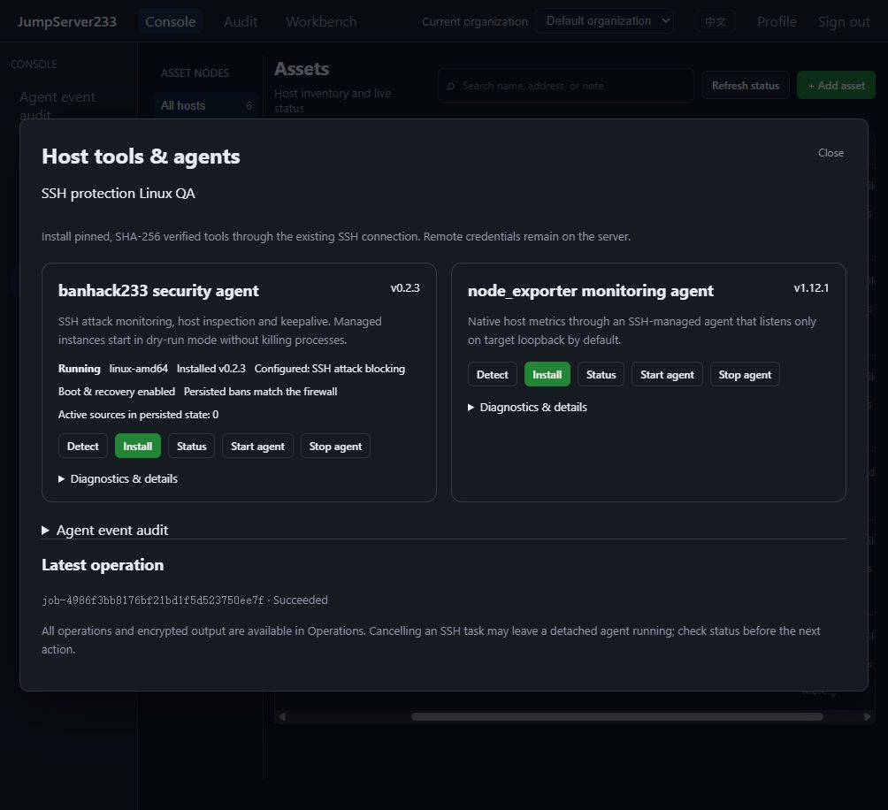

# Automated Verification

> [中文](./TESTING.md) | English

## SSH credential rotation plans (2026-10-18)

- Final full Playwright: 69/69 pass in 15.9 minutes, zero failures/skips, exit code 0, including existing protocols, real VM reboots and the new rotation case. The first full run's shared-root fixture conflict was replaced with a unique privileged account, then the complete suite passed from a clean environment.
- Final source, uncached serial Go/Testify: 59 packages, 929 passing tests and 35 skips for unavailable external fixtures. Real OpenSSH, PostgreSQL state and xrdp were supplied; absent fixtures are not counted as passes.
- Linux Docker race: nine related packages, 372 passing tests and eight external-fixture skips, covering plans, Vault coordination, API/SDK/CLI, jobs, files, sessions and node lifecycle.
- Plan core statement coverage: 75.4%. PostgreSQL organization isolation/takeover passed 50 repeats. Recovery/authority cases passed 20 repeats: denied recovery retains unresolved state; a 25 ms timeout exits a wait behind another host's credential mutation.
- Final production-image real SSH browser case: 12.9 seconds (13.5 including runner). It covers a no-sudo user reset through a unique passwordless `chpasswd` privileged account, existing key rotation, alias deduplication, partial failure, real CLI login and request retry, metadata CSV, weekly due checks, independent privileged authority, access policies, both languages and 390px, with zero pageerrors. The earlier real-root collector case also passed. Fixture automatic rotation and retained schedules are disabled.
- Final clean-volume Docker two-instance browser smoke: 18.77 seconds (cached build 3.78, startup 12.09, smoke 2.90), including bilingual rotation/risk pages. Disposable resources were cleaned by ownership. Retained project `jms233-rotation-plans-qa` exposes Web `http://127.0.0.23:15191` and API `http://127.0.0.23:18098` on loopback only.
- `go vet`, `go build ./...`, stripped server/CLI, frontend lint/types/production build, E2E types and content checks pass. New tests cover concurrent idempotency, per-account cancellation, binding, revocation, result failure without replaying remote changes, explicit password/key recovery and format 4/import compatibility.
- Ten Docker lifecycle Node tests and six frontend fixture/frame decoding Node tests pass. Content validation passes 1978 keys per locale, 108 bilingual documents and 948 relative links. The in-app browser reread actual run results and saved both languages with no console warnings/errors.
- Previous stable commit `1e1b80d` has confirmed successful `verify`, `frontend` and `docker-qa` jobs in [CI 39058754322](https://github.com/neko233-com/jumpserver233/actions/runs/39058754322).

Scope and remaining work: [Credential rotation plans](./ROTATION-PLANS.en.md). No CHANGELOG or release tag was created; full Enterprise and production HA acceptance remain in progress.

## SSH account risks (2026-10-18)

Final full Playwright passed 68/68 in 15.8 minutes, with no failures or skips and exit code 0. It includes every existing protocol, real VM recovery, bulk credential import and account risks with the complete mixed audit history. Go, race and production-image checks below also completed.

The first full browser run passed 67/68. Monitor and session events share an index, but valid monitor events omit `asset_id`. The new reader incorrectly treated them as corrupt and returned 503. Validation now requires an asset ID only for session start/end events, and monitoring does not count as account use. A mixed-journal unit case and actual monitor open/close before scanning cover this regression.

- Uncached serial Go/Testify with frozen final source passed 58 packages with tests and 901 tests, with 35 missing-fixture skips. Real OpenSSH, PostgreSQL state storage and xrdp were supplied; missing integrations are not counted as passes.
- Final Linux Docker race passed 9 packages and 355 tests, with 8 missing-fixture skips. The new risk core package has 78.0% statement coverage; encrypted PostgreSQL takeover passed 50 consecutive runs. An earlier three-character encryption-test marker coincidentally matched random ciphertext; a longer marker and the full rerun passed.
- The final production-image real SSH scenario passed 1/1 in 44.8 seconds (45.3 including runner overhead): weak/reused passwords across identities, confirm/ignore/reopen, stale source rejection, actual CLI/Web SSH and terminal monitoring, actual remote rotation clearing findings, SDK/CLI listing, scoped users unable to see other accounts/scan/export, credential-free CSV, an actual periodic run and bilingual 390px UI, with zero pageerrors. Scheduled-receipt assertions bind the current policy revision to avoid accepting an older run.
- Testify covers alias exclusion, SSH key reuse, visible peer filtering and constructed-ID probing rejection, credential changes reopening findings, optimistic review versions, source locks, corrupt/incomplete audit rejection, actually executed jobs, atomic failure, cancellation/deadline, owner revocation pausing schedules, retention, encrypted reload, interrupted PostgreSQL takeover, signed/organization SDK requests and exclusive CLI export files.
- The in-app browser separately scanned under the current policy: two active accounts, one remaining weak-password finding. Both language policies, seven checks, disabled periodic scheduling and the result after actual rotation were inspected. Real screenshots: [Account risks](./ACCOUNT-RISKS.en.md).
- Frontend lint/types/production build, E2E types, backend vet/build and stripped server/CLI builds passed. Clean-volume dual-instance Docker browser checks took 17.68 seconds, including bilingual risk pages and a successful empty-account scan, then disposed the temporary project. Retained debugging uses independent Web/API ports. Six Docker lifecycle and six frontend-tool Node tests passed. Existing main/initial JS budgets remain enforced.

This slice checks managed SSH identities within an organization. Remote OS password expiry/login history, automatic bulk remediation and full Enterprise acceptance remain open. See [Account risks](./ACCOUNT-RISKS.en.md) and [Performance](./PERFORMANCE.en.md) for commands and definitions.

## CSV/XLSX account credential import (2026-10-18)

Final full Playwright passed 67/67 in 15.1 minutes, with no failures or skips and exit code 0, covering native protection, a real VM reboot, every existing protocol and the new import scenario. The first run exposed incorrect test cleanup ordering: deleting a parent with managed accounts correctly failed. Account-first cleanup passed against the production image without retention in 11.0 seconds. A scheduled-job assertion was separately interrupted by a language-resource hot update; its trace showed Vite reconnecting and the panel resetting. The full run with frozen source passed every case.

- Final uncached serial Go/Testify passed 57 packages with tests and 881 tests, with 35 missing-fixture skips. Real OpenSSH, PostgreSQL state storage and xrdp were provided. Missing integrations are not counted as passes.
- Linux Docker race passed 365 tests across 8 related packages, with 7 skips. Final BOM compatibility, 500-row batches and SDK activity changes passed a further race run of 27 tests across 4 packages, without skips.
- The final production image passed its real OpenSSH scenario 1/1 in 10.3 seconds (10.9 including runner overhead): Web CSV/XLSX templates, two-host password/key import, actual CLI/Web SSH, XLSX updates, retained credentials, disable/enable, idempotent retries, atomic version conflicts, CLI/Web batch activity, both languages, Escape/focus and a 390px viewport, with zero pageerrors. Private-key upload request traces are disabled; temporary source files are deleted on exit.
- Testify covers signed preview binding, expiry and committed acknowledgement, altered/cross-user/cross-organization proofs, permission/target revocation, independent rotation authority, persistence rollback, concurrent retries, encrypted history, shared aliases and cross-organization references, receipt capacity/pruning, CSV BOM/multiline keys, rejected XLSX formulas/macros/external relationships/paths/XML, and the same receipt after PostgreSQL takeover. Review fixed the PostgreSQL encoder's omission of receipts.
- All 500-row creations and updates pass. Three local 500-password preview samples measured 3.14–3.73 ms/op, excluding network, disk and parsing. No dependencies were added; the dialog loads lazily and bundle budgets pass. See [Performance](./PERFORMANCE.en.md).
- `go vet`, `go build ./...`, stripped server/CLI builds, frontend lint/types/production build, E2E types and 10 Docker lifecycle Node tests pass. Content checks cover 1726 keys per locale, 104 bilingual documents and 897 relative links.
- Final fresh-volume Docker browser checks with a second instance took 17.37 seconds (warm build 2.95, startup 12.14, checks 2.28); ownership-checked disposal completed. Retained debug project `jms233-account-import-qa` exposes Web `http://127.0.0.19:15189` and API `http://127.0.0.19:18096` on loopback only. After restart, the in-app browser reread receipts, checked per-account import activity and saved Chinese/English captures with no console warnings or errors.
- The preceding stable commit `dbe91ba` has confirmed green `verify`, `frontend` and `docker-qa` jobs in [CI 39047933815](https://github.com/neko233-com/jumpserver233/actions/runs/39047933815).

See [Account import](./ACCOUNT-IMPORT.en.md) for behavior, format 3 upgrades and remaining scope. CHANGELOG and release tags were unchanged. Full Enterprise parity and production HA acceptance remain open.

## Remote Linux account lifecycle (2026-10-18)

The full Playwright suite passed 66/66 in 15.0 minutes, with no failures or skips and exit code 0. It includes remote provisioning, all existing protocols, native protection/recovery, ordinary/root systemd services and a real VM reboot. Final task-state display and terminal resize coalescing changes were separately rechecked against production images: 2/2 in 21.6 seconds.

- Final uncached serial Go/Testify run passed 57 packages and 854 tests; 35 tests skipped because their external fixtures were unavailable. Real OpenSSH, PostgreSQL state storage and xrdp were supplied. Missing integrations are not counted as passes.
- Final Linux Docker race run passed 8 related packages and 340 tests, with 7 fixture skips. This includes root directory inode/symlink proofs, cancellation fences and PostgreSQL takeover.
- Production images and actual OpenSSH verified Web provisioning, generated-key CLI and Web SSH login, default seven-day key rotation state, disabling, restoring and deleting with homes retained as root:0700. Deliberately denied SSH access left the staged credential unavailable; after allowing the fixture user, a second inspect attempt recovered with the original key.
- All six successful task receipts and attempt numbers remained readable after restarting the API. The in-app browser checked both languages and saved actual screenshots. PostgreSQL tests retain staged keys, tasks and unavailable credentials across takeover without automatically replaying writes; explicit inspection precedes credential activation.
- Testify covers independent action permissions, ongoing revocation, original-source checks at command approval, per-attempt login approval and old-permit expiration, idempotency, encrypted reservation, persistence rollback, cross-organization credential references, old-program rejection and authenticated format downgrade rejection. Actual OpenSSH separately verifies root bootstrap and delegation through an existing exact sudo rule.
- Full regression exposed an existing synchronous terminal ResizeObserver feedback warning. Resize updates now coalesce per frame and are cancelled on close. Production collaboration tests additionally observe window errors in both browsers and pass mobile/bilingual interactions without suppressing the error.
- vet, production/stripped Go builds, frontend lint/types/build, E2E types, 10 Docker lifecycle Node tests and bilingual content checks passed. Final fresh Docker dual-instance browser verification took 18.01 seconds (build 3.01, startup 12.04, smoke 2.96), followed by automatic disposal. Debug environments are retained separately.

See [Remote account lifecycle](./REMOTE-ACCOUNTS.en.md) for scope and format upgrade boundaries. Coverage is local regular Linux accounts; Windows/directory users, bulk governance, active/active and complete Enterprise parity remain open. Screenshots were captured on 2026-10-17; verification finished on 2026-10-18.

## Scheduled account discovery (2026-10-17)

Complete Playwright suite passed 65/65 in 14.6 minutes, with zero failures/skips and exit code 0. It covers scheduled discovery and all existing protocols, native protection/recovery, ordinary/root systemd services and real VM reboot. Disposable fixtures exited through the ownership-checked lifecycle. Final authority/pause boundary changes were separately rechecked with Go/Testify, Linux race and the focused production-image case.

- Final-source uncached serial Go/Testify suite passed: 57 packages and 838 tests, with 35 skips for unavailable external fixtures. Real OpenSSH, PostgreSQL state storage and xrdp were provided. Missing integrations are not counted as successes.
- Linux Docker race passed across 8 related packages and 242 tests, with 11 unavailable-fixture skips, including PostgreSQL takeover. Complete protocol execution is separately exercised by the browser suite.
- The final production Docker case using real OpenSSH passed 1/1 in 20.9 seconds: Web interval creation, independent authority, login/command approvals, pause invalidation, fresh run approvals on resume, native collection, CLI, credential revisions, archives, refused resumption after revocation, both languages and 390px layout, with zero pageerrors. The in-app browser separately inspected three real receipts and saved bilingual screenshots.
- Testify covers pinned physical targets/identities, refreshed credential bindings, cross-credential host exclusion, idempotency/stale revisions, cancellation during execution/dispatch, late-review cancellation outbox, per-run permit isolation, live-revocation auto-pause, command-review denial, recovery from a full 1000-run hot window and archive failures, independent archive namespaces, PostgreSQL takeover/organization isolation and format-2 downgrade refusal. SDK/CLI checks preserve organization/signatures, safe DTOs and explicit revisions, while disabled credentials permit plan management only.
- `go vet`, `go build ./...`, stripped server/CLI builds, frontend lint/types/production build, E2E types and 10 Docker lifecycle Node tests passed. Content checks passed for 1610 keys per language, 100 bilingual documents and 849 relative links.
- Fresh-volume Docker browser checks with a second instance passed in 17.28 seconds (build 2.71, startup 12.01, smoke 2.56). The disposable instance exited through its ownership-checked lifecycle. Retained debug stack `jms233-discovery-schedule-qa` exposes Web `http://127.0.0.16:15186` and API `http://127.0.0.16:18093`, on loopback only.
- Previous `198cd35` [CI 39038326332](https://github.com/neko233-com/jumpserver233/actions/runs/39038326332) is confirmed successful for `verify`, `frontend` and `docker-qa`.

See [Scheduled account discovery](./SCHEDULED-ACCOUNT-DISCOVERY.en.md) for scope and upgrade boundaries. No release changelog or version tag was created.

## Managed SSH accounts (2026-10-17)

Complete Playwright passed 64/64 in 14.5 minutes, with zero failures/skips and exit code 0. It includes managed accounts, all existing protocols, native protection/recovery, ordinary/root systemd services and a real VM reboot. Owned disposable resources were removed by the exit workflow. The final grant-account fallback was also checked separately against production Docker.

- Final uncached, serial Go/Testify passed: 57 packages, 814 tests; 35 skipped for missing external fixtures. Real OpenSSH, PostgreSQL state storage and xrdp were provided. Missing integrations are not counted as success.
- Linux Docker race passed 223 tests across five related packages, with seven missing-fixture skips. Final discovery association, node visibility, CLI metadata/activity and account selection checks passed 30 tests across five packages without skips.
- The production Docker end-to-end case passed 1/1 in 34.6 seconds: browser account creation and username grants, no primary-account connect access, independent CLI identity and SFTP files, password/key rotation, seven-day policy, named gateway, workbench execution, native discovery/association, disabled gateway primary account, real Web SSH output and idle live revocation within the approximately ten-second check period. Both languages, 390px layout, write-only key fields and zero pageerrors were checked.
- Testify additionally covers inherited parent settings without duplicated persisted host fields, independent ciphertext/history, parent ownership rebinding rejection, duplicate identities, stale versions, failed-write rollback, pending-rotation target guards, deletion activity archive, separate management/rotation authority, changed discovery UID, organization isolation, PostgreSQL takeover, disabled shared-copy synchronization without connection, preserved signatures/organization, redirect credential protection and unknown response-field removal.
- Vet, stripped server/CLI, frontend lint/build, E2E types, 1,590 bilingual keys and 98 bilingual documents passed. The new dialog is lazy, adds no dependencies and passes existing size budgets. Ignore rules cover generated helpers, caches, runtime data and test reports.
- Fresh Docker volumes passed authentication, static gzip, dedicated loopback exposure and browser checks with a second instance: build 3.01 seconds, startup 12.00, smoke 2.47; total 17.48. Disposable resources were removed. Retained debug ports are `127.0.0.13:15185` / API `127.0.0.13:18092`, separate from the original development instance. Retained-volume timings are not presented as fresh-volume results.
- The in-app browser also checked the final image's account list, provenance, rotation state and language switching. Actual screenshots and limits: [Managed SSH accounts](./MANAGED-ACCOUNTS.en.md). Named credentials currently apply to SSH; remote OS account creation/deletion, other protocol account models, active/active and full Enterprise parity remain open.

Logs are in the system temporary directory: `jms233-managed-accounts-go-delivery.jsonl`, `jms233-managed-accounts-race.jsonl`, `jms233-managed-accounts-race-complete.jsonl`, `jms233-managed-accounts-browser-reviewed-final.log`, `jms233-managed-accounts-e2e-full.log` and `jms233-managed-accounts-docker-final.log`. Initial focused failures were preserved while fixing the dynamic QA account SSH allowlist, relative SFTP listing assertion, selectors and wait for the ten-second live authorization interval. Management write responses were also completed with rotation status; business assertions were retained.

Previous account-discovery commit `108141e` has a fully successful [remote CI run](https://github.com/neko233-com/jumpserver233/actions/runs/39032638755): complete Linux backend race/vet/build, frontend and Docker. That result covers the previous commit only.

## Linux local account collection (2026-10-17)

Final complete Playwright passed 63/63 in 13.1 minutes, with no failures or skips and exit code 0. This includes account collection, all existing protocols, native protection/recovery, ordinary/root systemd services and a real VM reboot. The ownership-checked exit workflow cleaned this batch's disposable fixtures.

- Final uncached serial Go/Testify passed 57 packages and 784 cases, with 35 missing-fixture skips and no failures. PostgreSQL, real xrdp and ordinary-account OpenSSH were supplied. Root firewall, systemd and remaining native protocol integration are covered by complete browser fixtures and CI. Final vet, stripped server/CLI, warning-free frontend lint/build, E2E types and 16/16 Node helper checks passed.
- Linux Docker race covered nine related packages: 234 passed and 11 missing-fixture skips. The final native HostPlugins package separately passed 41 cases against a new ordinary-account OpenSSH target in 93.0 seconds, with four cases requiring firewall capability skipped. That target was cleaned after checking ownership labels. Final additional typed-job race passed 14 cases and skipped one missing-PostgreSQL case; real PostgreSQL was configured for the related-package batch and complete local run above.
- Testify covers discarding password/GECOS on the target, independent digests, strict JSON/pages/capacity, no partial inventory after a changing page, asset/organization concurrency limits, failed writes, encrypted reopen, UID reuse, retained missing/review state, revision conflicts, organization isolation and PostgreSQL takeover. API/jobs cover independent authority, login/command approval, live revocation, gateway policies, raw-job metadata injection refusal, idempotence and pointer isolation, restored pending review and interruption without replay after leadership loss.
- Final focused production Docker browser passed 1/1: 10.7 seconds for the case, 11.1 seconds total. Real pinned SSH gateways, 40 temporary Linux accounts, multiple pages, both approval types, revocation during approval, notes, missing-account detection after deletion, retained review across credential revisions and CLI all passed. After one simulated 503, the UI automatically recovered to the real completed result. Both languages and 390×844 had no page overflow; temporary accounts were cleaned by ownership.
- After the final image restart, the in-app browser confirmed encrypted records remained readable, retaining the summary of 26 current accounts and 39 newly missing QA accounts, both languages and no console warnings/errors. This summary reflects temporary-account cleanup, not production risk statistics. See [account collection](./ACCOUNT-DISCOVERY.en.md) for real screenshots.
- Final fresh-volume Docker passed authentication, compressed assets and parallel browser sessions: warm-cache build 2.61 seconds, startup 11.99 seconds and checks 2.15 seconds, approximately 16.8 seconds total. The disposable environment was removed. Retained `127.0.0.11:15184` / API `127.0.0.11:18091` are available for debugging and were confirmed to bind only loopback. Checks passed 1539 bilingual keys, 96 documents and relative links; see [performance](./PERFORMANCE.en.md) for JavaScript/binary sizes. Existing ignore rules cover generated programs, runtime data, reports and caches.
- The initial full browser run had 42 passed, one failed and 20 unrun cases: the new file initialized the same synthetic administrator before the old setup, which still demanded first-time HTTP 201 and received 409. Setup now permits normal authentication by that same known synthetic administrator before continuing; an unknown identity cannot resume setup. Failed `jms233-accounts-e2e-final.log` and its original trace remain. Earlier focused runs corrected an unsupported test field, label association and a pagination assumption affected by older temporary accounts. Real collection, permission and approval assertions were retained.

Batch temporary logs are `jms233-accounts-go-delivery.jsonl`, `jms233-accounts-e2e-complete.log`, `jms233-accounts-race-final.jsonl`, `jms233-accounts-native-race-final.jsonl` and `jms233-accounts-jobs-race-delivery.jsonl`. This delivers Linux local metadata collection and human review. Independent multi-account credentials, synchronization/binding, remote account lifecycle, scheduling, other platforms, archival policy, active/active operation and production failure exercises remain in [PLAN](./PLAN.en.md). ARM64 was compiled only; native execution was Linux amd64.

## Read-only live RDP monitoring (2026-10-17)

- Uncached serial Go/Testify passed 56 packages and 755 cases; 41 cases skipped missing external fixtures. Real PostgreSQL state storage and xrdp were supplied; missing integrations do not count as success. During the initial default package concurrency, native RDP and server HA checks connected to the same target and native input failed. Evidence remains in `jms233-desktop-monitor-go-parallel-failed.jsonl`. The full run then passed with CI's `-p 1`, without relaxing assertions.
- Final complete Playwright passed 62/62 in 13.4 minutes, with no failures or skips. This includes the new 9.4-second RDP monitoring case, all existing protocols, terminal collaboration, real Agent installation/recovery, ordinary/root systemd services and VM reboot. E2E exited with code 0 and its ownership-checked exit workflow removed this batch's disposable fixtures.
- Linux Docker race passed six related packages and 166 cases, with three missing-fixture skips, covering API, Desktop, RBAC, SessionClient, CLI and real native RDP. Vet, stripped server/CLI, frontend lint/build, E2E types, 1504 bilingual keys, 94 documents and 775 relative links passed.
- Testify/browser checks cover independent graphical authority, no independent asset connection grants, active foreign frames denied to historical replay roles, one-use tickets and protocol separation, source/membership/role revocation, no viewer input/clipboard channel, source continuity, unchanged idle time, limits, incomplete/failed/full audit, durable pagination and real CLI PNG. Node renderer and existing fixture/artifact helpers passed 16/16: single decode/latest-frame replacement, disposal and oversized/invalid PNG header rejection before decoding.
- The in-app browser verified real xrdp click updates, uninterrupted language switches, source continuity after viewer close, viewing activity after source termination and no console warnings/errors in production Docker. See [Live RDP monitoring](./RDP-LIVE-MONITOR.en.md) for real screenshots.
- A fresh Docker volume passed authentication, compressed static assets and parallel browser sessions: warm-cache build 5.03 seconds, startup 12.03 seconds and checks 2.48 seconds, approximately 19.5 seconds total. The disposable stack was removed. Retained `127.0.0.9:15183` / API `127.0.0.9:18090` remain separate from existing previews and bind only loopback. That retained-volume build took 7.09 seconds, startup 12.84 seconds and smoke 1.21 seconds; its timings are separate from fresh-volume evidence.

Commit `97231eb` [remote CI](https://github.com/neko233-com/jumpserver233/actions/runs/39028849375) passed every job: complete Linux backend race, vet/build, browser 62/62 (19.6 minutes) and Docker. Remote Docker performed HTTP checks with `browser:false`: build 80.52 seconds, startup 11.44 seconds and smoke 0.15 seconds. This is not remote browser verification evidence.

Batch logs are temporary `jms233-desktop-monitor-go-final.jsonl`, `jms233-desktop-monitor-race-final.jsonl` and `jms233-desktop-monitor-e2e-final.log`; production Docker logs remain under ignored `.cache/docker-qa/`. Existing ignore rules cover generated assets, screenshot reports, caches and runtime data, so these do not enter Git. Real Windows NLA, RDP sharing/control, active/active routing, production failure exercises and full Enterprise parity remain open.

## Terminal collaboration and clipboard ordering (2026-10-17)

- Full local Playwright passed 61/61 in 12.9 minutes, with no failures or skips, including real protocols, systemd VM reboot, existing security flows and collaboration. Final invitation usernames, mobile button bounds and formatting were checked separately against the production Docker image: the complete collaboration flow passed 1/1 in 11.0 seconds.
- Uncached repository Go/Testify passed 56 packages and 748 cases; 67 cases skipped because their external fixtures were not configured. Real PostgreSQL state storage and xrdp were provided, including durable policy/takeover checks. Vet, stripped server/CLI builds, frontend lint/build, E2E types and bilingual content checks passed. Skipped Go integrations do not prove complete native protocol acceptance.
- Linux Docker race covered API, SessionPolicy, SessionShares, Gateway, SessionClient and CLI, with targeted follow-up race for the final display field and collaboration authorization paths. Native RDP passed five consecutive race rounds against a newly created desktop; Windows also passed five consecutive rounds of the native package. Testify covers matching clipboard acknowledgement, initially empty format lists, rejection, revocation, timeout and late responses.
- Collaboration tests cover named identities without independent asset access, one-use tickets/source binding, read-only injection rejection, single-writer control, explicit reclaim, submitter audit, dual-identity command rules/review changes, removal, global disable, limits/concurrency, slow consumers, the 64 KiB output tail and legacy v1 compatibility. Revoking stalled remote input unblocks the write.
- A separate production Docker check verified final RDP clipboard transfer in both directions: actual target Paste/Copy counters, exact Chinese text, ended recording and zero page errors. The fixture now republishes X11 selection ownership on repeated Tk copies; a second copy after changing remote text returned the new value in the browser. The in-app browser confirmed real SSH output, a stable session ID across in-terminal language changes, and the default-disabled collaboration entry. See [Session collaboration](./SESSION-SHARING.en.md) for screenshots.
- A fresh Docker data volume passed authentication, compressed resources and parallel browser login: warm-cache build 2.89 seconds, startup 11.92 seconds and checks 3.17 seconds, approximately 18.0 seconds total. The disposable stack was removed; `127.0.0.8:15179/18086` remains for isolated debugging. Public artifact cache and Docker argument helper checks passed 12/12. Automatic approval rejected cleanup of four separately created RDP targets, one PostgreSQL state fixture and their certificates/helpers. That command did not run; these resources remain.
- Commit `b887503` [remote CI](https://github.com/neko233-com/jumpserver233/actions/runs/39024887191) passed every job: complete Linux backend race, vet/build, browser 61/61 (19.1 minutes, no retry markers) and Docker. Remote Docker performed HTTP checks with `browser:false`: build 60.06 seconds, startup 11.32 seconds and smoke 0.10 seconds. Native RDP paste failures from earlier `4bc1a65` and `5619586` remain in their historical runs; subsequent success did not relax remote text or button-count checks. This CI covers the terminal-collaboration commit, excluding later RDP monitoring changes.

Local Go output is in temporary `jms233-sharing-go-final.jsonl`; production Docker logs remain under ignored `.cache/docker-qa/`. RDP sharing, complete screen snapshots, real Windows NLA, production HA and full Enterprise parity remain open; see [Session collaboration](./SESSION-SHARING.en.md) and [PLAN](./PLAN.en.md).

## Interactive session security (2026-10-17)

- The final uncached local Go/Testify run passed 55 packages / 694 cases, skipped 72 cases without external fixtures and had no failures. Vet, build, warning-free frontend lint/build, E2E types and bilingual content checks passed.
- Final complete Playwright passed 60/60 in 13.4 minutes, with no failures or skips. Ordinary/root systemd accounts, a real guest reboot, native protection, all existing protocol UI/CLI flows and new session security ran in the same regression. Fixture lifecycle, public artifact cache and Docker argument checks passed 12/12.
- Linux Docker race covers SessionPolicy, Gateway, Desktop, Recorder and API. The additional active-terminal policy update / viewer closure case passed normal and Linux race checks separately. A real PostgreSQL case separately verifies that takeover reloads both policy and audit.
- New checks cover revision conflicts, concurrent writes, unchanged memory after failed writes, the 200-entry audit bound, time boundaries, permission denial, delegated access, compatible terminal I/O, retained recording identity, RDP sequence caching and the same burned frame in encrypted recordings. Termination cannot wait behind a blocked remote-input lock.
- Focused Playwright passed 2/2 against isolated production images in approximately 10.1 seconds: real SSH output, read-only monitoring, recording playback, identity retained after disabling watermarks for future sessions and a real xrdp frame watermark. Both languages and 390×844 have no horizontal overflow; settings tabs and checkbox sizing were repaired. The in-app browser separately confirmed both languages and no console warnings/errors. See [session security](./SESSION-SECURITY.en.md) for screenshots.
- Final fresh-volume Docker verification passed authentication, compressed static assets and browser logins to two isolated instances: build 3.11 seconds, startup 12.02 seconds and checks 2.74 seconds, approximately 17.9 seconds total. Only that disposable environment was removed. The retained debug instance uses `127.0.0.6:15176/18083`, isolated from existing previews.
- The older remote frontend CI had 57 passed, one failed and one unrun case: the Chinese systemd status assertion did not wait for its asynchronous job, and fixed asset names caused duplicate matches on retry. Tests now await the submitted job ID and generate unique asset names per fixture, preserving the business assertions. Failed CI runs also retain browser screenshots and traces for three days so synthetic-fixture failures can be inspected.
- The [remote CI](https://github.com/neko233-com/jumpserver233/actions/runs/39016555668) for previous commit b676efd has finished: complete Linux race passed 54 packages, vet/build and Docker succeeded, and the native RDP package passed this run. Frontend ended with the systemd failure above. This run excludes the new policy and does not print per-case skip counts; it is not complete CI evidence for the present changes.

Full Enterprise parity, real Windows NLA and production HA drills remain in [PLAN](./PLAN.en.md). These results do not replace that acceptance.

Local logs remain in the temporary directory: jms233-session-security-go-final.jsonl and jms233-session-security-e2e-full.log. Downloaded older CI output is jms233-backend-ci-final.log. Production Docker records remain under ignored .cache/docker-qa/.

## Live monitoring and continuous authorization (2026-10-17)

- An uncached local Go run passed 54 packages / 681 cases and skipped 71 cases without external integration fixtures. This does not establish complete protocol integration. Vet, build, frontend lint/build and E2E type checks passed.
- New Testify coverage includes separate monitoring permission, single-use/expired tickets, input isolation, capacity/slow viewers, viewer revocation, primary termination, failed audit writes, SSH grant/group/role/credential/organization changes, and access/rule changes during pending command approval.
- Linux Docker race checks cover API, Gateway, Auth and RBAC; gateway monitoring also repeats five times. Complete CI fixtures remain responsible for external protocol integrations.
- A new Playwright flow passed on isolated production images in approximately 4.8 seconds: real SSH output, no viewer input transmission, primary survival after viewer closure, bilingual text and a 390×844 mobile layout. The in-app browser separately confirmed Chinese output, watermark, meaningful rendering and no console warnings/errors.
- Production Docker uses fresh namespaces/data volumes and tests parallel browser logins on a different loopback host, then cleans only its disposable environment. Production contexts exclude tests and fixtures. Monitoring adds an approximately 3.13 kB lazy module; the approximately 442.88 kB main entry passes size budgets.
- Repository PR creation permission was fixed and release-please generated a release PR, without merging or publishing a version. CI separates backend, frontend and production Docker work for parallel execution.
- The earlier remote CI RDP text assertion has no confirmed root cause. Six local CPU-limited cold-start Linux race runs against real xrdp passed. Assertions now retain final target state, and CI preserves a desktop screenshot on failure. This does not establish that the remote failure is fixed.

See [live terminal monitoring](./LIVE-SESSIONS.en.md) for scope and interfaces. This batch does not establish full Enterprise parity or production HA acceptance.

## Stabilized baseline: systemd, performance and Docker isolation

2026-10-16: complete Windows Go/Testify passed 54 packages / 737 cases with no failures or skipped cases; full Playwright passed 58/58 (13.8 minutes). Backend vet/build, warning-free frontend lint/build, E2E types and 12/12 fixture/artifact/isolation argument checks passed. Complete Linux race passed 54 packages / 745 cases with no failures, skipped cases or data races. After the long-run output channel was interrupted, the same environment and code were restored and successful test-cache results were rechecked with exit code 0. Interrupted output remains in jms233-systemd-race-interrupted-output.log.

Real Debian PID 1 systemd covers root/ordinary-account units, cgroup ownership, daemon crashes and kernel-table recovery, upgrade/rollback, an actual guest reboot, rejection of unknown drop-ins, manual lifecycle after disabling supervision and data-preserving uninstall. New actions retain platform authorization, access policies and review. Invalid version requests do not pause healthy services. Initial runs exposed authorization-error wrapping, response-state ordering and systemd path syntax, which were fixed. Fixtures now use 512 MiB guests, 1 GiB containers and a 64 MiB TCG cache. Real-reboot tests exceeded the previous ten-minute package limit; the integration package limit is now twenty minutes.

The main production entry fell from 628.26 kB to 442.11 kB; the stripped Windows executable fell from 51,472,896 to 38,855,168 bytes. Strict types remain enabled, incremental caches are separate and builds enforce size budgets. See [performance](./PERFORMANCE.en.md). Fresh isolated Docker verification took approximately 18.6 seconds including parallel-browser checks; existing environments took approximately 6.5 seconds. Separate loopback hosts avoid cross-port cookie collisions, verified with both logins in one browser context. A clean staged-source export without .git, dependencies or generated programs also passed Docker builds, authentication and content checks in approximately 18.9 seconds. See [Docker verification](./DOCKER-QA.en.md).

The in-app browser completed an existing native-component v3 update, bilingual status checks and production-image login. The original qa-operator still has only Browser QA / qa-monitor / view, and the old user store contains zero root users. Existing 5173/5177 previews remain; separate Docker debug environments use 127.0.0.2:15173/18080 and 127.0.0.3:15174/18081. ARM64 has compilation evidence only. Production HA, real Windows agents and remaining Enterprise work stay open.

Success evidence: temporary jms233-systemd-go-verified.log, jms233-systemd-race-verified.log, jms233-systemd-e2e-final.log and ignored workspace .cache/docker-qa/ plus .cache/clean-index-verify.log. Initial failure/timeout logs jms233-systemd-go.log and jms233-systemd-go-final.log remain. Automatic approval rejected cleanup of temporary clean checkout jms233-clean-index-ItyLVB, so it is retained outside Git.

Existing-host component update receipt and protection health, captured on 2026-10-16:



## Agent events and centralized audit acceptance

2026-10-16: [Agent events](./AGENT-EVENTS.en.md) passed acceptance. Full Windows Go/Testify passed 54 packages / 725 cases; full Linux race passed 54 packages / 730 cases, with no failed/skipped cases or data races. Full Playwright passed 56/56 (8.5 minutes); final event-filter/native-recovery checks passed 2/2 (3.3 minutes). After the final native shell-integrity change, all hostplugins cases passed again on Windows and a fresh Linux fixture, 26/26 each, proving a symlink target was never executed. Backend vet/build, frontend lint with no warnings, build, E2E types and helpers 6/6 passed. The existing main-chunk size warning is 626.69 kB.

New checks cover event chains, rotation, read-only pagination, interrupted attempts, duplicate/concurrent backfill, rollback/reset/gap detection, index persistence failures, 1005 receipts across segments, organization-scoped PostgreSQL restart/isolation and local migration preserving cursors. They also cover internal plan metadata injection, refreshed credential bindings and archiving before freeing hot history. Initial runs exposed a returned-plan pointer alias and the empty PostgreSQL initialization branch; both were fixed and rerun. A final targeted Linux run timed out waiting for repair on a reused stateful fixture; a fresh fixture passed 26/26. Failed logs remain available.

The in-app browser additionally verified upgrades of existing components, actual cron repair while the platform was offline, backfill and history/plan survival across server restart, separate host-event/receipt filters, bilingual UI and a 390px layout without horizontal overflow or console warnings/errors. The 5173 preview retains five-minute collection and the isolated 12291/12292 protection host. The earlier 8084/5177 preview runs current code. Original qa-operator retains only Browser QA / qa-monitor / view, and the existing user store did not acquire root. Temporary hosts/browser fixtures from this batch were cleaned by ownership; earlier previews and approval-blocked resources remain. Actual execution was Linux amd64; ARM64 was cross-built only. Systemd, native Windows agents, production HA exercises and remaining Enterprise scope stay open.

Evidence logs in the temporary directory: `jms233-agent-events-go-final.log`, `jms233-agent-events-race-final.log`, `jms233-agent-events-e2e-final.log`, `jms233-agent-events-browser-final.log`, `jms233-agent-events-integrity-win.log` and `jms233-agent-events-integrity-race-final.log`. Failed runs have separate logs.

## Earlier native-recovery acceptance baseline

2026-10-16 native ban-recovery acceptance passed. The [recovery component](./HOST-AGENT.en.md) integrates with builds, server lifecycle and bilingual status. Full Windows Go/Testify passed 53 packages/701 cases; full Linux race passed 53 packages/704 cases, with no failed/skipped cases or data races. Full Playwright passed 55/55 (6.4 minutes), helpers 6/6, vet, backend builds, frontend lint (zero warnings), build and E2E type checks. The main-chunk warning is 622.47 kB. Content checks pass 1369 keys per locale, 78 bilingual documents and 624 relative links.

Native cases cover actual cron, controlled stop/locked restoration after table loss with a live daemon, real container reboot, IPv4/IPv6, original expiry, helper-tampering refusal and transient nft failures preserving an existing monitor. Linux adds three file-lock/concurrent-snapshot cases. Source-provenance and both ELF architectures/hashes are verified; ARM64 is compiled without real-host execution. The first full Go run restored bans correctly but a whole-line JSON expiry assertion failed on a changed comma position. It now compares parsed time values and passes the final full suite. The first 55/55 browser run (6.7 minutes) and failure evidence remain. After improving atomic reads and kernel-error handling, full Go/race/browser suites were rerun; the results above cover the final implementation.

The in-app browser also verified explicit migration of an earlier agent, actual blocking of a synthetic source, counts and English/Chinese 715px/375px layouts without console warnings/errors. The 5173 root preview and earlier 8084/5177 preview run current code. The isolated 12291/12292 protection host remains; temporary Windows/race hosts were cleaned by ownership. Earlier previews and approval-blocked resources remain. Original qa-operator retains only Browser QA / qa-monitor / view; the existing store has no root. Systemd, centralized native-repair event history, actual ARM64/Windows hosts and production HA exercises remain open. Full Enterprise parity remains in progress.

## Release and protection-policy acceptance baseline

2026-10-16 release-transition/SSH-protection acceptance passed: full Windows Go/Testify and Linux race each passed 50 packages/673 tests and subtests, with no failed/skipped cases or data races. Full Playwright passed 54/54 (7.5 minutes), helpers 6/6, backend vet/build, frontend zero-warning lint, build and E2E type checks. The first race run stopped on an official-artifact download EOF; the second full run passed and the first log remains. The main-chunk warning is 621.60 kB. Content checks pass 1361 keys per locale, 76 bilingual documents and 608 relative links.

Native Linux amd64 covers both pinned historical upgrades, rollback, explicit recovery, interruption after manifest switching, ordinary-start refusal and explicit rollback. The optional root/NET_ADMIN fixture has an isolated network namespace, without privileged mode, host networking or host filesystem mounts. Actual TCP checks prove an attacking source is blocked on SSH 22 while port 18080 remains reachable; management/allowlisted sources are preserved. Restoring audit mode restores SSH reachability, and a foreign same-name nftables table is rejected and preserved. Initial native execution exposed nftables 1.0.6 omitting kernel table comments in JSON; strict top-level text ownership checks were added and actual blocking verified. A later raw-JSON test assertion was corrected to use structured ownership state. Failure evidence remains.

The in-app browser on 5173 performed installation, startup, SSH-blocking configuration, policy readback and existing-cron supervision. Chinese/English pages and 715px/375px layouts have no horizontal overflow or console warnings/errors. New screenshots are in [host tools and agents](./HOST-PLUGINS.en.md). A separate 12291/12292 fixture remains for preview; the earlier 8084/5177 preview runs current code again. Temporary race fixtures were cleaned by ownership; earlier previews and approval-blocked resources remain. Original qa-operator retains only Browser QA / qa-monitor / view; no root was added to its existing store. Recovery of unexpired bans after reboot/kernel-table recreation remains unverified. Full Enterprise parity and production HA exercises remain in progress.

## Existing lifecycle acceptance baseline

2026-10-16 Agent lifecycle acceptance passed: Windows Go/Testify and Linux race each passed 50 packages/664 tests and subtests, with no failed/skipped test cases or data races. Full Playwright passed 52/52 (4.9 minutes), helpers 6/6, plus vet, backend builds, frontend zero-warning lint/build and E2E type checking. The build still warns about the 618.51 kB main chunk. Content checks cover matching 1338 translation keys per locale, 76 bilingual documents and 604 relative links.

New cases verify native host reboot, actual cron crash recovery, launcher-integrity rejection, start/stop/disabling supervision, repeated uninstall, retained configuration/logs and reinstall. The in-app browser on 5173 verified both running supervised agents, bilingual pages and no console errors; automation covers 715px/375px layouts. A separate 12287/12288 fixture backs the new preview. Original qa-operator still has only the Browser QA node / qa-monitor view grant. The new Linux race fixture was cleaned by ownership; earlier previews and approval-blocked resources were preserved.

The first browser environment stopped before business cases when its MongoDB fixture exited 48. Evidence was retained and diagnostics now preserve error-level startup logs. The second complete run passed all 52 cases. Native SSH first exposed a missing space in the repeated-uninstall script; the targeted run and full Go/race suites passed after repair. That baseline did not include upgrades or blocking policies; see [host tools and agents](./HOST-PLUGINS.en.md) for current features and remaining systemd/runtime limits.

## Previous tool integration acceptance

2026-10-16 final consolidated acceptance: Windows Go/Testify and Linux race each passed 50 packages and 655 tests/subtests with no failed/skipped cases or data races. Full Playwright passed 51/51 (4.9 minutes), helper tests 6/6, plus vet, backend builds, frontend lint/build and E2E type checks. Frontend lint has no warnings; the build still reports the 618.05 kB main-bundle warning.

This batch delivers pinned BanHack/exporter detection, SSH/SFTP installation, detached lifecycle, inspection/scanning/keepalive preview and SSH-tunneled metrics through native APIs/CLI and bilingual UI. Coverage includes view-only denial, both review gates, running revocation, config/artifact integrity, takeover without replay, lost-start acknowledgment recovery, 715px/375px English/Chinese layouts and keyboard focus. The default root account, native RDP/clipboard/encrypted replay and all existing protocols were included in the full suite.

Failure evidence was retained: the RDP resolved-gateway audit defect was repaired and the revocation text assertion corrected. Windows buffer exhaustion previously prevented requests or entry scripts from reaching the server. Normal in-app navigation and reusable public-artifact caching reduce that pressure without replaying uncertain mutations or relaxing validation. Only bounded public artifact files are copied; production code rechecks pinned SHA-256 hashes for every installation. The in-app browser also verified root login, two live native Linux agents, bilingual layouts and host metrics. Full Enterprise parity remains in progress; boot autostart, plugin upgrade/uninstall and production protection configuration remain outside this delivered slice; see [host tools and agents](./HOST-PLUGINS.en.md).

## Batch investigation history

2026-10-16 host tools batch verification: after repair, complete Windows Go/Testify and Linux race suites each passed 50 packages and 655 tests/subtests, with no failed/skipped cases or data races. Vet, backend builds, frontend lint with no warnings, frontend build and E2E type checks passed; the build still warns about the 618.05 kB main bundle. Added pinned SHA-256 artifacts, read-only detection, native Linux SSH/SFTP installation/lifecycle, lost-start acknowledgment recovery, config integrity, per-effect/running authorization checks, idempotency/takeover without replay, CLI JSON and owner isolation coverage.

The first full browser run passed 48 cases, failed one RDP gateway-chain audit assertion and did not run the next serial case. Capture/native clicks succeeded; the audit omitted the opened route. The repair records the connector-resolved gateway chain and adds persistence/slice-copy tests. The first trace/error record was preserved. The second run passed 49/50: gateway audit passed; the previously skipped revocation case correctly disconnected but expected the wrong text (Closed rather than the existing Session ended). The assertion now follows the UI contract and also checks disabled text input and a 403 on reconnection. The second screenshot/trace was preserved. All 50 cases are being rerun.

2026-10-16 RDP/default-account baseline: before adding the host-tools module, Windows Go/Testify and Linux race each passed 49 packages and 641 tests/subcases, with no failed/skipped cases or data races. Coverage includes real RDP desktops, mouse/keyboard, text clipboard, certificates/security modes, gateways, review, revocation, organizations, encrypted graphical recordings and local single-active takeover. Default root initialization covers ordinary HTTP authentication, hashed storage, restart without resetting changed passwords, existing-account preservation and explicit opt-out.

Consolidated regression reproduced and fixed Windows atomic index replacement while audit readers held the file open. Five targeted rounds passed after synchronized reads/writes, followed by the complete suites above. Clipboard responses now have revisions for repeated/empty content and unavailable feedback. CLI fails rejected input and removes incomplete captures. Local xrdp advertises Unicode but ignores directly typed Chinese; explicit Chinese clipboard transfer is confirmed by target state. See [RDP](./RDP.en.md).

Backend vet/build, frontend lint/build, E2E type checking and 4/4 fixture-helper tests passed. The main frontend chunk warning is 612.56 kB. The in-app browser signed in as root on 5173 and checked real Linux SSH metrics, native RDP, bilingual text clipboard transfer and repeated reads. The new complete browser suite still awaits its final run. After host-tool integration, rerun complete Go, race and browser verification against the current tree; this baseline cannot establish acceptance for the new module.

2026-10-16 Telnet and consolidated acceptance: final Windows Go/Testify and Linux race suites each passed 45 packages and 619 tests/subcases, with zero failures, skipped cases or data races. New coverage includes negotiation deduplication, IAC/NVT/binary mode, NAWS/terminal type, malformed/oversized subnegotiation and control sequences, prompt/credential validation, split password-echo redaction, cancellation and login limits. Real Debian/BusyBox Telnet covers verified TLS, plaintext TCP, native account/window sizes, pinned SSH gateways, independent login review, command denial and revocation. Two-node takeover verifies real active output immediately before cancelling the leader, then closure, invalid tickets, retained protocol audit, actual reconnect and cross-organization 404.

The complete Playwright suite passed 44/44 in 4.0 minutes, adding bilingual Telnet/TLS/prompt forms, plaintext copy/default port switching, actual Linux output and recording, jms telnet through a pinned gateway, view-only denial, independent login review and live revocation. Consolidated checks corrected a shadowed transport variable in the shared terminal and a new SDK test response missing the /ws/ prefix. The first browser run also found descriptive copy included in the control name; the transport selector now has a dedicated accessible label and associated description. Failure screenshots/trace were retained before the complete rerun. Backend vet/build, frontend zero-warning lint/build, E2E type checks and all four fixture-helper tests passed; the main-bundle warning remains at 608.19 kB.

Content checks passed: both locales have matching 1237 translation keys/interpolation parameters; all 70 bilingual documents and 552 relative file links are valid. Only the documented types.go and mssql.go patches differ among 104 original SQL Server driver runtime files; original hash manifests remain intact.

The in-app browser separately used direct TLS in Chinese/English to run id, uname and stty, verify command records and play complete recordings. HTML language, page width and final console checks passed without warnings/errors. README and [Telnet documentation](./TELNET.en.md) contain dated real bilingual captures. All 11 assets passed native probes: seven databases, Kubernetes, Telnet and two SSH monitoring hosts. Original qa-operator still has only the default Browser QA node / qa-monitor view grant and receives 403 for the isolated organization.

Preview API 8084 / Vite 5177, Telnet TLS 16992 / plain 16523 / health 16524 and earlier previews remain. This batch's four temporary Go-test OpenSSH hosts, race/E2E resources and extra test network were cleaned using ownership records, preserving original preview networks. E2E cleanup now includes Kubernetes certificate/work directories and Telnet. Previously approval-blocked stopped resources and certificate directories remain untouched without retries or bypasses.

Telnet device MFA, scripted login, automatic account rotation and resource monitoring remain open; plaintext, prompt matching and shared PTY audit limits are explicit in protocol documentation. RDP, other Enterprise database/application protocols, account discovery, cloud synchronization, application marketplace, active-active deployment and production HA drills remain unfinished. The full Enterprise goal stays active. No commit, push, release or changelog modification was performed.

2026-10-16 Kubernetes and consolidated acceptance: final Windows Go/Testify and Linux race suites each passed 44 packages and 608 tests/subcases, with zero failures, skipped cases or data races. Real K3s covers verified TLS, WebSocket v5 and official SPDY fallback, main/sidecar containers, terminal dimensions, native exit status and RBAC 403, pinned SSH gateways, encrypted tokens, independent login review, command denial, revoked access and organization isolation. The two-node takeover case rechecks real command output on an attached live connection immediately before cancelling the leader, then verifies connection closure, invalid tickets, retained audit and reconnect. This establishes local single-active hot-standby acceptance.

The complete Playwright suite passed 41/41 in 4.0 minutes, adding bilingual cluster/TLS forms, namespace/Pod/container selection, actual terminal output and recording, gateway Agent CLI, operator review and revoked access. Audit/review copy now uses terminal wording instead of incorrect SSH-only labels, with bilingual audit assertions. Backend vet/build, frontend zero-warning lint/build and all four fixture-helper tests passed. The main-bundle warning remains at 605.30 kB. Both locales have matching 1212 keys/interpolation parameters; all 68 bilingual documents and 528 relative file links passed checks, now integrated into CI and make test. Only the documented types.go and mssql.go patches differ among 104 original SQL Server driver runtime files.

Consolidated verification corrected new assertions against the existing blocked enum and ended-session copy. Terminal tests now observe actual WebSocket prompts before input and require real output lines, preserving existing PTY recognition limits. Added tests reached production login rate limits; tests now reuse genuinely authenticated HttpOnly sessions without weakening production limits. The K3s fixture explicitly creates default service accounts and uses the image's standalone kubectl to avoid startup races and wrapper differences. The last regression also exposed an existing scheduled-input test using noncanonical datetime-local values exactly at zero seconds. It now omits zero seconds as the browser does, with a real-browser case for zero/nonzero seconds and whole hours. Complete Go/race had passed; the entire browser suite was rerun after the test corrections.

The in-app browser separately connected to main and sidecar, executed id, uname -s and stty size, and verified command records and complete recording playback. Chinese/English HTML language, page widths and browser console checks passed. README and [Kubernetes documentation](./KUBERNETES.en.md) contain dated real bilingual captures. Inventory shows seven databases, Kubernetes and two SSH monitoring hosts, all online through native probes. Original qa-operator still has only the default Browser QA node / qa-monitor view grant and receives 403 for the isolated organization.

Preview API 8084 / Vite 5177, K3s TLS 16443 / health 16444 and earlier previews remain. This batch's six temporary OpenSSH hosts, race/E2E resources and extra test network were cleaned using ownership records; the original ClickHouse preview network remains. Previously approval-blocked stopped resources and certificate directories were left untouched without retries or bypasses.

The full Enterprise goal remains active: RDP/Telnet, other database/application protocols, account discovery/database rotation, application marketplace, active-active deployment and production HA drills remain unfinished. Kubernetes files, noninteractive jobs, resource management, namespace discovery and cloud IAM token refresh also remain open. No commit, push, release or changelog modification was performed.

2026-10-16 Redis/MongoDB and consolidated acceptance: the final Windows Go/Testify and Linux race suites each passed 43 packages and 600 tests/subcases, with zero failures, skipped tests or data races. Real TLS integration covers seven databases, pinned SSH gateways and organization two-node takeover. New coverage includes RESP allocation guards, binary/NULL/exact integers, read-only policy, cancellation/revocation, MongoDB 1005-row cursor batches, Extended BSON, NULL/missing fields, partial writes and native numeric codes. Durable audit and recovery copies clear results and missing-field coordinates; argument values, field/key/collection names and error bodies are excluded.

The first consolidated run found three issues; all suites were rerun after repair: Redis normalizes socket expiry before the context timer as cancellation; MongoDB extracts numeric WriteException/BulkWriteException codes without bodies; the existing SQL Server driver returned buffers before its response reader finished, causing a real cross-connection race. Close now shuts transport first and pools buffers only after the reader has finished; active readers retain allocations until GC. Testify close-order tests and ten real TLS limit/reconnect cycles run in both full suites. Only types.go and mssql.go among 104 original driver runtime files contain documented patches; original hashes remain intact.

The final complete Playwright suite passed 37/37 in 4.0 minutes, adding bilingual Redis/MongoDB asset configuration, JSON commands, key/collection browse templates, NULL/missing fields, asset read-only authority, Agent CLI through pinned gateways, actual writes and no-rollback copy. Backend vet/build, frontend zero-warning lint/build and 4/4 fixture lifecycle tests passed. Both locales contain the same 1187 keys; all 66 bilingual documents and 506 relative links passed validation. The main-bundle warning remains at 602.62 kB. CI and E2E automatically prepare, validate and clean independent official-image TLS fixtures for both engines.

The in-app browser separately executed Redis binary, NULL and bilingual commands, plus MongoDB exact Int64, NULL/missing fields and native error code 2. Errors show only generic copy and numeric codes. Both audit views retain command names/placeholders without argument values, field/collection names or results. HTML language, page width and final browser console checks passed without warnings/errors. README and [NoSQL documentation](./NOSQL.en.md) include real bilingual captures; inventory shows seven databases and two SSH monitoring hosts.

Preview API 8084 / Vite 5177, Redis TLS 15491 / health 15492, MongoDB TLS 15501 / health 15502 and earlier previews remain available. Four temporary OpenSSH hosts, race/E2E resources and this batch's extra test network were cleaned using ownership records. Native probes confirm all seven databases are online after detaching the extra network; the original ClickHouse preview network remains. Original qa-operator still has only the default Browser QA node / qa-monitor account view grant and receives 403 for the isolated organization. Previously approval-blocked stopped resources and certificate directories remain untouched, without retries or bypasses.

Native-client TCP proxying, Redis Cluster/Sentinel routing, MongoDB node discovery, other Enterprise protocols, account discovery/database rotation, application marketplace, active-active deployment and production HA drills remain open. The full Enterprise goal stays active. Redis database indexes are not permission boundaries; native write commands/scripts follow database account authority, as documented. No commit, push, release or changelog modification was performed.

2026-10-16 ClickHouse HTTPS SQL and full regression acceptance: final Windows Go/Testify and Linux race each passed 41 test packages and 573 tests/subtests, with zero failures or skipped cases. Coverage includes five real TLS databases, ClickHouse typed parameters/NULL/exact large integers/Array/Tuple/Map, read-only enforcement, DDL/DML, validated numeric error codes, cancellation and server query cleanup, result/wire limits, original binary bytes, pinned SSH gateways and organization-scoped active/standby takeover for all five databases. Audit tests prove column aliases/types, every result set and parameter values are excluded even from decrypted durable records; recovery scrubs legacy result metadata.

The final complete Playwright suite passed 33/33 (3.1 minutes), adding bilingual ClickHouse inventory/typed parameters, NULL, asset read-only denial, settings-override rejection, Agent CLI through a pinned gateway, actual writes and explicit lack of rollback guarantees. Backend vet/build, frontend lint/build with zero lint warnings and all four fixture lifecycle tests passed. Both languages have the same 1174 translation keys. All 64 bilingual documents and 486 relative links passed checks. The main bundle warning remains at 601.08 kB. Protocol limits are documented in [ClickHouse](./CLICKHOUSE.en.md).

Consolidated regression fixed differences found in real execution: official JSONCompact forcibly replaces invalid UTF-8, so the connector now uses the names/types row format with UTF-8 replacement disabled. Complete parsing detects late errors after HTTP 200. The fixture has a larger thread pool, bounded query threads and frequent system logs disabled. Limit/cancellation queries respect actual server constraints, and gateway fixtures preserve loopback forwarding boundaries. An interrupted HA test had changed its synthetic SSH password; the final Windows/Linux runs each used fresh hosts to avoid stale account state. Shell fixtures use LF, enforced by Git attributes for `.sh` files.

The in-app browser executed real English/Chinese bound queries, NULL and error code 47. It confirmed generic errors with numeric codes only, `{p1:?}` retained in audit without argument values, correct HTML language and no horizontal overflow. Final checks after connection recovery had no console warnings/errors. Bilingual screenshots are linked from the protocol guides and README; inventory shows five databases, synthetic SSH monitoring and real Linux OpenSSH CPU, memory, network and disk metrics. The original qa-operator still has only view access to the default Browser QA node; the isolated organization returns 403.

Preview API 8084 / Vite 5177 and ClickHouse HTTPS 15481 / health 15482 remain available. Test-network cleanup briefly interrupted the preview container. Its network was restored and verified through a real TLS session, bound queries and inventory probing. The Docker network `jms233-clickhouse-final-20261016` is now a preview dependency and must be preserved. The four temporary OpenSSH hosts, race and E2E run resources were cleaned; existing previews remain.

Local automatic approval rejected cleanup of the stopped old container `jms233-clickhouse-e573a745-898b-4c60-928f-77e40f77a8d9` and certificate directory `jms233-clickhouse-cert-9St0qc`, giving only blocked by policy. Cleanup was not bypassed or claimed complete. The previously retained `jms233-sqlserver-cert-vGKVIW` was also left untouched. Full Enterprise parity remains incomplete and the goal is active. No commit, push or release was performed, and changelog was not edited.

2026-10-16 native SQL Server acceptance: final Windows Go/Testify and Linux race each passed 40 test packages and 539 tests/subtests, with zero failures or skipped cases. Coverage includes real TLS TDS, parameters/NULL, multiple result sets, DDL/DML, affected rows, procedures, partial batch commits, cancellation/revocation, result/wire limits, pinned SSH gateways, asset configuration and organization-scoped two-node takeover. Read-only cases cover control words adjacent to numbers, Unicode digits, SELECT INTO, sequences, remote queries and dynamic execution. Requests cannot override asset read-only policy. Every result set is deep-copied and excluded from durable audit.

The official driver copy adds allocation guards for declared/accumulated PLP, legacy text/image and variant values over 4 MiB. Testify uses 2 GiB declarations without payloads to prove rejection before allocation, retaining normal-value and real-database regression. Runtime sources, original license, original hashes and patch documentation ship together; unified Go/race commands explicitly include the patch package. See [SQL Server](./SQLSERVER.en.md).

The final full Playwright suite passed 31/31 (2.8 minutes), adding bilingual SQL Server, multiple result sets, read-only denial, Agent CLI through pinned SSH and actual batch writes. Backend vet/build, frontend zero-warning lint/build and 4/4 fixture-lifecycle cases passed. All 62 bilingual documents and 470 relative links passed validation; only types.go differs among the 104 original driver runtime sources, matching the documented decoder patch. Initial browser preparation hit a Docker Hub EOF; bounded build retries, case-independent missing-resource handling and owner-record recovery were fixed before a full rerun. After static review strengthened number/identifier token boundaries, backend and browser suites were rerun in full. The main-chunk size warning remains at approximately 600 kB.

The in-app browser separately checked bilingual parameters, NULL, two result sets, rollback, HTML language and no horizontal overflow, with no console warnings/errors. Final API/audit readback confirms @p1 is retained, parameter values are excluded and adjacent control words are rejected before execution. The preview displays four SQL engines and synthetic/real OpenSSH monitoring. Original qa-operator still only has the default Browser QA view grant and receives 403 for other organizations. SQL Server `15471` / health `15472` and earlier previews remain available; temporary SSH, E2E containers and networks were cleaned. The superseded fixture directory `jms233-sqlserver-cert-vGKVIW` remains because local automatic approval rejected deletion; it is not reported as cleaned. The full Enterprise gaps remain active under [PLAN](./PLAN.en.md); the overall objective is not marked complete.

2026-10-16 native MySQL/MariaDB acceptance: the final Windows Go/Testify and Linux race runs each passed 38 test packages and 522 tests/subtests, with zero failures or skipped cases. Coverage includes real TLS MySQL 8.4 / MariaDB 11.4, bound parameters/NULL, read-only policy, DDL/DML, affected rows, partial MyISAM writes, procedures, restricted direct execution after unsupported preparation, rejection of multiple top-level statements, result/wire limits, cancellation/revocation, SSH gateways and organization-scoped active/standby takeover for both engines. Lifecycle cases verify that closing or losing ownership prevents approval, cancellation, session and expiry callbacks from changing pending queries or dispatching work.

The complete Playwright suite passed 29/29 (2.9 minutes), adding bilingual inventory/query UI for both engines, connect grants/revocation, read-only denial, trusted dialect selection, real Agent CLI through pinned SSH gateways, explicit write-mode copy and actual DDL. Backend vet/build and frontend zero-warning lint/build passed. The initial MySQL procedure test exposed unsupported server preparation; all suites were rerun after the fix. One Linux race SSH-audit case exceeded its one-second wait; the full rerun passed after adjusting the wait bound, with no data race found. The main-bundle size warning remains at approximately 599 kB.

The in-app browser separately checked both engines' bilingual rows, NULL, read-only rollback, redacted SQL audit, HTML language and no horizontal overflow, with no console warnings/errors. Inventory still shows CPU, memory, network directions and disk for real OpenSSH and synthetic hosts. Bilingual README, database docs and real captures were updated; all 58 bilingual documents including AGENTS and 446 relative links passed validation. Local MySQL `15461` / health `15462`, MariaDB `15463` / health `15464` and earlier previews remain available; temporary Windows/Linux SSH, E2E containers/certificate directories and this batch's network were cleaned. Original qa-operator still only has the default Browser QA view grant and receives 403 for other organizations. Other Enterprise databases, RDP/K8s, account discovery/database rotation, application marketplace, multi-active operation and production HA drills remain open; the full Enterprise objective stays active.

2026-10-16 native PostgreSQL acceptance: Windows Go/Testify and Linux race each passed 36 packages and 498 tests, with zero failures or skips. Coverage includes real TLS PostgreSQL, pinned SSH gateways, separate real Linux OpenSSH and two-node takeover. Sixteen new Testify cases cover redaction, ambient configuration isolation, bound parameters/NULL, read-only/write transactions, limit rollback, cancellation/revocation, approvals/ownership, idempotency, persistence failure, memory-only rows and recovery without replay. The existing takeover scenario now also verifies organization database audit retention, invalidation of old sessions, reconnect and cross-organization denial.

The complete Playwright suite passed 25/25 (2.2 minutes), adding real PostgreSQL bilingual UI, TLS, bound queries, SQL review, denial for view-only users, cancellation and Agent CLI through a pinned SSH gateway. An earlier parallel run encountered browser ERR_NO_BUFFER_SPACE; the isolated full rerun passed. Backend vet/build and frontend zero-warning lint/build passed. The main bundle still emits a size warning at approximately 599 kB. The in-app browser additionally verified real rows, SQL NULL, read-only rollback, audit exclusion of parameter values, HTML language and no page overflow, with no console warnings/errors. Final control sizing and copy adjustments passed lint/build again and were checked in the in-app browser.

The local PostgreSQL preview remains on 15441 / health 15442 alongside prior OpenSSH previews. This batch's temporary Windows/Linux SSH fixtures, E2E containers and test network were cleaned. Original qa-operator still has only the default Browser QA view grant and receives 403 for other organizations; an organization view-only account also receives 403 for database connection. English/Chinese README and PostgreSQL docs include real dated product captures; 54 bilingual documents and 416 relative links passed validation. Other databases, RDP/K8s, organization aggregation/mapping, multi-active operation and production HA drills remain open; the full Enterprise objective remains active.

2026-10-16 shared SSH private-key acceptance: the final Windows Go/Testify and Linux race suites each passed all 34 packages, including PostgreSQL, two-node takeover and a separate real Linux OpenSSH fixture. Fourteen new Testify cases cover retiring the old key only after every vault commits, partial promotion, resuming/cancelling from a copy, cancellation cooldown for unstaged copies, finalization without further remote operations, same-organization copies, automatic scheduling deduplication, independent keys, archived organizations, encrypted-journal tampering and recovery when a source journal precedes the global list. Takeover tests start with the source already promoted and an organization copy still on the old key, then verify both new-key execution and old-key rejection.

The final complete Playwright suite passed 22/22 in 2.2 minutes, adding real SSH key rotation within/across organizations, preserved restrictions, authorized-key readback, consistency of three vaults, monitoring, new-key Web SSH, Agent CLI and bilingual hints. Backend vet/build, frontend lint/build, all 52 bilingual product documents and 394 relative links passed. The existing approximately 592 kB main-chunk warning remains.

The in-app browser separately verified a local real OpenSSH preview: default organization and Browser QA isolated copies share the same rotated fingerprint, bilingual monitoring is online and Web SSH connected with the new key. HTML language and console checks passed. The dedicated preview host on 12253 / health 12254 and its network are retained for inspection; other resources from this test batch were cleaned. The original qa-operator still only has view access to default Browser QA and receives 403 for the new organization. Address-alias merging, other asset protocols, organization aggregation/mapping, active-active deployment and production HA drills remain open; the full Enterprise goal stays active.

2026-10-16 shared SSH password acceptance: the final Windows Go/Testify and Linux race suites each passed all 34 packages, including PostgreSQL, two-node takeover and a separate real Linux OpenSSH fixture. Eleven new Testify tests cover concurrent seven-day scheduling, staging every vault before remote mutation, active-operation status, copies across organizations, conflicting credentials, history restore, preparation failure, partial commit, encrypted restart recovery and archived organizations. HA checks verify both credential copies authenticate after takeover and can restore the original password. Backend vet/build and frontend lint/build passed.

The final complete Playwright suite passed 21/21 in 1.9 minutes, adding real SSH rotation across organizations, authentication from both copies, conflict API and edit-form feedback, bilingual coordination status and history restore. The in-app browser verified organization switching, bilingual monitoring and HTML language on the local preview with no console warnings/errors; the original qa-operator still only has view access to default Browser QA. All 52 product documents and 388 relative links passed checks. The existing approximately 591 kB main-chunk warning remains. Address-alias merging, coordinated retirement of an identical shared private key, other Enterprise protocols and production HA drills remain open; the full Enterprise goal is still active.

Organizations isolate resources, roles and operational audit through `X-JMS-ORG`, browser switching and Agent CLI selection. Standalone storage and PostgreSQL single-active HA are supported. See [Organizations](./ORGANIZATIONS.en.md). Full Enterprise parity remains in progress.

Platform sign-in approval and console notifications use verified identities, original-source one-use completion, encrypted persistence and PostgreSQL single-active HA. See [Platform sign-in reviews](./PLATFORM-LOGIN-REVIEWS.en.md). Full Enterprise parity remains in progress.

Source, weekly-hour and execution-channel restrictions support standalone and single-active HA. See [Access policies](./ACCESS-POLICIES.en.md). Full Enterprise parity remains in progress.

SSH key installation, verified rotation, opt-in seven-day scheduling and persistent staged recovery are described in [SSH key rotation](./SSH-KEY-ROTATION.en.md).

Targets and gateways support imported SSH private keys with write-only input, vault encryption, public fingerprints and verified history restore. Password rotation remains password-specific. See [SSH private keys](./SSHKEYS.en.md).

SSH gateway routing supports up to three pinned hops across monitoring, Web SSH, CLI, SFTP, jobs and password rotation. Configuration and encrypted credentials support standalone and PostgreSQL single-active HA; see [SSH gateways](./GATEWAYS.en.md). Full Enterprise parity remains in progress.

Passkey registration, device-verified sign-in, local MFA, revocation, and HA recovery: [Passkey](./PASSKEY.en.md).

SAML signed assertions, browser binding, local MFA, encrypted SP identity, and configuration audits: [SAML](./SAML.en.md). Remaining profiles and production IdP integration are open.

CAS cases cover HTTPS, CAS 2/3, service/renew, replay, and strict XML. Browser tests verify cancellation, mandatory MFA, no default grants, and disablement. Release synthetic CAS/health port `12233` before E2E. This does not establish production CAS acceptance. See [CAS.en.md](./CAS.en.md).

LDAP cases use real synthetic LDAPS/StartTLS for certificate checks, escaped filters, ambiguous/missing/out-of-scope identities, disabled AD flags, encrypted bind secrets, source isolation, and MFA failure budgets. The browser configures a CA, prepares an account, completes MFA, and verifies disablement. Release synthetic LDAPS `12229` and health `12230` before E2E. See [LDAP.en.md](./LDAP.en.md).

After completing changes, run backend tests, static analysis, frontend lint/build, and real browser end-to-end verification together. `make verify` is the local entry point. `.github/workflows/ci.yml` runs PostgreSQL integration and the complete race suite on Linux.

## Local entry point

Use Go 1.27, Node.js 24, pnpm, installed frontend dependencies, and Playwright Chromium. Prepare the frontend in `web` with `pnpm install --frozen-lockfile` and `pnpm exec playwright install chromium`.

Run `make verify` from the repository root when Make is available. Windows PowerShell can run these commands in sequence:

```powershell
# Repository root
node scripts/check-content.mjs
node --test server/testsupport/docker-qa.test.mjs

# In server
go test -count=1 ./... github.com/microsoft/go-mssqldb
go vet ./... github.com/microsoft/go-mssqldb
go build ./...

# In web
pnpm lint
pnpm build
pnpm test:e2e
```

Set `JMS_TEST_DATABASE_URL` to a dedicated test PostgreSQL connection string for database and HA integration. Without it, those tests explicitly skip; that does not establish HA acceptance. CI supplies dedicated PostgreSQL and runs `go test -race ./...`. When Windows has no C compiler, run race on Linux CI/a container. Ordinary `go test` does not establish race acceptance.

## Coverage layers

- `node scripts/check-content.mjs` validates translation keys/interpolation parameters, bilingual document pairs/opening language links, relative file targets and original SQL Server driver hashes; it runs in `make test` and CI. Document checks only establish local target existence, not external URL availability or Markdown anchors.
- Native Go tests and Testify `assert`/`require` cover input boundaries, grants, login/MFA, password rotation, SSH/SFTP, audits, jobs, and scheduling. Job cases also cover capacity queuing, template revisions/snapshots, durable claim recovery, cancellation, reviews, and former-leader write rejection.
- PostgreSQL tests verify shared state. The two-node HA case actually starts active/standby nodes, switches leadership, and verifies retained login sessions, templates, and future plans. It does not establish production network, shared-filesystem, or multi-active failure acceptance.
- Playwright starts isolated API, Vite, and real synthetic SSH servers. Browser UI executes commands and two-host batches and checks actual stdout/exit codes. It verifies scheduled template snapshots, recurring pause/resume, plan pagination, HttpOnly login, permanent-token revocation, automatic Chinese/English detection, and view-only denial.
- The synthetic SSH server returns deterministic monitoring and command data. This proves the protocol/application path, without claiming a connection to production hosts.
- RBAC cases cover direct/group unions, immediate revocation, management/connection separation, audit/termination/cancellation separation, delegated user-manager escalation rejection, system-role MFA, audit rollback, revision concurrency, and HA reload. The browser actually creates/binds a role and verifies revocation for an existing session. See [RBAC.en.md](./RBAC.en.md).

## Isolation and artifacts

OIDC cases cover three client authentication methods, PKCE/state/browser proof, rejected JWT claims and key rotation, write-only/encrypted secrets, controlled provisioning and privilege boundaries, mandatory MFA/recovery, cross-flow failure budgets, recent-session proof, and provider disablement. The browser follows a real synthetic IdP authorization page and redirects, completes local MFA, and checks HttpOnly sessions, empty asset grants, and access loss on disablement. PostgreSQL/HA cases cover encrypted OIDC configuration, identity mappings, and recovered authentication timestamps. See [OIDC.en.md](./OIDC.en.md).

E2E uses local API `8083`, Vite `5177`, SSH `12222`, SSH health endpoint `12223`, and synthetic OIDC IdP `12226`. Release these test ports before running. Existing servers are not reused by default; development instances can use other ports.

`web/e2e/run-tests.mjs` allocates an independent OS temporary directory per run. After Playwright and its servers exit, it validates the path and removes that directory. It does not read or remove user data directories. Failure screenshots, traces, and results are in ignored `web/test-results/`. Inspect a trace with `pnpm exec playwright show-trace <trace.zip>`. CI, tests, and documentation do not save real credentials; isolated synthetic accounts are used.

Report build chunk-size warnings separately; a successful build does not establish performance acceptance. Retain concrete evidence for any failure, fix it, and repeat the affected verification.

2026-10-15 SAML batch verification: full Windows `go test -count=1 ./...` with PostgreSQL/HA, Linux `go test -race -count=1 ./...` with PostgreSQL/HA, `go vet ./...`, `go build ./...`, web lint/build, and all 13 Playwright cases passed. The SAML IdP uses `127.0.0.2:12235` to verify a cross-site POST without the Lax flow cookie followed by browser-bound same-origin finalization. In-app browser verification covered actual sign-in, operator rejection, Chinese/English settings, and disabling the synthetic provider. These are isolated local results, not production IdP or full Enterprise acceptance.

2026-10-15 Passkey batch: full Windows Go/Testify with PostgreSQL and two-node takeover, full Linux race with PostgreSQL, vet/backend build, frontend lint/build, and 14/14 Playwright cases passed. Native WebAuthn registration/assertion used Chromium’s virtual authenticator and covered cancellation, rename, MFA enrollment/recovery, configuration-epoch revocation, and credential removal. The in-app browser verified Chinese/English configuration and personal management on an isolated localhost instance. Physical authenticator acceptance is outstanding. Vite binds IPv4 explicitly because this host rejects IPv6 loopback sockets; the trusted WebAuthn origin remains localhost.

Gateway browser fixtures use SSH `12237` and health `12238`, forwarding only the explicit synthetic destination to SSH `12222`. Run with these test ports free. Passkey Vite binds IPv4 `127.0.0.1` while its origin remains `http://localhost:15178` for WebAuthn; the default browser port is `5177`.

2026-10-15 gateway batch: all 31 Windows Go/Testify test packages passed with PostgreSQL and two-node HA takeover; all 31 Linux race test packages passed with PostgreSQL. Backend vet/build, web lint/build and 15/15 Playwright cases passed. Gateway coverage includes actual one-to-three-hop SSH, per-hop pins/authentication, PTY/resize, SFTP, rotation, graph/persistence, target-only grants, Web SSH, session route audit and Agent CLI. Local Passkey registration/removal again requires the current password, plus a fresh second factor when enabled; API tests reject passwordless management even from a fresh Passkey session. The in-app browser confirmed Chinese/English gateway forms, the saved route and synthetic CPU/memory/network/disk metrics, with no console warnings/errors in that verification. These are isolated local results; production network and physical authenticator acceptance remain open. The production bundle still reports the existing main-chunk size warning (about 561 kB).

2026-10-15 SSH-key batch: all 31 Windows Go/Testify packages passed with PostgreSQL and two-node takeover, as did all 31 Linux race packages with PostgreSQL; backend vet/build and frontend lint/build passed. The final stable browser run passed 16/16 cases. Coverage includes encrypted-key import, bounded KDF/algorithm validation, write-only API/form behavior, key-based target/gateway authentication, PTY/SFTP/metrics/CLI, typed encrypted history, verified key restore, credential-snapshot conflict rejection, password restore under key authentication and HA reload. In-app browser checks confirmed Chinese/English forms, empty private-key/passphrase fields on edit, live synthetic monitoring and an actual connected SSH PTY through the gateway. No browser console warnings/errors were observed in that check. Standalone review endpoints were updated to the current source; test PostgreSQL/race resources were removed. These are isolated local results; remote key installation/rotation, production network acceptance and full Enterprise parity remain open. The existing production main-chunk warning remains, now approximately 562 kB.

## Real SQL fixtures

The SQL Server 2022 Developer fixture is `node server/testsupport/sqlserver/run.mjs`, default database port `15471` / health `15472`, bound only to loopback with certificate/hostname verification. Set `JMS_TEST_SQLSERVER_FIXTURE_URL` and, across containers, `JMS_TEST_SQLSERVER_NETWORK_ADDR`. E2E automatically uses separate `15473` / `15474` ports; CI starts and cleans the fixture. The explicit `github.com/microsoft/go-mssqldb` package includes allocation-guard tests in unified Go/Testify and race commands.

Fixture image builds retry transient EOF/connection-reset failures at most three times; deterministic build failures are not retried. Cleanup still checks resource ownership and handles missing Docker objects case-insensitively. `node --test server/testsupport/docker-qa.test.mjs` verifies these boundaries. Failed cleanup preserves owner records. From the repository root, `node web/e2e/run-tests.mjs --cleanup <that run's system temporary directory>` repeats the same path/name/Docker-label checks. Use the recorded path without guessing or substituting other directories.

The full browser suite requires Docker and starts verified-TLS PostgreSQL, MySQL 8.4 and MariaDB 11.4. MySQL uses database port `15465` / health `15466`; MariaDB uses `15467` / `15468`, bound only to loopback. Keys and certificates live in a per-run system temporary directory with ownership records for cleanup after exit.

For separate backend verification, start `node server/testsupport/mysql/run.mjs` with `JMS_QA_SQL_ENGINE=mysql` and `JMS_QA_SQL_ENGINE=mariadb`. Default ports are `15461` / `15462` and `15463` / `15464`. Set the complete health URLs as `JMS_TEST_MYSQL_FIXTURE_URL` and `JMS_TEST_MARIADB_FIXTURE_URL`. Cross-container runs additionally use `JMS_TEST_MYSQL_NETWORK_ADDR` and `JMS_TEST_MARIADB_NETWORK_ADDR` for addresses on the dedicated network. CI supplies both fixtures and cleans them on exit. Missing variables explicitly skip real SQL integration and do not establish protocol acceptance.

## Real Kubernetes fixture

Kubernetes integration separately starts isolated official K3s with `node server/testsupport/kubernetes/run.mjs`, default TLS 16443 / health 16444. Set `JMS_TEST_KUBERNETES_FIXTURE_URL` and, for cross-container runs, `JMS_TEST_KUBERNETES_NETWORK_ADDR`. Missing variables explicitly skip real integration and do not establish Kubernetes acceptance. CI prepares/cleans the fixture; E2E uses independent 16445 / 16446. Cluster tokens stay in fixture memory and loopback health replies; do not copy complete health bodies into reports or logs. See [Kubernetes](./KUBERNETES.en.md) for authorization and protocol boundaries.

## Real RDP fixture

`node server/testsupport/rdp/run.mjs` provides an isolated Debian/xrdp/Xorg/Openbox/Tk desktop, default TLS 19389 / health 19390. Set `JMS_TEST_RDP_FIXTURE_URL` for complete Go tests and `JMS_TEST_RDP_NETWORK_ADDR` across containers; missing configuration explicitly skips native integration. E2E uses independent 19391 / 19392 and checks actual desktop colors and target state for cold startup, mouse, Unicode text and explicit text clipboard. Port reachability alone does not establish desktop acceptance. CI and `make verify` include the imported RDP runtime patch tests. Actual Windows NLA and production HA remain unverified; see [RDP](./RDP.en.md).

SSH, Telnet and RDP fixture startup supports container restarts while retaining existing accounts, SSH host keys and authorized public keys. Initialization applies only to new accounts. The RDP application starts after its window manager is ready, avoiding a first-connection black screen caused by startup ordering.

## Real Telnet fixture

`node server/testsupport/telnet/run.mjs` supplies native Linux Telnet and direct TLS, default plain 16523, TLS 16992, health 16524. Set `JMS_TEST_TELNET_FIXTURE_URL` for the full Go suite; cross-container runs also set `JMS_TEST_TELNET_NETWORK_ADDR` and `JMS_TEST_TELNET_PLAINTEXT_NETWORK_ADDR`. Missing variables explicitly skip real integration and do not establish Telnet acceptance. CI supplies the fixture; E2E uses independent 16525 / 16994 / 16526. See [Telnet](./TELNET.en.md).

## Real OpenSSH fixture

Docker is required for the complete browser suite and real key-lifecycle acceptance. The fixture uses Debian/OpenSSH, published only on IPv4 loopback. Backend tests use a separate account for HA to avoid cross-package filesystem races.

Start `node server/testsupport/openssh/run.mjs` with `JMS_QA_KEYHOST_SSH_PORT=12245` and `JMS_QA_KEYHOST_HTTP_PORT=12246`. Read `/health` on `127.0.0.1:12246`, then set `JMS_TEST_KEY_HOST_ADDR` to its `address`, `JMS_TEST_KEY_HOST_FINGERPRINT` to `fingerprint`, and `JMS_TEST_KEY_HOST_NAME` to `container_name` before the full Go suite. Linux race containers use `network_address` on the same dedicated Docker network. Without these variables the real-host integration is explicitly skipped. CI provisions it automatically.

Playwright starts its own fixture on SSH `12241` / health `12242`; the gateway maps `keyhost.synthetic.invalid:22` to it. Container ownership is recorded in the current E2E temporary directory and checked against Docker labels before cleanup. A failed cleanup preserves the record and fails the run. Release occupied test ports before running the suite.

2026-10-15 SSH key-lifecycle acceptance: all 31 Windows Go/Testify packages and all 31 Linux race packages passed with PostgreSQL and a real Linux OpenSSH fixture. Coverage includes two-node takeover followed by old-key cleanup and an actual command. Backend vet/build, frontend lint/build and the complete 17/17 Playwright suite passed. Real-host cases verify installation, preserved authorization options, old-key rejection, encrypted journal recovery, cancellation, duplicate requests, revision conflicts and unsafe-path rejection. Browser cases install/rotate through the UI, inspect the remote public-key file, enable the seven-day schedule, run CLI/Web SSH, and check Chinese/English text and view-only denial.

The in-app browser also created a local review asset and confirmed the Chinese page, new public fingerprint, schedule state and actual CPU/memory/disk metrics. Its native confirmation window stalled the control interface, so installation and another rotation used the local API; Playwright verified the corresponding UI actions. Review instances and their separate OpenSSH host remain available; test PostgreSQL/race and E2E containers were removed. The existing production main-chunk warning remains at approximately 566 kB. Production hosts, production HA failure drills and full Enterprise parity remain outstanding.

2026-10-15 access-policy acceptance: all 32 Windows Go/Testify packages and all 32 Linux race packages passed with PostgreSQL and a separate real OpenSSH fixture. Coverage includes IP/CIDR/IPv6 ranges, trusted proxy chains, DST, ordering, group/node scope, revision conflicts, current-administrator lockout prevention, denial audit, original review sources, scheduled rechecks and live SSH rejection. Two-node cases verify restored upload denial and plan sources after takeover. Backend vet/build and frontend lint/build passed. The final complete Playwright run passed 18/18 cases, including policy toggle/edit/delete, denied sign-in, restored CLI/Web SSH, denied file actions and bilingual UI. New-test locator and fixture-command issues were corrected during the combined regression.

The in-app browser also saved and reloaded a disabled review policy, verifying Chinese/English forms, Asia/Shanghai, Monday–Friday 09:00–18:00, configuration audit and page language. No console warnings/errors were observed in that check. The existing `qa-operator` retains view-only access to its original Browser QA asset; policy management returns 403. Pairing and 342 relative links passed across 48 product documents. This run’s PostgreSQL, race, OpenSSH and E2E temporary resources were removed; previous review hosts/instances remain available. The current main-chunk warning is approximately 574 kB. Sign-in approval/notification actions beyond allow/deny, organization policies, RDP clipboard controls, database masking and full Enterprise acceptance remain outstanding.

2026-10-16 platform sign-in review acceptance: all 33 Windows Go/Testify packages and all 33 Linux race packages passed with PostgreSQL, two-node takeover and a separate real Linux OpenSSH fixture. Backend vet/build and frontend lint/build passed. The final complete Playwright run passed 19/19 cases, covering waiting-page reload, approval, rejection, cancellation, one-use browser/API completion, console notifications, bilingual UI and the one-minute approval deadline. Proof tests also cover MFA setup, password/role/MFA/provider/Passkey changes, reviewer permission revocation, encrypted restart, persistence rollback and concurrent completion. All 50 product documents and 362 relative links passed pairing/link checks.

The in-app browser confirmed Chinese approval/history, waiting-page reload, automatic sign-in after approval, English language switching and the corrected completion deadline. No console warnings/errors were observed during that check. The original qa-operator remains view-only on Browser QA and receives 403 for platform-review management. Local review instances are updated; this batch's PostgreSQL/race/OpenSSH/E2E temporary resources were removed; earlier review hosts remain available. The existing main-chunk warning remains at approximately 582 kB. Organization isolation, other asset protocols, external notification delivery, production HA drills and full Enterprise acceptance remain outstanding.

2026-10-16 organization acceptance: all 34 Windows Go/Testify packages and all 34 Linux race packages passed with PostgreSQL, two-node takeover and a separate real Linux OpenSSH fixture. Coverage includes default-data compatibility, canonical header/query validation, four authentication methods, foreign asset/gateway/file/job/audit IDs, organization-to-system escalation rejection, protected legacy system-role groups, live SSH/schedule revocation after membership removal, encrypted scopes and post-takeover organization resources/roles/plans/memberships. All SFTP identities now validate the selected organization's asset before entering transfer services; unknown assets return 404. Backend vet/build and frontend lint/build passed.

The final full Playwright run passed 20/20 in 1.8 minutes, including all existing cases and organization creation, membership, switching, roles, monitoring, Web SSH, Agent CLI, revocation, archive/restore and bilingual UI. The switcher now updates immediately after creation. A stalled browser-response-body test was replaced with both visible UI completion and authoritative API readback. Permission wording identifies the current organization scope. Pairing and all 384 relative links passed across 52 product documents.

The in-app browser created and retained Browser QA isolated with browser.org limited to viewing its dedicated Organization QA monitor synthetic host. It verified bilingual monitoring, membership, switching, role catalogs and HTML language with no console warnings/errors in that check. The dedicated SSH fixture uses 12249 / health 12250 so automatic rotation cannot interfere with the default preview account. The original qa-operator still only views default Browser QA and receives 403 for the new organization. Preview APIs are updated. This batch's PostgreSQL/race/OpenSSH/E2E temporary resources were removed; earlier preview hosts remain. The main-chunk warning is approximately 591 kB. Cross-organization aggregation, shared-remote-account rotation coordination, automatic organization mapping, production HA drills and other Enterprise protocols/capabilities remain unfinished.
