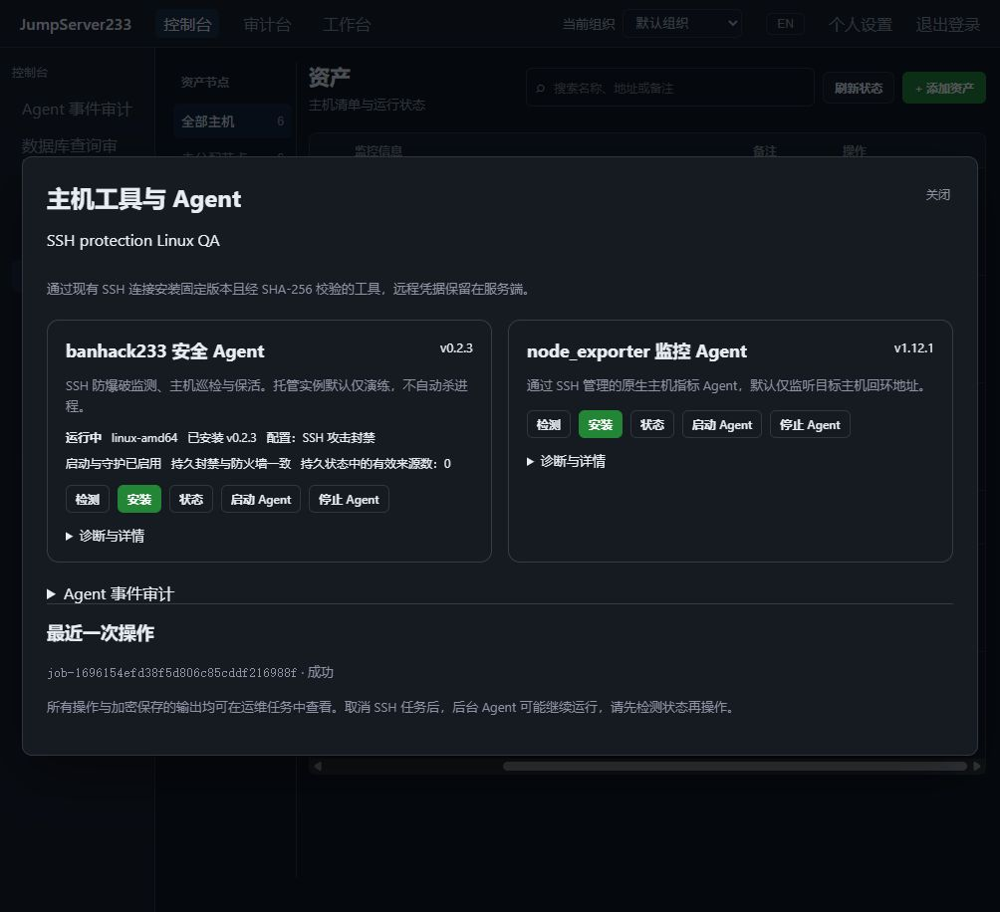

# 自动化验证

> 中文 | [English](./TESTING.en.md)

## 仓库产物与历史清理（2026-10-20）

- `.gitignore` / `.dockerignore` 补齐 Node/Go/Vite 缓存、浏览器截图和临时产物目录；正式图片、源码、锁文件和环境模板保持可见，已跟踪文件没有被新增规则隐藏。
- 45 项 QA/发布辅助测试通过，包括三次保留上限、中英截图对、PNG/JPEG/WebP、重复清理、活动/子进程保护、未完成及损坏报告保护、链接/越界/文件变化拒绝和正式图片引用检查。146 份双语文档、每语言 3464 个键、1334 个相对链接和 85 张正式图片检查通过。
- 实际删除一份 61713 字节的旧只读预览；重复清理删除零项。Docker 连续两次预览确认零资源候选，且没有创建或改写报告。原生包/race 已接入当前批次自动精简；历史专题、失败诊断、应用数据、开发依赖与共享缓存按文档边界保留。精简回执在忽略的 `.cache/qa-reports/repository-hygiene/`，本次未增加产品截图。

## 原生受限 SFTP（2026-10-20）

- 业务代码 `edf46ad` 全量 Go/Testify 1575 项通过、109 项外部夹具/平台跳过、零失败，75.5 秒；Go vet 通过。隔离 Linux/PostgreSQL race 13 个包 143 项通过、零跳过/失败，71.3 秒。覆盖实际生产 helper、虚拟根路径、越界/符号链接、350 个目录条目、1.5 MB 传输、原子无覆盖及显式替换、并发目录替换、伪造交接拒绝和控制缓存重叠拒绝。
- 首轮最终 race 暴露多跳 SFTP 关闭时偶发 EOF；60 次 Linux race 重复复现。修复只归一化主动关闭 SSH 后的本地通道 EOF，不改变文件操作错误；确定性 EOF、重复关闭和取消用例通过，Windows 两类关闭测试各重复 60 次通过。最终上述全量及 race 均通过；保留精简原因回执。
- 六平台原生包、真实 OpenSSH/CLI/Web PTY、REST SFTP 和中英 Playwright 浏览器验收通过：上传、逐字节下载、新建目录、禁止隐式覆盖及重复显式替换、拒绝越界和符号链接跟随、仅查看操作员拒绝文件访问。两张文件管理截图已目视检查，零应用警告/异常和意外 HTTP 失败。沿用实际升级/故障回滚/向前恢复演练；同一源码注入版本不作为历史发布迁移证据。
- 生产网页首屏 JS 499421 字节、gzip 161450、全部 JS 1601821、最大包 482262；保持既有预算，无新增依赖。此前本批 lint/应用与 E2E 类型检查通过，完整页面套件未重跑，86/86 仍为上一批基线。实际原生与 race 自有容器、网络、临时数据/程序/归档、SSH 镜像及构建记录清理并重复验证；仅保留忽略的 `.cache/qa-reports/confined-sftp/` 结构化结果及两张中英截图。

SFTP 登录许可仍按用户、资产和账号授权，每条新通道执行当前工作区策略；不证明目录 inode 或目录专属审批。精确/正则目录命令规则、资源配额、自动安装调度及真实历史版本迁移仍待完成。无内网部署、tag 或正式 Release。

## 原生 SSH 执行工作区（2026-10-20，历史批次）

- 最终全量 Go/Testify 1566 项通过、109 项外部夹具/平台跳过、零失败，73.3 秒；Go vet 通过。隔离 Linux/PostgreSQL race 12 个包 128 项通过、零跳过/失败，67.4 秒。实际执行生成的生产 helper，验证目录内读写、嵌套 shell、目录外读写/切换、符号链接、跨界硬链接/移动、截断、权限/时间修改、清空环境、关闭继承 FD、零 capabilities，以及网络/注入/命名空间/io_uring 等原始 syscall 拒绝；未将不支持内核跳过当作成功。
- 六平台原生包构建与完整校验通过。Linux 只读容器中的真实 OpenSSH、原生 `jms exec` 和浏览器 PTY 均在配置的真实工作目录执行；目录内写入成功，目录外读取/改写失败，外部哨兵保持原值。资产仅管理员可配置，托管账号继承，省略字段保持原策略，空值可关闭，重载保留，旧审批/连接绑定失效，SFTP/网关旁路拒绝。
- Playwright Chromium 实际登录 200，中英编辑页显示保存的工作区，Web SSH 通过二进制 WebSocket 输出执行标记，终端关闭返回 204；最终零应用警告/异常及意外 HTTP 失败。修正了新字段标签与说明混入的问题、测试弹窗切语言顺序，以及 WebSocket 先关闭后 DELETE 返回 404 的产品竞态。重复关闭已结束会话不追加审计，重启后保留本人/他人权限区别。预期匿名会话 401 和精确 Headless 性能提示单独记录。
- 生产构建、lint、应用/E2E 类型、6 项渲染/缓存、41 项 QA/发布辅助、macOS 辅助（8 通过、2 平台跳过）通过。146 份双语文档、每语言 3463 个键、1332 个相对链接及 85 张引用图片通过检查。首屏 JS 499421 字节不变，总 JS 1601699 字节（增加 1329），无新增依赖或预算放宽。本批使用实际候选浏览器定向验收，未重跑完整页面套件；既有 86/86 是上一批基线。
- 四轮原生 QA 和两轮 race 的自有容器、网络、数据/归档、临时程序、SSH 镜像及构建记录已清理，重复清理通过；共享基础缓存保留。仅保留忽略的 `.cache/qa-reports/workspaces/` 精简报告、失败原因摘要和两张中英截图。升级/回滚回归仍为同一源码注入版本与合成故障程序，不构成历史版本迁移证据。无内网部署或正式 Release。

工作区为可选的整个目录树授权，系统程序/库只读且管理通道另行授权，不是完整容器；精确/正则目录命令规则、资源配额和自动安装调度仍待完成。受限 SFTP 的后续验收见上方批次。详见[工作区](./SSH-WORKSPACES.md)。

## 首次启动验收与放行边界（2026-10-20）

- 全量 Go/Testify 1561 项通过、109 项外部夹具/平台跳过、零失败，13.6 秒；Go vet 通过。独立 Linux/PostgreSQL race 八个相关包 105 项通过、零跳过/失败，67.2 秒。新增真实 HTTP 门禁、进程/attempt 绑定、错误口令与口令缓冲清除、放行重放拒绝和回滚修订递增检查。
- 六平台原生包完整构建/校验，Windows amd64 实际离线安装及重复回执通过。Linux 只读容器中通过 `jms update run` 验证首次健康/首页摘要和 API/WS 门禁；放行前候选退出时恢复快照并自动恢复旧服务，试运行写入移出活动数据，修订从 2 经选择/回滚递增至 4。放行后候选退出保留新版本及写入，再向前安装正常候选成功，最终修订 6。
- 上述版本为同一源码注入的 `v0.0.0`、`v0.0.1`、`v0.0.4`；`v0.0.2/3` 是明确合成的故障程序，没有发布。它们验证事务边界，不能替代历史正式版本格式迁移验收。真实 OpenSSH 在升级前后、回滚后及向前修复后均成功执行命令，用户 ID、查看授权和历史命令审计保留；普通操作员建立 SSH 会话仍返回 403。
- 实际候选网页经 Playwright Chromium 登录 200，中英显示 `v0.0.4`，零应用警告/异常；预期匿名会话 401 和精确 Headless 读屏提示单独计数。首轮 QA 错把 `trial` 健康当作业务就绪，修正等待条件后通过；产品门禁未放宽。前端生产构建、lint、应用/E2E 类型、6 项渲染/缓存、41 项 QA/发布辅助、macOS 辅助（8 通过、2 平台跳过）和双语内容检查通过。首屏/总 JS 499421/1600370 字节，无新增依赖。本批未重跑完整页面套件，既有 86/86 只是上一批基线。
- 精简回执与两张中英截图位于忽略的 `.cache/qa-reports/activation/`。两轮原生 QA、race 的自有容器、网络、数据、程序/归档、独立 SSH 镜像和构建记录均已清理，重复清理通过；共享基础缓存保留。历史文件保留预览无待删除项。无内网部署、tag 或正式 Release。自动安装调度、真实历史版本迁移和强目录规则仍待完成。

协议及恢复方法见[单机安装事务](./INSTALLATION.md)。

## 单机安装事务与离线预检（2026-10-19）

- Go/Testify 全量 1546 项通过、109 项外部夹具/平台跳过、零失败，16.5 秒；Go vet 通过。独立 Linux/PostgreSQL race 八个包 90 项通过、零跳过/失败，63.7 秒。覆盖快照互斥、守卫、错误密钥/损坏格式、修订与请求重放、提交点前后恢复、保留新写入、恢复回执中的旧数据位置及真实进程强制退出后的恢复。
- Windows amd64 实际创建加密快照、执行目标程序离线预检并选择原生包，重复请求不重新升级。Linux amd64 在只读容器根文件系统和 tmpfs 数据中，通过 `jms update run` 启动选择的版本，运行中安装被拒绝；预检失败恢复原检查点字节与原选择，随后成功切换并幂等重放。
- 原生演练为同一源码构建的 `v0.0.0` → `v0.0.1` 注入版本，不是历史正式发布间的数据格式迁移。失败场景向合成用户存储写入损坏内容后验证预检拒绝和原快照恢复，再在自有夹具中修复源内容继续升级。独立 Testify 用例另模拟目标迁移写入/模式标记损坏后失败，确认旧数据完整恢复并保留失败现场。
- 独立真实 OpenSSH 在升级前后均成功执行命令，既有用户 ID 和命令审计保留。普通操作员升级前后均保留资产查看授权，建立 SSH 会话返回 403，未提升权限。实际候选网页经 Playwright Chromium 登录返回 200，中英显示新的合成版本；零应用警告/异常，单独记录预期匿名会话 401 和 Headless 读屏性能提示。
- 六平台包重新构建并完整校验；前端生产构建、lint、应用/E2E 类型检查、6 项渲染/缓存、41 项 QA/发布辅助和 macOS 辅助测试（8 通过、2 平台跳过）通过。144 份双语文档、3461 个每语言键、1312 个相对链接和 85 张引用图片通过检查。未新增依赖或修改网页业务代码；首屏/总 JS 499421/1600370 字节不变。本批未重跑 19 分钟完整页面套件，上一批 86/86 仍只是既有基线。
- 精简回执和两张中英截图位于忽略的 `.cache/qa-reports/installation/`。自有主机临时程序/数据、容器、网络、临时归档、独立 SSH 镜像和可归属构建记录已清理，重复清理通过；共享基础镜像/缓存保留。本批没有内网部署、tag 或正式 Release。上线健康失败回滚、自动安装调度、真实历史版本迁移和强目录规则仍待完成。

命令与信任边界见[单机受控安装](./INSTALLATION.md)。

## 原生版本暂存与中断清理（2026-10-19）

- Go/Testify 全量回归 1521 项通过、109 项外部夹具/平台跳过、零失败，5.5 秒（复用已有 Go 缓存）；Go vet 通过。首次只有测试将 Windows 短路径与规范路径按字符串比较失败，修正为比较规范路径后通过。
- 七个相关包的隔离 Linux/PostgreSQL race 最终 66 项通过、零跳过/失败，50.7 秒。覆盖完整归档校验、并发重试、文件/清单/回执篡改、缺失或额外条目、权限、非受管目录和链接拒绝；真实子进程持锁后强制退出，确认 OS 释放锁、下一次暂存清理已证明归属的中断目录且再次清理零删除。归属不明的目录保留并报冲突。
- 六个平台包均重新构建并完整校验。Windows amd64 实际执行 `stage`、重复暂存、`stage-status`、`stage-clean` 和暂存后的 CLI，确认变更过的候选拒绝覆盖、外部数据哨兵不变。Linux amd64 在只读容器根文件系统和独立 tmpfs 中暂存/复核后，从候选目录实际启动单端口生产服务；网页与受保护 API 验证通过。
- Playwright Chromium 直接访问上述候选服务，真实登录返回 200，中英设置页显示正确的 `v0.0.0` 合成验收版本；未发布该版本。零应用警告/异常；单独记录 1 次预期匿名会话探测 401 和 4 条 Headless GPU 读屏性能提示。识别器只允许精确来源/路径/登录前状态和精确驱动性能消息，登录后 401、其他请求错误及应用警告仍失败。首轮浏览器夹具缺少公开来源配置，补齐 `JMS_PUBLIC_URL` 后登录通过；未修改产品来源校验。
- 40 项 QA/发布/浏览器日志辅助测试、macOS 部署辅助测试与双语内容检查通过。未修改网页业务代码，本批使用生产构建和实际候选的浏览器冒烟，未重跑 19 分钟完整页面套件；此前 86/86 是上一批基线。首屏/总 JS 仍为 499421/1600370 字节，无新增依赖。
- 每轮原生 QA 与 Linux race 的自有容器、网络、归档、暂存程序和数据已清理，并重复清理验证。精简结果及两张中英截图保存在忽略的 `.cache/qa-reports/staging/`；不会自动删除已交付的正式候选版本。当前只有受控候选暂存，程序切换、应用迁移、协调数据回滚、自动安装及强目录规则仍待完成；无内网部署或正式 Release。

命令与边界见[受控版本暂存](./UPDATES.md#受控版本暂存)。

## 正式发布检查与原生制品（2026-10-19）

- 原生 Go/Testify 全量回归 1497 项通过、106 项外部夹具/平台跳过、零失败，79 个包通过，75.7 秒。另在独立 Docker PostgreSQL 中执行七个相关包的 Linux race：36 项通过、零跳过/失败，54.1 秒，包含共享状态接管、请求重放、权限、备份启动互斥及真实归档检查。初次测试本身通过，但重复清理误判 Docker 的 `network … not found`；补充严格缺失识别和失败边界用例后，清理及重复清理均通过。
- 六个平台（Linux/macOS/Windows × amd64/arm64）的两个程序、网页和清单均实际构建并经完整 SHA-256、文件集合及 ELF/Mach-O/PE 架构检查。Windows amd64 CLI 已运行并确认版本/源码 SHA；Linux amd64 包在只读容器中以单一端口提供网页和受保护 API。重复打包拒绝覆盖，原字节不变。未执行真实 macOS 或其他架构设备运行，也未上传正式 Release。
- 完整生产 Playwright 86/86 通过、零失败/跳过，19.5 分钟，runner 退出 0、临时数据与夹具清理成功。完整套件之后的样式和检查中刷新修正另经生产 Docker 与手动浏览器定向验证，未为该修正重复整套。最终 Docker 冒烟含检查中状态轮询，构建/启动/检查 7.74/11.97/7.22 秒，通过并自动清理。
- 真实 CLI 与浏览器查询官方发布端点均返回暂无正式稳定版；不是伪造“已是最新”。手动浏览器核对原账号登录、检查结果在容器重建后保留、策略保存、重复保存审计条数不增加、中英展示及零控制台警告/错误。轮询和错误分支使用明确的受控响应验证，不将它们当作真实发布制品安装。
- 38 项 QA/发布辅助测试、6 项前端渲染/缓存测试、Go vet、lint、应用/E2E 类型、macOS 部署辅助测试和双语内容检查通过。首屏 JS 499421、最大块 482262 字节不变；新增功能及中英资源按需加载，总 JS 1600370 字节，比前批增加 9093 字节。总量预算为功能明确增加 9 kB，首屏/单块 500 kB 上限不变，并新增更新页面懒加载门禁。文档 142 份、每语言 3461 键、85 张被引用产品图片。
- 原生 QA 制品、运行数据、容器和临时目录已删除并重复验证；完整浏览器与 Docker 夹具也已清理。精简回执和两张手动截图位于忽略的 `.cache/qa-reports/updates/`。发布器实际上传仍待首次正式 Release；受控安装、迁移/失败回滚与强目录规则继续推进，不能据此宣称完整通用更新器或企业版完成。

功能与命令见[软件更新](./UPDATES.md)。

## 文件治理与自动保留（2026-10-19）

- Git/Docker 忽略规则补齐浏览器截图与报告、性能分析、临时目录、备份和恢复状态；不全局屏蔽图片。浏览器与 Docker 验证结束自动保留最近三次已清理的独立验证，每次最多两张中英文截图；跳过活动进程、未清理夹具与保留的调试环境。具名历史专题保留 JSON 证据。
- QA 辅助测试 36/36 通过、零跳过，包含十项文件保留测试，覆盖重复执行、活动 PID、失败诊断、路径边界、链接、预览后文件变更和 Git 忽略规则。macOS 部署辅助测试 8 项通过、2 项平台跳过；文档检查通过 140 份文档、3426 个双语键与 85 张有引用的产品图片。内容检查现会拒绝无引用图片。
- Docker 生产中英浏览器冒烟通过，构建/启动/检查 53.82/11.94/3.25 秒，容器、卷及本轮可归属缓存已清理。备份包 Linux race 通过，测试时间 50.472 秒；保留命名空间同时补充 ASCII/Unicode 大小写、真实控制目录别名和有效加密归档预检用例。
- 按用户新增的历史清理要求，自动与显式清理共移除 690 个文件、55438139 字节，包括 4 张无引用的旧产品截图；保留 85 张正式引用图片和有限验证证据。旧失败清理回执在核实原临时目录与对应容器均不存在后补充独立核对记录。此前未执行的历史文件清理在本次明确请求后完成；重复执行零删除，`.cache/` 根目录临时脚本归零。
- 本批未重跑 19 分钟完整浏览器套件；备份批次的 85/85 完整结果仍作为既有基线，本次另跑真实 Docker 浏览器冒烟与受影响代码回归。最终原生 Go 1463 项通过、105 项环境/平台跳过、零失败；最终命名空间 Linux race 补充用例 15.313 秒通过。详细回执和清理明细保存在忽略的 `.cache/qa-reports/housekeeping/`。无内网部署或正式 Release。

策略及命令见 [Docker 验证](./DOCKER-QA.md)。

## 单机整站加密备份与恢复（2026-10-19）

- 最终全量 Go/Testify：1,523 项通过、42 项平台/夹具跳过、零失败，74.2 秒；使用隔离真实 PostgreSQL 和 OpenSSH。服务端用例验证活动目录互斥、备份前后真实 HTTP 登录、相同用户 ID、凭据密文保留和恢复后实际 SSH 命令执行。停机过程中已有会话/审计排空测试也在整套中通过。
- 最终 Linux Docker race：14 个相关包、745 项通过、9 项跳过、零失败，353.6 秒；结果与原生测试重叠。覆盖备份包、CLI、服务启动及既有 API/轮换/权限链路。
- 覆盖分块认证、序号/长度/结束帧、截断/重排/追加、格式版本、清单哈希、错误口令、路径穿越/危险文件名、链接、父目录缺失、重复大小写、外部 Vault key、进程崩溃解锁、空目录/替换恢复、八类恢复中断及三类回滚中断。相同备份重试保留导入后的新数据；结构有效但同 ID 不同清单的归档也被拒绝。
- Docker 七项功能检查通过：真实生产镜像在只读根文件系统与直接 `/data` 卷下运行；运行中备份拒绝，停机导出/校验，错误口令和未显式替换保留旧数据，显式恢复保留完整旧目录，两次重试不覆盖新文件，真实 API 重启后用户/资产 ID 保持一致。构建/启动/浏览器冒烟为 41.62/12.16/3.91 秒。恢复后手动浏览器的中英界面、原账号登录与资产行通过，零警告/错误；界面资产是离线合成主机，真实 SSH 证明来自原生 OpenSSH 用例。
- 前端 lint、应用/E2E 类型、6 项渲染/缓存测试、26 项 QA 辅助测试、Go vet 和 140 份双语文档检查通过。JS 首屏 499421 字节（gzip 161459），全部 1591277、最大块 482262；未新增依赖或放宽体积预算。备份归档、Vault key、恢复控制目录与中断写入已加入 Git/Docker 忽略规则。
- 新维护包的 macOS arm64/amd64 编译分别通过，耗时 3.0/2.6 秒；独立编译缓存、对象与辅助程序已清理并重复检查。这是包编译证明，不代表真实 macOS 恢复或 launchd 验收。最终另删除本批 80 个辅助文件、日志与重复截图，共 7670899 字节，保留两张恢复截图及精简报告；重复清理零残留。
- 最终完整生产 Playwright 85/85 通过、零失败/跳过，19.0 分钟；runner 退出 0，生命周期回执确认全部夹具与临时数据已清理。首轮准备夹具绕过 Bootstrap、Windows 短路径和 Docker 标准输入转发问题已修正并保留摘要。另一次会话切换中断的浏览器仅完成 8/85；Linux 运行缺少最终退出证据，均保留中断状态。确认实际进程已不存在后才清理归属资源并重跑，未因观察超时重启。新增即时生命周期回执记录 PID、临时目录与最终清理状态。

报告和必要截图保存在忽略的 `.cache/qa-reports/backup/`，完整浏览器精简结果归档到 `production-browser/`。原生、race、Docker 调试及中断夹具已按归属重复清理；辅助文件清理结果以 `owned-files-cleanup.json` 为准，此前被审核拒绝的路径未重试。当前为[单机停机备份](./BACKUP.md)，不代表 PostgreSQL 集群备份、应用跨版本迁移或远端机器状态回滚。未部署内网、创建 tag 或正式 Release；通用更新器与强目录限制继续推进。

## 云主机 SSH IP 迁移与 SSH 优先范围（2026-10-19）

- 最终全量 Go/Testify：1,470 项通过、41 项平台/夹具跳过、零失败，91.2 秒；使用隔离真实 PostgreSQL 与 OpenSSH。真实 SSH 用例通过固定网关将两个合成 IP 映射到同一 OpenSSH，迁移前后实际执行命令，并拒绝旧连接绑定；这证明真实 SSH 链路，不代表真实云账号验收。
- Linux Docker race：13 个相关包、685 项通过、9 项跳过、零失败，344.6 秒。此后发现 CLI 接受 `--source` 却未筛选，修复并补齐来源筛选/分页；最终完整 Go 已包含该修复，另以 Linux race 对最终 CLI 补测 47 项、零跳过/失败，45.9 秒。各套结果有重叠，不相加。
- 完整生产 Playwright：85/85 通过、零失败/跳过，18.5 分钟；新迁移策略用例 1.7 秒，覆盖明确开启、保存回读、关闭元数据更新时同步关闭迁移、中英文和 390px 布局，以及 LAN 隔离。该整套运行开始后追加的 CLI 修复及末次双语提示调整分别有原生/race/Docker 和最终生产 Docker/手动浏览器补测，未把它们描述成整套运行开始前的源码。
- Docker 七项功能检查通过：四类云来源的显式迁移与相同请求重试、原生 CLI、受保护标准输入写入、修订冲突、两次真实 API 重启、配置/删除恢复及无密钥审计；未发出合成云账号的外部请求。最终 Docker 增量构建/启动/浏览器冒烟为 9.24/12.79/2.73 秒，中英界面确认已保存开关与提示一致。初始构建为 48.77 秒。重启后的旧本地登录令牌按既有规则失效，夹具已改为重新认证并刷新 CLI 环境。
- 覆盖默认关闭、相同云实例/主机密钥、父子账号凭据密文/修订/历史保留、16 类不可信变更、5 类待确定操作、跨组织别名、取消、原子持久化、接管与重复迁移。与人工资产地址相符不再被误认为来源拥有资产。登录复核与临时 SFTP 仍沿用原平台绑定规则，详见[迁移边界](./ASSET-DISCOVERY.md)。
- 前端 lint、应用/E2E 类型、Go vet、夹具/生命周期/渲染辅助测试、138 份双语文档、每语言 3426 键及相对链接检查通过。没有新增依赖或放宽包体预算，首屏 JS 仍为 499421 字节；最后的文案调整经新 Docker 生产构建确认。最初的 SSH 准备、测试版本字段/API 路径和 CLI 筛选失败保留脱敏摘要，最终结果如上。

精简报告、源码 SHA-256 与必要截图保存在忽略的 `.cache/qa-reports/migration/`；整套报告为 `.cache/qa-reports/browser-1792403988249/`。本批临时数据、Go 程序、容器、卷和网络已清理，Docker/race/原生夹具重复清理通过。最后删除辅助脚本、日志和重复截图的命令被自动审批审核拒绝，仅返回 `blocked by policy`，未给出具体原因；77 个文件共 7380191 字节仍保留，清单见 `owned-files-cleanup.json`，没有改用其它方式重试。此前被拒绝的删除也未重试。未部署内网、打 tag 或创建正式 Release。后续以[SSH 稳定版](./SSH-FIRST.md)为验收重点；整站导入/导出、通用更新器与强目录限制尚未完成。

## 阿里云 ECS / 腾讯云 CVM 清单（2026-10-19）

- 最终全量 Go/Testify：1,414 项通过、48 项平台/夹具跳过、零失败，74.5 秒；使用独立真实 PostgreSQL。Linux Docker race：13 个相关包、646 项通过、8 项跳过、零失败，333.4 秒；两套结果重叠，不相加。
- 覆盖阿里云公开 GET/POST 签名向量、腾讯云公开 TC3 向量、STS 账号/ARN、17 位 UID 精度、临时令牌、阿里云分页与前后权限预检、腾讯云稳定总数/完整分页、部分地域失败、限流重签名、取消、异常/超大响应、IPv4/IPv6/标签/原始状态及 4 MiB 元数据总量。权限失败不累计缺失，不停用已有资产；API、组织权限、仅写凭据、重启恢复和幂等纳管有配套测试。
- 最终完整生产 Playwright 84/84 通过、零失败/跳过，19.4 分钟，runner 退出 0；期间 13 份相关源码/用例指纹未变，所有原先未执行的插件依赖用例均通过。首次完整运行保留为失败：78 项通过、插件升级 1 项失败、串行依赖 5 项未执行。该用例错误地接受了上一任务的成功状态，现改为等待本次提交返回的任务 ID 和成功状态；未延长普通 UI 断言掩盖问题。另一次准备阶段进程中断未产生用例结果，归属夹具清理两次后重新执行。
- 最终 Docker 七项功能检查全部通过：四类云来源的相同请求重试、凭据保留、固定账号/提供商、修订冲突、原生 CLI 回读及标准输入写入、两次真实 API 重启、审计/导出不含密钥和删除状态恢复。合成来源未执行外部云请求。最终界面补测 1/1 通过（2.5 秒，含准备 3.0 秒），覆盖四类云来源、切换清空凭据、1024/4096 字符临时凭据、中英及 390px 布局。手动浏览器检查修复凭据复选框尺寸，并保留中英截图、13px 控件及零警告/错误的证据。
- 前端 lint、应用/E2E 类型、生产构建、Go vet、清理/夹具/渲染辅助测试及双语检查通过。初始 Docker 构建/启动/浏览器冒烟为 47.4/12.0/2.8 秒；最终界面增量为 7.2/7.2/2.6 秒。JS 首屏 499421 字节（gzip 161448），全部 1589944、最大块 482262；新增功能净增 2028 字节懒加载代码，未增加依赖或放宽体积限制。每语言 3423 键、136 份双语文档、1230 条相对链接检查通过。
- 报告和必要截图保存在忽略的 `.cache/qa-reports/china/`，完整浏览器报告为 `.cache/qa-reports/browser-1792400540124/`。Go 临时目录、隔离 PostgreSQL、race 容器/卷/网络、完整浏览器夹具和 Docker 调试实例已清理，重复清理通过；另删除本批 98 个辅助文件、日志、重复报告和首轮重复截图，共 7802858 字节。保留首轮失败摘要和关键截图。首次 Go 检查发现正则重复次数超出 Go 限制，改为独立长度校验后最终全量/race 通过；保留脱敏诊断。既有被自动审核拒绝的删除不重试。

真实阿里云/腾讯云账号、RAM/CAM 完整资源可见性及生产云验收未完成。原生适配不等于全企业版完成；其他云平台、自动 IP 迁移、多节点及其余 Enterprise 功能继续推进。未部署内网、打 tag 或创建正式 Release，整体验收后仅发布一次。

## AWS 国际区/中国区清单验证（2026-10-19）

- 最终全量 Go/Testify：1,353 项通过、48 项因夹具/平台跳过，零失败；隔离真实 PostgreSQL 下耗时 79.5 秒。另有三项 RDP 驱动测试通过。最终 Linux Docker race：13 个相关包、588 项通过、8 项跳过、零失败，338.0 秒；两套结果有重叠。
- 覆盖 AWS 公开 SigV4 向量、两个地域分区端点、临时令牌、完整分页、限流与取消、账号/所有者不符、无效/超大响应、稳定实例身份、停机/无 IP、限定地域的缺失阈值、凭据保留、重启、API/CLI，以及包含各端口的规范化元数据总量限制。首次加密恢复失败暴露了旧 LAN 校验，修正后通过最终套件及真实 Docker 重启验证。
- 完整生产 Playwright 执行 84 项：83 项通过，AWS 用例因下拉框精确标签匹配包含选项文本而失败。改为组合框角色定位后，在最终 Docker 成品上以 1.7 秒通过（含准备 2.7 秒），覆盖中英编辑、仅写字段和 390px。整套报告保留失败状态，修正用例有独立通过报告；随后新增的云元数据保护经最终全量 Go/race 和新生产 Docker 构建补测。
- 最终 Docker 六项功能检查全部通过：相同来源重试、两个 AWS 分区、凭据保留、固定账号绑定、原生 CLI 回读、真实 API 重启及删除来源恢复。最终构建/启动/浏览器冒烟为 42.3/12.1/3.3 秒。AWS 清单协议采用签名合成夹具验证，不宣称真实 AWS 账号或生产云验收。
- 前端 lint、应用/E2E 类型、生产构建、夹具/生命周期及双语内容检查通过。首屏 JS 仍为 499421 字节（gzip 161446），全部 JS 1587916，最大块 482262。AWS 控件和翻译净增 5738 字节懒加载代码，未新增依赖，首屏/单块仍限 500000 字节。每语言 3408 键、136 份双语文档及 1230 条相对链接检查通过。
- 报告位于 `.cache/qa-reports/cloud/`，完整浏览器报告为 `.cache/qa-reports/browser-1792392864008/`。保留精简结果、源码 SHA-256、必要截图和脱敏初次失败诊断；本批测试数据、Go 临时程序、容器、卷、网络及 49 个临时辅助文件/日志/重复报告（2067277 字节）已清理，重复清理通过。既有自动审核拒绝的删除未列入本批，也未重试。

其他云平台、自动 IP 迁移、多节点映射及其他企业能力仍待完成。未部署内网、打 tag 或创建正式 Release，整体验收后仅发布一次。

## LAN 资产发现与同步（2026-10-19）

- 最终全量 Go/Testify：1324 项通过、48 项因协议夹具或平台跳过，零失败，74.7 秒；使用隔离真实 PostgreSQL，包含来源/策略、资产与纳管回执的单活接管。
- 最终 Linux Docker race：12 个相关包，559 项通过、8 项跳过，零失败，328.2 秒；结果与原生测试重叠。覆盖无认证 SSH 指纹、网关复核和撤销、并发/取消、整批资产事务、凭据保留、一次性纳管、元数据修订与 DST 去重。
- 完整生产 Playwright：83/83 通过，零失败/跳过，18.2 分钟；新功能用例 9.4 秒，真实 OpenSSH、Web SSH、CLI、中英文表头、390px、一次性重试和定时均走通。首次浏览器运行在人工发现表头翻译冲突后中止，原测试数据已清理，修正后重跑了整套。
- 后续调度元数据保护经最终全量 Go/race 和新 Docker 构建补测；局部 CSS 经实际浏览器单独复核。最终 Docker 功能用例 8/8 通过，38.4 秒，包括 API 容器重启后凭据与回执恢复、已执行单次计划改名后跨一次调度轮询不重放。本机和 Docker 最终 CSS 的 SHA-256 完全一致。
- 首屏 JS 499421 字节、gzip 161456 字节，全部 JS 1582178 字节、最大块 482262 字节。发现页面及双语资源保持懒加载，首屏/单块保留 500000 字节上限。首次 Docker 构建 34.5 秒、启动 12.0 秒；增量界面构建约 5–6 秒，最终调度改动重建 47.9 秒。
- 本地报告：`.cache/qa-reports/discovery/`；完整浏览器结果为 `.cache/qa-reports/browser-1792388954970/`。保留结构化结果、源码摘要和必要截图；中止运行根目录、Go 临时目录、race 容器/卷/网络均已重复清理。本批 Docker 最终实例与辅助文件清理结果写入 `cleanup.json`。
- 既有自动审批拒绝删除的监控/品牌测试残留继续保留，路径和原因沿用下方历史记录；没有改用其他方式重试这些删除。
- 本批辅助文件删除也被自动审批以 `blocked by policy` 拒绝，命令未执行：28 个忽略的脚本、日志、PID/根目录记录合计 1001857 字节，保留清单见 `cleanup.json`。容器、卷、网络和 Go 临时目录已清理；未重试被拒绝的文件删除。

本次未进行内网部署、打 tag 或创建正式 Release。企业版总体对齐继续推进。

## 品牌外观验证（2026-10-19）

- 全量 Go/Testify：1300 项通过、48 项因缺少协议夹具或平台跳过，零失败，70 个测试包及 29 个无测试包；75.0 秒。使用隔离真实 PostgreSQL 检查共享状态、提交回执不确定后的重试及主备接管。
- Linux Docker race：六个相关包，307 项通过、5 项跳过，零失败，335.9 秒；与原生测试重叠，不相加。覆盖图片边界/元数据剥离、四类图片、全部文本字段、安全链接、主题对比度、修订、相同重试、并发写入、保存失败、审计保留、当前全局权限/撤销、CLI/SDK 及接管。
- 最终完整生产浏览器回归 82/82 通过，零失败/跳过，18.7 分钟。本轮改动源码摘要与运行期间记录一致，修改时间均早于启动。覆盖双语名称/标题/页脚、四类上传、PNG 缓存、独立网站图标/终端标识、跨标签刷新、真实 Web SSH、CLI 及当前管理授权拒绝。独立 Docker 生产外观用例另以 4.3 秒通过。
- 首次用例误用了关闭按钮名称，已改为“Close terminal”；该轮完整进程中断且无完成报告，不计入验收。上述最终完整套件在修正后执行。
- 内置浏览器实际保存/重载双语设置、切换语言，并在退出后检查公开登录页；捕获日志无警告/错误。真实单机 API 重启后，四类图片摘要和两条审计完整保持；相同重试不重复审计，核验约 1.12 秒。
- Go vet、前端 lint、严格应用/E2E 类型、生产构建、QA 生命周期测试及双语/内容检查通过。初始 JS 498,714 字节、gzip 161,277，全部 JS 1,541,734；管理页及翻译保持懒加载，初始依赖/单包预算仍为 500,000。
- 原生/race 临时资源、复核容器/卷/网络，以及最终浏览器数据和夹具已清理；原生/race/复核环境重复清理通过。后续浏览器 Go 临时程序位于本轮自有目录。紧凑报告及关键截图保存在忽略的 .cache/qa-reports/branding/；此前被拒绝的历史清理路径保持原状。本轮自动审批还拒绝删除 9 个辅助脚本及 1 份原始日志，仅返回 blocked by policy；这些忽略文件保留，清单及大小写入本轮 summary.json，未换方式重试删除。没有内网部署或 Release，整体企业版对齐继续进行。

## SSH 监控历史验证（2026-10-18）

- 完整生产浏览器回归 81/81 通过，零失败/跳过，18.2 分钟；runner 退出 0，临时数据及协议夹具已清理。最终图表修正后的 Docker 专项另有独立结果，见下文。
- 全量 Go：69 个测试包，1286 项测试/子测试通过、48 项缺少协议夹具或平台跳过，零失败，74.7 秒；另有 29 个无测试包。使用隔离真实 PostgreSQL 验证组织作用域、最大长度键、保留期删除及主备接管。此轮未为原生 Go 配置其它协议夹具；真实 SSH 等业务链路由浏览器套件覆盖。
- Linux Docker race：六个相关包，401 项通过、8 项缺少夹具跳过，零失败，323.2 秒；包含真实 PostgreSQL 接管，与原生 Go 结果重叠，不相加。Windows 首次 race 因 CGO 未启用而未启动，随后在隔离 Linux 环境完成。
- Testify 覆盖分钟末样本、同时间重试与冲突、较早样本、聚合、断档与真实零、加密重启、错误密钥/损坏、八段缓存、容量、持久化失败回滚、取消、并发、重复物理清理、授权撤销、绑定变更、SDK/CLI 参数及凭据脱敏。HA 用例以明确的合成历史值证明持久化恢复；真实采集证据来自 OpenSSH。
- 最终 Docker 专项浏览器 1/1 通过、零跳过，25.7 秒：真实 OpenSSH 采集、离线/恢复、历史 API 与 CLI、当前查看授权/撤销、中英界面、390px 手机、区间键盘操作和 Esc 焦点恢复。实际 API 容器重启后八个已结束分钟记录完全一致，核验约 0.92 秒。
- 浏览器复核修正了纵轴方向；lint 后移除图表路径中不必要的可变闭包，最终零警告。一次专项断言将跨 UTC 分钟的混合区间误判为纯离线，现按离线计数验证，并单独检查纯离线区间不含指标；最终构建已重跑专项。
- Go vet、前端 lint、严格应用/E2E 类型检查、生产构建和双语/来源检查通过。新功能图表和翻译保持懒加载，原体积预算未增加。紧凑报告与关键截图保存在忽略的 `.cache/qa-reports/monitor-history/`。
- 专项容器、数据卷、网络、专用镜像及 Linux race 缓存卷已删除，重复清理通过。Windows 自动审批拒绝删除归属已确认的 Go 临时目录及辅助脚本；此前也拒绝了 `web/dist` 的删除。约 45MB Go 临时文件、忽略的辅助脚本和构建输出仍保留，具体边界已记录到清理报告。

## 平台密码安全、幂等与测试清理（2026-10-18）

- 最终完整生产浏览器用例 81/81 通过，零失败/跳过，18.3 分钟；新密码安全用例在整套内为 17.8 秒。包含真实 SSH、数据库、RADIUS、systemd、Web/CLI 与中英文桌面/手机验证。
- 运行期间修复的清理模块未被已启动 runner 重新加载：该次收尾退出 1，原始报告明确保留。随后用修复版对同一临时目录清理两次均退出 0，确认目录删除；历史 Docker 清理复查删除零项。不能把原始完整命令的退出码写成 0。
- 最终全量 Go：69 包、1,280 项测试/子测试通过、35 项平台或缺少夹具跳过、零失败，退出 0；使用独立真实 OpenSSH、PostgreSQL、RDP 和 FreeRADIUS。Linux Docker race：4 个相关包、359 项通过、14 项缺少夹具/平台跳过、零失败，退出 0；两者不相加。
- Testify 覆盖角色密码策略、UTF-8/字符类别、HMAC 历史、旧哈希迁移、有效期、凭据撤销、受限证明来源/超时/重放、修订冲突、相同策略无副作用、保存失败回滚、独立恢复权限、TOTP 恢复和 PostgreSQL 接管。CLI 在 Windows 验证创建时受保护 DACL，在 Linux 验证 0600。
- 新功能独立 Docker 浏览器 1/1 通过，18.6 秒；实际 API 容器重启及检查 0.85 秒，待改密能力保留，成功后可重新登录、重放被拒绝、审计保留。管理查询在重启后重新认证。内置浏览器另确认中英策略界面、无改动禁用保存及零警告/错误。
- 31 项清理/夹具/缓存/渲染辅助测试通过。覆盖重复清理、归属变更拒绝、活动 E2E 保护、并发退出、无标签镜像、模板 JSON、共享镜像保护及仓库构建历史；inspect 不请求环境变量或命令正文，非归属标签在解析后移除，错误不回显原始正文。报告不保留认证 trace。
- Docker 纯净数据及双实例 Cookie/端口隔离通过：缓存构建 3.32 秒、启动 11.94 秒、浏览器检查 3.65 秒，约 18.9 秒，临时资源清理；调试实例关闭两次均成功。历史回收包含 74 个既有容器、25 个数据卷和 23 个网络。共享基础镜像、其他项目数据及无法证明归属的缓存保留；Docker 统计与宿主磁盘实际释放量分别看待。
- Go vet/build、前端 lint、严格应用/E2E 类型检查、生产构建及双语/来源检查通过。所有 JS 1,510,989 字节，初始 494,291（gzip 159,485），最大包 477,132；为懒加载密码功能明确增加总预算 25,000 字节，见[性能记录](./PERFORMANCE.md)。报告/关键截图保存在忽略的 `.cache/qa-reports/`，临时程序与测试数据清理，规则写入 AGENTS。
- [密码安全](./PASSWORD-SECURITY.md)采用 v3 用户文档，兼容旧数组/v2；升级需备份并更新所有接管节点。邮件重置/到期提醒、泄露密码库、目录密码回写、闲置账号、批量用户导入、生产 HA 和完整企业版对齐继续进行。

## 平台用户生命周期验证（2026-10-18）

- 最终完整生产浏览器 80/80 通过、零失败/跳过、19.4 分钟，runner 退出 0，临时数据和协议夹具清理；其中用户生命周期用例为 12.9 秒。整套期间 1021 份主要源码/测试指纹未变化。

- 实现、配套用例和中英说明集中完成后统一验证。最终全量 Go：69 包、1,257 项测试/子测试通过、35 项平台或缺少夹具跳过、零失败，退出 0；使用真实 OpenSSH、PostgreSQL、RDP 和 FreeRADIUS。
- Linux Docker race：11 个相关包、395 项通过、4 项缺少夹具跳过、零失败，退出 0；包含真实 PostgreSQL 用户文档接管和过期代次会话文档拒绝。与全量 Go 重叠，不相加。
- Testify 覆盖状态与到期、Bearer/永久 Token/AccessKey 凭证通道、已隔离登录证明、待 MFA 设置、外部来源/Passkey 代次、修订冲突、批量回滚、自己/管理员/永久本地管理员保护、归档恢复、旧数组迁移、保存失败回滚、审计拒绝非法内容、SDK 与 CLI。API 另验证 OIDC/RADIUS 待完成能力撤销后不能复活。
- Docker 新功能浏览器 1/1 通过、零跳过、13.8 秒：真实 OpenSSH 连接、禁用后持续授权关闭、Bearer/Token/Signature 认证失效及重新启用不复活、元数据编辑不撤销、批量冲突回滚、过期、归档/禁用恢复、CLI、中英桌面与 390px 手机布局。
- 独立 HTTP 检查验证浏览器 Cookie 原先可认证、禁用后及重新启用后均返回 401，补充上述三类显式认证头的证据。合成用户已归档。
- 首轮集中检查修复 MFA 变量引用；验证环境改正 RDP 健康 URL 和 SSH `container_name` 参数。浏览器原先的 5 秒断言短于既有 10 秒授权复查，将等待上限改为 15 秒后通过，没有缩短生产复查周期。
- 实际 API 容器重启保留用户修订、身份代次和审计，旧会话拒绝访问，合成用户随后归档；重启及检查 1.07 秒。内置浏览器确认中英管理页、归档记录和重启后审计，未捕获警告/错误。
- Go vet/build、前端 lint、严格应用/E2E 类型检查、生产构建、3052 个中英键、126 份配对文档及 16 项生命周期/渲染/缓存辅助测试通过。全新 Docker 数据与双实例浏览器端口隔离约 19.7 秒，临时资源清理；保留新调试环境 `http://127.0.0.43:15201/console/users`（API 18108）和旧环境，均仅回环。
- v2 用户文档升级需备份并更新全部接管节点；当前恢复保留原授权、角色绑定和 MFA，显式启用后生效。永久删除、导入、管理员密码/MFA 重置、生产 HA 和企业版总体能力不据此宣告完成。

## 原生 RADIUS 验证（2026-10-18）

- 集中编写实现、配套测试和双语说明后统一验证。全量 Go：69 包、1,242 项通过、35 项平台/缺少夹具跳过、零失败，退出 0；使用真实 OpenSSH、PostgreSQL、RDP 和 FreeRADIUS。
- Linux Docker race：7 个相关包、363 项通过、4 项缺少夹具跳过、零失败，退出 0；包括真实 FreeRADIUS UDP/双向 TLS 和 PostgreSQL。与全量 Go 有重复用例，不相加。
- Docker 浏览器专项修复后 1/1 通过、零跳过、8.3 秒；覆盖主挑战刷新、附加认证前无平台会话、权限拒绝、受保护 CLI 状态、认证后真实 SSH 和中英文桌面/手机。首轮发现窄屏用户名溢出，修复换行后通过。内置浏览器另实际走通挑战、会话及 RADIUS 个人设置，未捕获警告/错误。
- 原生协议首轮发现两处测试/夹具问题：非 Challenge 响应应丢弃 State，FreeRADIUS 挑战须配置对应 Post-Auth-Type。修复后，完整 Go 与真实协议用例通过。夹具就绪检查使用双向 TLS 握手，避免 Docker 端口代理提前接通产生假就绪。
- 实际 API 容器重启后，持久化的待认证因子仍能完成；随后才签发会话，重复能力提交被拒绝。重启及完成检查约 1.05 秒。保留独立实例 `http://127.0.0.41:15200/console/radius`，API 18107，仅回环；旧调试环境保留。
- 全新数据的 Docker 双实例浏览器隔离验证通过，约 19.9 秒；临时容器/数据清理。Go vet/build、前端 lint、严格应用/E2E 类型检查、生产构建、双语内容及 10 项生命周期辅助测试通过。
- 完整生产浏览器回归 79/79 通过、零失败/跳过、17.8 分钟，runner 退出 0，临时数据与夹具清理；期间 1,007 份主要源码/测试指纹未变更。随后集中修正 RADIUS 传输字段切换、空应答挑战及状态细节，扩充专项 1/1（8.3 秒）和以上最终后端全量/race 重跑通过。生产 HA、多活和完整企业版功能未据此验收。

## 原生 Playbook 统一验收（2026-10-18）

- 实现、测试代码和双语说明集中完成后统一验证。最终全量 Go：67 包、1,190 项通过、35 项平台/缺少夹具跳过，零失败，退出 0；使用真实 OpenSSH、PostgreSQL 和 RDP。
- Docker 原生 Playbook 专项：1/1 通过、零失败/跳过，20.2 秒；真实 SSH file/template/stat/command、assert、循环、通知 handler、源码快照、手动去重重跑、权限拒绝、冲突、CLI 及英文 1440px/中文 390px。内置浏览器另复核 v1 快照、幂等“未变更”和真实步骤 stdout，未捕获警告或错误。
- 临时干净 Docker 双实例浏览器隔离检查通过：缓存构建 4.81 秒、启动 12.19 秒、检查 4.56 秒，约 21.6 秒；临时资源清理。保留实例 `http://127.0.0.39:15199/workbench`，API 18106，仅绑定回环。
- Linux Docker race：6 个相关包、363 项通过、4 项缺少夹具跳过、零失败，退出 0；与全量 Go 存在重复用例，不相加。首轮 race 发现与 Go 同样的三处测试问题，以上为修正后的完整相关包重跑。
- 生产 API 容器在原生 pause 步骤期间实际重启；重新登录后检查五步运行成功、原步骤作业 ID 保留、追加标记严格为单个 `x`，证明该场景没有重放已完成 SSH 步骤；最后一步删除自有标记文件。
- 最终完整生产浏览器回归 `pnpm test:e2e:production`：78/78 通过、零失败/跳过、17.7 分钟，runner 退出 0；全新临时数据、真实协议/原生服务夹具及最终清理均完成。新增 Playbook 用例在完整套件内另以 19.6 秒通过。986 份实现、配置和测试源码指纹前后一致，现有调试实例保留。
- vet、全量 Go 构建、lint、严格前端/E2E 类型检查、生产构建和 10 项辅助测试通过。内容检查：每语言 2,904 键、122 份双语文档、1,114 个相对链接，零错误。沿用 `.gitignore` 排除缓存、日志、产物和本机工具文件；不手工更新 changelog。
- 首轮 Go 有三项测试失败：旧 Operations 存储版本断言、末尾空白被规范化的控制字符样例、YAML flow 条件下标未加引号。修正测试后完整重跑得到上述最终值。浏览器定位用例改为可访问 textbox 角色并增加明确动作超时，随后专项通过。
- [原生 Playbook](./PLAYBOOKS.md)说明格式边界；完整 Ansible、全部企业版和生产多活仍在进行。

## 日历调度统一验收（2026-10-18）

- 实现、测试代码和双语说明成批完成后统一验证。最终完整生产浏览器回归：pnpm test:e2e:production，77/77 通过，零失败/跳过，17.9m，runner 退出 0。使用全新临时数据及真实协议/原生夹具；完成清理，保留已有调试环境。957 份实现、配置与测试源指纹前后一致。
- 全量 Go：66 包、1,143 项通过、35 项平台/缺少协议夹具跳过，零失败，退出 0；使用真实 OpenSSH、PostgreSQL 和 RDP。Linux Docker race：5 个相关包、316 项通过、4 项缺少协议夹具跳过，零失败，退出 0。两者有重复用例，不相加。
- Testify 覆盖五段语法、UTC/IANA、夏令时缺口与整小时/半小时回拨、世纪闰年、起止窗口、逾期合并/跳过、并发领取、时钟回拨、版本冲突、原子审计、创建幂等、模板删除、旧格式迁移和 PostgreSQL 组织接管；API/SDK/CLI 覆盖当前权限、分页与输入/响应边界。
- 新生产 Docker 专项完整流程：1/1 通过，零失败/跳过，runner 11.2 秒。包括真实 SSH 分钟触发、Web 创建/预览、冲突重载、编辑、暂停恢复、CLI、撤权拒绝、英文桌面和中文 390px；无 pageerror。触发等待随实际分钟变化，不将本次耗时视为固定上限。内置浏览器另确认中文对话框、UTC/计划本地预览、变更审计与零警告/错误。
- 新数据卷、端口与双实例隔离的纯净 Docker 浏览器烟测通过：缓存构建 3.25 秒、启动 12.25 秒、检查 4.30 秒，总计约 19.8 秒，临时资源清理完成。保留实例 http://127.0.0.37:15198/workbench，API 18105，仅绑定回环。
- vet、全量 Go 构建、lint、严格前端/E2E 类型检查、生产构建、10 项 Docker 辅助测试及 6 项前端辅助测试通过。双语内容每语言 2,771 键、120 份文档；最终链接检查零错误。缓存、日志、报告和生成物沿用现有忽略规则。
- 首次完整回归为 76/77（17.5 分钟），已有组织隔离用例的 CLI 子进程失败，现有输出不足以确定原因；trace 已保留。补充不含凭据的退出码/信号/作业状态诊断后，用全新环境重跑完整套件，以上结果为最终重跑值，两次不相加。另修正新测试的路由依赖缺失及创建响应等待超时；最终用页面成功状态和原生 API 复核创建。完整企业版、Playbook/Ansible 和生产多活仍未宣称完成；语义、保留期限和 v3 数据升级见[日历调度](./SCHEDULING.md)。


## 运营报表与原生登录动画（2026-10-18）

- 最终完整生产浏览器回归：`pnpm test:e2e:production`，76/76 通过，零失败/跳过，16.8 分钟，runner 退出 0。使用全新临时数据、真实协议与原生服务夹具，清理完成；保留原有调试环境。报表、登录动画和原有完整业务链路均在本次套件内验证。

首次完整生产浏览器回归为 75/76 通过（16.4 分钟）；Kubernetes 操作员节点请求出现 Chromium `net::ERR_NO_BUFFER_SPACE`，请求未到达后端，导致资产列表等待超时。失败 trace 已保留；源码未为该系统瞬态改动，随后使用全新临时环境重跑完整套件。

- 全量 Go：66 包、1,104 项通过、35 项平台/缺少夹具跳过，零失败，退出 0。使用真实 OpenSSH、PostgreSQL 和 RDP 夹具；缺少的协议及系统场景明确跳过。
- Linux Docker race：16 个相关包、421 项通过、5 项缺少协议夹具跳过、零失败、退出 0；锁顺序和 SDK 完整性收紧后，三个最终相关包另跑 race，125 项通过、零失败/跳过、退出 0。两次存在重复测试，不相加。
- Testify 覆盖聚合区间/UTC/来源失败、当前权限撤销、部分导出确认、审计失败不返回 CSV、加密回执/损坏/容量/TTL、PostgreSQL 作用域接管、会话/文件原生索引及 SDK/CLI 摘要/大小/短写检查。
- 最新生产 Docker 专项浏览器：2/2 通过，零失败/跳过，4.7 秒。真实 SSH 作业、操作人归属、Web/CLI CSV 与 SHA-256 回执、跨组织隔离、权限撤销、中英文 390px 和原生登录动画均通过。
- 一次性纯净 Docker：热缓存构建 2.84 秒、启动 12.11 秒、浏览器/端口/并行隔离检查 3.99 秒，通过并清理；已有调试实例保留。持续查看实例为 `http://127.0.0.35:15197/console/reports`，API 端口 `18104`，均只绑定回环。
- `go vet`、严格类型检查、lint、生产构建、10 项 Docker 辅助测试和 6 项前端辅助测试通过。内容检查为每语言 2,712 键、118 份双语文档、1,066 个相对链接，零错误。现有 `.gitignore` 排除缓存、运行数据、打包产物和本机工具文件。
- 内置浏览器实际导出后显示回执、字节数和 SHA-256；重建生产实例后原生作业历史保留。数据源和语义边界见 [REPORTS](./REPORTS.md)，生产多活及完整企业版验收继续进行。

## 平台登录审计与独立平台通知（2026-10-18）

- 最终完整生产前端回归：`pnpm test:e2e:production`，74/74 通过，零失败/跳过，16.2 分钟，runner 退出 0。使用全新临时数据、真实协议及原生服务夹具，清理完成；原有调试环境保留。两条操作人文案修正后，最新镜像专项另跑通过。

- 全量 Go：65 包、1,080 项通过、35 项夹具/平台跳过、零失败，进程退出 0；使用真实 OpenSSH、PostgreSQL 共享存储与 RDP 夹具，其余缺少的数据库、Kubernetes、Telnet、系统级防护和 systemd 场景明确跳过。
- Linux race：8 包、350 项通过、5 项缺少真实协议夹具跳过、零失败，退出 0，覆盖登录审计、原生复核、通知、身份、API、SDK 和 CLI/服务入口。
- Testify 专项覆盖多分段索引提交中断、重启去重、游标/缺口、十万条容量、365 天查询期限、损坏密文、关闭/取消、并发写入及 PostgreSQL 平台 namespace 隔离/接管。HTTP 专项验证 LDAP/OIDC/SAML/CAS/Passkey 真实本地协议夹具、MFA、审计失败撤销会话、CSV 公式前缀、导出审计故障、可信代理和权限撤销；不代表真实生产身份提供方已验收。
- 最新镜像隔离 Docker 专项浏览器 11.9 秒（runner 12.3 秒）：本人/全局范围、单独导出权限、撤权后的详情清除、原生登录复核与会话兑换、平台/组织通道隔离、签名 TLS Webhook、双语 390 px、CSV、CLI；无 pageerror。通知仅发送到本机拥有的 TLS 捕获器，使用合成身份。IAB 另验证“操作人 ID”文案，准确区分消费、取消与审批动作。
- vet、lint（零警告）、前端与 E2E 类型检查、生产构建、10 个 Docker helper 和 6 个前端 Node 测试通过。内容检查为每语言 2,580 键、116 篇双语文档。
- 新数据卷、双实例 Docker 浏览器烟测通过，约 22.19 秒；临时资源清理完成。保留调试实例 http://127.0.0.33:15196，API 18103；原有调试环境保留。IAB 另验证中文列表、复核消费详情、关闭返回和无控制台错误。

能力范围与数据保留边界见[平台登录审计](./LOGIN-AUDIT.md)。

## 原生主机监控告警（2026-10-18）

- 最终完整生产前端 Playwright：73/73 通过、零失败/跳过，16.7 分钟，runner 退出码 0。一次生产构建，使用全新临时数据及全部原有真实协议/原生夹具；828 份实现/验证源码指纹前后一致。本轮自有夹具已清理，保留的调试环境不受影响。覆盖真实 SSH 告警/确认/恢复、授权撤销、BanHack/Agent、systemd 自愈、数据库、Kubernetes、RDP、Telnet 及会话协作。

- 最终 Go/Testify 无缓存全量：64 包、1,055 项通过、35 项因夹具/平台能力跳过、零失败，退出码 0。包括原生恢复助手预生成、真实 OpenSSH 及 PostgreSQL 接管/组织隔离。
- 最终 Linux Docker race：10 包、449 项通过、7 项因缺少真实 SSH/数据库/Kubernetes/RDP/Telnet 夹具跳过、零失败，退出码 0。对应真实协议另由完整 Go 和浏览器覆盖，跳过不算通过。
- 新监控引擎语句覆盖率 83.5%。专项覆盖重复样本、连续时间/恢复阈值、缺数等待、静默结束、确认防重、目标身份变更、权限撤销、磁盘故障回滚、加密损坏、重启计数重置、并发 CAS、20,000 条活动告警容量及既有恢复继续处理、历史裁剪和返回值隔离。
- 最新生产 Docker 专项 27.6 秒、含 runner 28.1 秒：暂停真实 OpenSSH 容器得到离线、触发站内告警、Web 确认、恢复容器后新探测记录恢复、CLI 读取、中英文、390px、撤销主机授权后清除详情均通过，零 pageerror。此前初版专项 30.6 秒；两次均通过。内置浏览器另在 API 容器更新重启后重新登录，核对旧告警的真实“已确认、已恢复”详情。
- 纯净 Docker 双实例真实浏览器检查 18.79 秒（热缓存构建 2.37、启动 12.13、检查 4.29），本轮随机环境已自动清理。最新保留调试环境 UI http://127.0.0.31:15195，API 18102；旧环境保留。
- Go vet、lint（零警告）、严格类型、生产构建、10 项 Docker 工具测试及 6 项前端缓存/帧测试通过。双语检查为每语言 2,444 key、114 份文档、1,030 个相对链接；新增测试截图和能力边界见[监控告警](./MONITOR-ALERTS.md)。完整生产前端套件使用 `cd web && pnpm test:e2e:production` 执行。

## 安全通知与命令复核（2026-10-18）

- 最终完整生产前端 Playwright：72/72 通过、零失败/跳过，16.4 分钟。使用预构建静态前端、全新临时数据及原有全部真实协议/原生夹具，源码 850 份指纹前后完全一致。覆盖 SSH 命令过滤与原生复核、权限撤回、会话协作、数据库、Telnet、Kubernetes、RDP，以及真实 systemd 自愈/重启后采集 Agent 修复通知并打开详情。测试结束清理本轮自有夹具。
- 最终 Go/Testify 无缓存全量：63 包、1,026 项通过、35 项缺少夹具/平台能力跳过、零失败，退出码 0。体积边界补丁后重新完整执行；原生助手仍按 go generate 准备。
- 最终 Linux Docker race：9 包、290 项通过、4 项缺少真实数据库/Kubernetes/RDP/Telnet 夹具跳过、零失败，退出码 0。对应真实协议另在完整浏览器套件覆盖，跳过不计为通过。
- 索引原子提交、旧数据迁移、交互告警写盘失败、快照后续授权、逐字回显命令完整性及权限撤回等七类专项连续 30 次通过。新告警存储语句覆盖率 83.9%，事件元数据基础包 93.9%；另有 20,000 条最坏标签编码的体积裁剪/回读测试，避免写出超过恢复上限的文档。
- 最新生产 Docker 镜像专项 11.8 秒、含 runner 12.2 秒：真实 OpenSSH 访问复核、一次性许可消费、命令拒绝未执行、复核批准后执行、作业拒绝、风险摘要、后续角色授权与撤回、延迟响应防回滚、CLI 精简详情、签名 Webhook 元数据、中英文和 390px 均通过，零 pageerror。外部渠道只连接本机 TLS 捕获服务和合成数据。
- 新数据卷、双实例 Docker 浏览器检查 19.78 秒（缓存构建 3.68、启动 12.15、检查 3.95），验证实例自动清理。内置浏览器核对中英文和 Docker 重启后重新登录读取旧安全事件。保留 UI 为 http://127.0.0.29:15194，API 18101；旧环境保留。
- Go vet、lint、严格类型、生产构建、10 项 Docker 工具测试及 6 项前端缓存/帧测试通过。双语检查 2,339 key/语言、112 份文档、1,008 个相对链接通过。真实截图及边界见[通知中心](./NOTIFICATIONS.md)，体积/速度见[性能基线](./PERFORMANCE.md)。
- 首次全套为 63 通过、2 失败、7 未执行，未计为完整通过；Kubernetes CLI 明确读到容量补丁中途缺少 import 的编译状态，插件 CLI 安装也未成功。随后以 850 个源码文件的固定指纹和全新夹具重跑。
- 冻结后的开发前端全套为 71 通过、1 失败（16.7 分钟）：协作测试的 Chromium trace 明确为 ERR_NO_BUFFER_SPACE，页面脚本未加载。相同协作用例在生产 Docker 独立重跑 11.1 秒通过，随后上述生产前端全套完整通过；未放宽业务断言或权限规则。

## 通知中心（2026-10-18）

- 完整隔离 Playwright：71/71 成功、零失败/跳过，16.0 分钟，退出码 0；前置 6 项制品缓存/帧测试也全部通过。包含真实 SSH、数据库协议、登录身份、原生插件、systemd 用户/系统服务、重启恢复和本次通知场景。

- Go/Testify 无缓存全量：62 包、996 项成功、35 项缺少对应夹具或能力跳过，零失败，退出码 0。随后补充的五次重试上限、配置/退订/账号停用及取消订阅历史用例，与通知包完整专项一起 45 项通过、零跳过；含真实 PostgreSQL 接管，核心覆盖率 81.5%。
- 最终 Linux Docker race：5 包、194 项成功、5 项缺少夹具跳过、零失败；补充通知包 race 45 项通过、零跳过。游标原子提交、未知回执、权限撤回、关闭取消与 PostgreSQL 接管五类故障连续 30 次通过。跳过不计为通过。
- 最新生产镜像专项：9.2 秒（含 runner 9.7 秒），三外部渠道接收、TLS 邮箱/手机验证码、真实 OpenSSH 与 CLI、审批待办撤回、详情跳转、中英文和 390px 均通过，零 pageerror。所有邮件、Webhook、短信只到本机捕获服务及合成地址，不是生产服务商或终端送达验收。改密取消结果的通知与权限边界另有真实 API 回归。
- 最新全新数据卷、双实例 Docker 浏览器检查：18.83 秒（缓存构建 2.90、启动 12.11、检查 3.82），验证实例自动清理。保留调试 UI 为 http://127.0.0.27:15193，API 为 http://127.0.0.27:18100；不影响旧实例。
- Go vet、前端 lint、类型检查、生产构建与 10 项 Docker Node 测试通过；原生助手按 go generate 准备，未手工修改生成物。双语截图见[通知中心](./NOTIFICATIONS.md)，性能数据见 [PERFORMANCE.md](./PERFORMANCE.md)。

## 访问授权工单（2026-10-18）

- 生命周期并发修复后的最终 Go/Testify 无缓存串行全量：60 包、951 项成功、35 项缺少对应外部夹具或能力跳过，零失败，退出码 0。最终 Linux Docker race：7 包、322 项成功、8 项相同原因跳过，零失败，退出码 0；跳过不计为通过。
- 最终生产镜像真实 SSH 定向验证 20.4 秒，含运行器 20.9 秒。最终纯净卷 Docker 双实例浏览器检查 19.04 秒（缓存构建 2.99、启动 12.03、检查 4.02 秒），临时实例自动清理；保留调试实例为 `http://127.0.0.25:15192`，API `http://127.0.0.25:18099`。
- 最终 Windows stripped 服务端 41,591,296 字节、CLI 12,497,408 字节；本机 Linux API 镜像 24,542,553 字节，未压缩。前端冷启动与体积数据见[性能基线](./PERFORMANCE.md)。

- 完整 Playwright：70/70，通过，16.0 分钟，零失败、零跳过、退出码 0。新增双级审批、界面调整重审、CLI/Web SSH 实际登录、撤销后活动会话关闭；覆盖所有既有协议、原生 Agent 和真实虚拟机重启场景。首次全量发现已有文本影响表单可访问名称，补齐显式标签后从空环境重跑通过。
- 最终生产 Docker 定向场景另行通过；包含两名独立审批人、审批前及第一级后拒绝访问、第二级后连通、幂等状态查询、中英及 390px，零 pageerror。相同场景还经内置浏览器查看审批和撤销记录，验证 Escape 关闭并返回原按钮焦点。
- 工单核心包语句覆盖率 75.7%。PostgreSQL 组织隔离/批次回执接管连续 50 次通过；关闭时取消并等待 API 授权操作、延迟调整及接管恢复组合连续 30 次通过；并发决策、五级审批、最终写入故障、撤销与旧决定重试等重复 20 次通过。
- 无新增依赖；Go vet、前端 lint、严格类型、生产构建、10 项 Docker 生命周期测试与 6 项前端缓存/帧处理测试均通过。双语内容为每语言 2,123 个 key、110 份文档，文档链接与占位符检查通过。缓存、原生生成物、构建、测试产物和本机工具保持忽略。
- 先前一次既有 node_exporter 升级测试报告 `integrity_failed`，定向复查通过；该次不记为完整通过。工单存储与权限测试未放宽校验。最终全量结果单列于下方。

单机文件、PostgreSQL 状态存储恢复、原生授权门及隔离 SSH 已验证；生产多活、跨地域故障和邮件/短信通知未据此宣称验收。实现、API/CLI 与保留边界见[访问授权工单](./ACCESS-TICKETS.md)。

## SSH 账号改密计划（2026-10-18）

- 最终完整 Playwright：69/69 通过，15.9 分钟，零失败、零跳过，退出码 0，包含所有既有协议、真实虚拟机重启及新增改密场景。首次全量的共享 root 夹具冲突已改为唯一特权账号，随后从空环境完整重跑通过。
- 最终源码 Go/Testify 无缓存串行全量通过：59 包、929 项测试成功，35 项缺少对应外部夹具跳过。已提供真实 OpenSSH、PostgreSQL 状态库及 xrdp；缺失夹具不计为通过。
- Linux Docker race：9 个相关包、372 项测试成功，8 项缺少外部夹具跳过。覆盖账号计划、Vault 协调器、API/SDK/CLI、作业、文件、会话及节点生命周期。
- 计划核心包语句覆盖率 75.4%；PostgreSQL 组织隔离/接管连续 50 次通过。恢复及权限相关用例重复 20 次通过，确认恢复被拒绝时仍保留待恢复状态；25 ms 超时能退出对其他主机改密锁的等待。
- 最终生产镜像真实 SSH 浏览器用例 12.9 秒（含运行器 13.5）：无 sudo 普通账号经唯一的免密 `chpasswd` 特权账号重置、已有密钥轮换、共享别名只改一次、部分失败、CLI 实际登录与相同请求重试、元数据 CSV、每周到期判断、独立特权权限、访问策略、中英及 390px，零 pageerror。此前真实 root 特权账号场景也已通过。测试夹具的自动轮换关闭，保留计划也已停用。
- 最终纯净卷 Docker 双实例浏览器检查 18.77 秒（缓存构建 3.78、启动 12.09、检查 2.90），包含中英改密页与账号风险页，结束后按归属清理一次性环境。保留调试为 `jms233-rotation-plans-qa`，Web `http://127.0.0.23:15191`、API `http://127.0.0.23:18098`，只绑定回环。
- `go vet`、`go build ./...`、stripped 服务端/CLI、前端 lint/类型/生产构建、E2E 类型及内容检查通过。新增核心测试覆盖并发去重、逐项取消、来源绑定、权限撤销、写入失败不重复远端变更、显式密码/密钥恢复和格式 4 保留导入回执。
- 10 项 Docker 生命周期 Node 测试、6 项前端夹具/帧解码 Node 测试通过；每语言 1978 个 key、108 份双语文档、948 个相对链接检查通过。内置浏览器重读实际批次并保存中英截图，控制台无警告或错误。
- 上一稳定提交 `1e1b80d` 的 [CI 39058754322](https://github.com/neko233-com/jumpserver233/actions/runs/39058754322) 已确认 `verify`、`frontend` 和 `docker-qa` 全部成功。

能力与剩余边界见[账号改密计划](./ROTATION-PLANS.md)。未修改 CHANGELOG 或创建发布标签；完整企业版与生产 HA 验收仍在进行。

## SSH 账号风险检测（2026-10-18）

最终完整 Playwright 68/68 通过，15.8 分钟，零失败、零跳过，退出码 0；包含全部既有协议、真实虚拟机恢复、批量凭据导入及带完整混合审计历史的账号风险场景。以下 Go、race 与生产镜像检查也全部完成。

首轮完整浏览器回归为 67/68：监看事件与会话事件共用索引，但合法监看事件不带 `asset_id`，新检测器曾误报损坏并返回 503。现已按事件类型校验，仅会话开始/结束要求资产 ID，监看不计为账号使用；增加混合审计单测，并在风险用例中实际打开/关闭终端监看后再扫描。

- 固定最终源码后，无缓存 Go/Testify 全量串行通过：58 个有测试的包、901 项通过，35 项缺对应外部夹具跳过。提供真实 OpenSSH、PostgreSQL 状态库和 xrdp；缺失集成不计为通过。
- Linux Docker race 最终 9 包、355 项通过，8 项缺对应夹具跳过。新风险核心包语句覆盖率 78.0%；PostgreSQL 加密接管用例连续 50 次通过。早期加密断言使用三字符标记，曾偶然命中随机密文；改成长标记后全量复测通过。
- 最终生产镜像真实 SSH 用例 1/1 通过，44.8 秒（含运行器 45.3）：弱密码和跨身份复用、确认/忽略/重新打开、来源版本冲突、实际 CLI/Web SSH 及终端监看、远端真实改密后风险解除、SDK/CLI 列表、受限用户不可见其他账号/不能扫描或导出、CSV 无凭据、实际周期执行及中英 390px 页面，零 pageerror。计划回执断言绑定本次配置版本，避免误用旧周期回执。
- Testify 覆盖同远端别名排除、SSH key 复用、可见关联过滤及构造 ID 探测拒绝、凭据变化重新打开、乐观处置版本、来源读取锁、坏/不完整审计拒绝、作业实际执行判定、失败回滚、取消与 60 秒上限、计划撤权暂停、保留清理、加密重启、PostgreSQL 接管中断、签名/组织 SDK 和 CLI 输出文件排他创建。
- 内置浏览器另执行当前策略下完整检测，确认 2 个有效账号和剩余 1 项弱密码风险，核对中英策略、七个检测项、停用的周期计划及实际改密后的状态。真实截图见[账号风险](./ACCOUNT-RISKS.md)。
- 前端 lint、类型、生产构建、E2E 类型、后端 vet/build 和 stripped 服务端/CLI 构建通过。纯净卷双实例 Docker 浏览器检查 17.68 秒后自动清理，包括中英风险页和成功的空账号检测；保留调试实例使用独立 Web/API 端口。6 项 Docker 生命周期和 6 项前端工具 Node 测试通过；主入口及初始 JS 保持既有体积预算。

账号风险整体为组织内的托管 SSH 检查，远端 OS 密码有效期、OS 登录历史、自动批量修复和完整企业版验收仍未完成。验证命令与口径见[账号风险](./ACCOUNT-RISKS.md)和[性能基线](./PERFORMANCE.md)。

## CSV/XLSX 批量账号凭据导入（2026-10-18）

最终完整 Playwright 67/67 通过，15.1 分钟，零失败、零跳过，退出码 0；包含原生防护、真实虚拟机重启、全部既有协议及新导入场景。首轮发现新用例先删除仍有托管账号的父资产，现已修正清理顺序并在生产镜像非保留模式复测通过（11.0 秒）。另一次定时作业断言被验证期间语言资源热更新触发的页面重载中断，trace 显示 Vite 重连和面板状态重置；固定源码后的整轮验证已全部通过。

- 最终源码无缓存 Go/Testify 全量串行通过：57 个有测试的包、881 项通过，35 项缺对应外部夹具跳过。提供真实 OpenSSH、PostgreSQL 状态库和 xrdp；缺少的集成不计为通过。
- Linux Docker race 的 8 个相关包、365 项通过，7 项缺夹具跳过。最后的 BOM 兼容、500 行整批和 SDK 审计补充以 4 包、27 项、零跳过 race 复测通过。
- 最终生产镜像真实 OpenSSH 用例 1/1 通过，用例 10.3 秒、含启动报告 10.9 秒：Web CSV/XLSX 模板、双主机密码/密钥导入、实际 CLI/Web SSH、XLSX 更新、凭据保留、禁用/恢复、幂等重试、并发冲突无部分写入、CLI/Web 批次审计、中英文、Escape/焦点和 390px 布局，零 pageerror。私钥上传用例关闭请求 trace，临时源文件在退出时删除。
- Testify 覆盖签名预览绑定、过期及已提交确认、篡改/跨用户/跨组织拒绝、权限和目标撤销、独立轮换权限、写入失败回滚、并发重试、加密历史、共享别名与跨组织引用、回执容量/过期清理、CSV BOM/多行私钥、XLSX 公式/宏/外部关系/路径/XML 拒绝，以及 PostgreSQL 接管后同一回执恢复。复查修复了 PostgreSQL 编码未保存回执的问题。
- 500 行创建和更新全部通过；500 个密码账号预览三次本机基准为 3.14–3.73 ms/op，不含网络、磁盘或文件解析。未新增依赖，界面按需加载，体积预算通过，见[性能基线](./PERFORMANCE.md)。
- `go vet`、`go build ./...`、stripped 服务端/CLI 构建、前端 lint/类型/生产构建、E2E 类型及 10 项 Docker 生命周期 Node 测试通过。内容检查：每语言 1726 个 key、104 份双语文档、897 个相对链接。
- 最终纯净卷 Docker 双实例浏览器检查 17.37 秒（热缓存构建 2.95、启动 12.14、检查 2.28），一次性环境按归属检查退出清理。保留调试环境为 `jms233-account-import-qa`，Web `http://127.0.0.19:15189`、API `http://127.0.0.19:18096`，只绑定回环；重启后内置浏览器重读原回执、核对单账号批次活动并保存中英文截图，控制台无警告/错误。
- 上一稳定提交 `dbe91ba` 的 [CI 39047933815](https://github.com/neko233-com/jumpserver233/actions/runs/39047933815) 已确认 `verify`、`frontend`、`docker-qa` 全部成功。

功能、格式 3 升级及剩余范围见[账号导入](./ACCOUNT-IMPORT.md)。未修改 CHANGELOG 或创建发布标签；完整企业版与生产 HA 验收仍未完成。

## 远端 Linux 账号生命周期（2026-10-18）

完整 Playwright 66/66 通过，15.0 分钟，零失败、零跳过，退出码 0；包含新建远端账号、既有所有协议、原生防护/恢复、systemd 普通/root 服务与真实虚拟机重启。最后的任务状态显示和终端尺寸合帧修改另外以生产镜像 2/2 定向复测，21.6 秒。

- 最终源码 Go/Testify 全量无缓存串行通过：57 包、854 项测试，35 项缺少对应外部夹具跳过。提供了真实 OpenSSH、PostgreSQL 状态库与 xrdp；缺少的集成不计为通过。
- 最终 Linux Docker race：8 个相关包、340 项测试通过，7 项缺夹具跳过；包括 root 环境目录 inode/符号链接证明、取消栅栏与 PostgreSQL 接管。
- 生产镜像真实 OpenSSH 账号用例通过：Web 创建后使用生成密钥完成 CLI 与 Web SSH 登录、独立七天密钥轮换状态、停用、恢复、删除后保留 root:0700 主目录。刻意让 SSH 拒绝新账号，证明验证失败时凭据保持不可连接；放行夹具账号后，用原密钥和第二次 inspect 尝试恢复。
- API 实例重启后，六条成功回执及尝试序号重新读取通过；内置浏览器核对中英文状态并保存真实截图。单活 PostgreSQL 测试证明暂存密钥、任务和不可连接状态保留，接管后不自动重放；显式 inspect 成功后才提交凭据。
- Testify 覆盖独立动作权限、运行中撤权、命令审批后的原来源复核、逐尝试登录审批与旧许可作废、重复提交、密文预留、写入失败回滚、跨组织凭据引用、旧二进制格式拒绝与认证加密降级拒绝。原生 OpenSSH 另验证 root 安装和既有精确 sudo 规则的委派执行。
- 全量回归发现既有终端的 ResizeObserver 同步尺寸反馈告警；已改为每帧合并并在关闭时取消。生产镜像协作用例额外监听两侧 window error，移动端与中英交互均通过，未屏蔽该错误。
- vet、生产/stripped Go 构建、前端 lint/类型/生产构建、E2E 类型、10 项 Docker 生命周期 Node 测试、双语内容检查均通过。最后的纯净 Docker 双实例浏览器检查 18.01 秒（构建 3.01、启动 12.04、检查 2.96），临时环境自动清理；调试实例单独保留。

范围和格式升级边界见[远端账号生命周期](./REMOTE-ACCOUNTS.md)。当前覆盖 Linux 本地普通账号；Windows/目录账号、批量治理、多活及完整企业版仍待完成。截图日期为 2026-10-17，整批验证跨至 2026-10-18。

## 计划账号收集（2026-10-17）

完整 Playwright 65/65 通过，14.6 分钟，零失败、零跳过，退出码 0。覆盖本批计划收集及既有所有协议、原生防护/恢复、systemd 普通/root 服务和真实虚拟机重启；一次性环境由归属检查后的退出流程清理。最后的权限/暂停边界调整另以 Go/Testify、Linux race 和生产镜像定向用例复核。

- 最终源码无缓存 Go/Testify 全量串行通过：57 包、838 项测试，35 项缺少对应外部夹具跳过；提供了真实 OpenSSH、PostgreSQL 状态库和 xrdp。缺少的集成不计为成功。
- Linux Docker race 的 8 个相关包、242 项测试通过，11 项缺少对应夹具跳过；包含 PostgreSQL 接管。完整协议实测另由浏览器套件覆盖。
- 生产 Docker 真实 OpenSSH 定向用例最终 1/1 通过，20.9 秒：Web 创建间隔计划、独立权限、登录与命令审批、暂停作废旧轮次、恢复后新审批、原生采集、CLI、凭据修订、归档、撤权后禁止恢复、中英文和 390px 布局，零 pageerror。内置浏览器另外检查三轮真实回执并保存中英文截图。
- Testify 覆盖物理主机/采集身份固定、凭据绑定刷新、单主机跨凭据互斥、幂等与过期版本、暂停运行/派发中任务、晚返回审批的取消归档、逐轮许可隔离、运行中撤权自动暂停、命令审批拒绝、1000 条热记录归档失败/恢复、独立归档命名空间、PostgreSQL 接管/组织隔离和版本 2 降级拒绝。SDK/CLI 检查组织与签名保留、安全 DTO、显式版本及已停用凭据只能用于计划管理。
- `go vet`、`go build ./...`、stripped 服务端/CLI 构建、前端 lint/类型/生产构建、E2E 类型检查、10 项 Docker 生命周期 Node 测试均通过。双语内容检查通过：每语言 1610 个 key、100 份中英文文档、849 个相对链接。
- 新卷 Docker 双实例浏览器检查 17.28 秒通过（构建 2.71、启动 12.01、检查 2.56 秒），一次性实例按归属检查后的流程退出。保留调试实例为 `jms233-discovery-schedule-qa`，Web `http://127.0.0.16:15186`、API `http://127.0.0.16:18093`，均只绑定回环地址。
- 上一批 `198cd35` 的 [CI 39038326332](https://github.com/neko233-com/jumpserver233/actions/runs/39038326332) 已确认 `verify`、`frontend`、`docker-qa` 全部成功。

功能和升级边界见[计划账号收集](./SCHEDULED-ACCOUNT-DISCOVERY.md)。未修改发布日志或创建版本标签。

## SSH 多账号托管（2026-10-17）

完整 Playwright 64/64 通过，14.5 分钟，零失败、零跳过，退出码 0。包含本批多账号及既有全部协议、原生防护/恢复、systemd 普通/root 服务和真实虚拟机重启；一次性环境由归属检查后的退出流程清理。最终授权页账号回退另在生产 Docker 定向检查通过。

- 最终源码无缓存 Go/Testify 全量串行通过：57 包、814 项测试，35 项因缺少对应外部夹具跳过。提供了真实 OpenSSH、PostgreSQL 状态库及 xrdp；缺失集成不算成功。
- Linux Docker race 的 5 个相关包、223 项测试通过，7 项缺少对应夹具跳过；最后的发现关联、节点可见性、CLI 元数据/活动和账号选择补充检查为 5 包、30 项、零跳过通过。
- 生产 Docker 真实端到端用例 1/1，通过耗时 34.6 秒：浏览器创建账号、按用户名授权、无默认账号连接权、独立 CLI 身份和 SFTP 文件、密码/密钥轮换、七天策略、具名网关、工作台执行、原生发现及关联、默认网关账号停用、Web SSH 输出和约十秒内无输入自动断开。两种语言、390px 布局、只写私钥输入及零 pageerror 均检查。
- Testify 另覆盖父配置继承、持久化不重复主机字段、独立密文/历史、不可重绑凭据归属、重复账号、过期版本、持久化失败回滚、未决轮换阻止目标迁移、删除活动归档、独立管理/轮换权限、当前发现 UID 变化、跨组织隔离、PostgreSQL 接管、停用共享副本同步且不连接、签名和组织保留、重定向不转发凭据及响应未知字段丢弃。
- vet、stripped 服务端/CLI、前端 lint/build、E2E 类型、1590 个双语键和 98 份双语文档检查通过。新增对话框按需加载、无新增依赖，既有体积预算通过；忽略规则继续覆盖生成物、缓存、运行数据和测试报告。
- 全新 Docker 卷的鉴权、静态 gzip、只暴露专用回环地址与双实例浏览器检查通过：构建 3.01 秒、启动 12.00 秒、检查 2.47 秒，共 17.48 秒，一次性环境已清理。保留调试实例为 `127.0.0.13:15185` / API `127.0.0.13:18092`，与原开发实例独立；保留卷计时不当作新卷结果。
- 内置浏览器另核对最终镜像的账号列表、来源关联、轮换状态及中英文切换。真实截图与边界见 [SSH 多账号托管](./MANAGED-ACCOUNTS.md)。当前支持 SSH 具名凭据；远端系统账号增删、其他协议账号模型、多活和完整企业版仍待完成。

本批日志在系统临时目录：`jms233-managed-accounts-go-delivery.jsonl`、`jms233-managed-accounts-race.jsonl`、`jms233-managed-accounts-race-complete.jsonl`、`jms233-managed-accounts-browser-reviewed-final.log`、`jms233-managed-accounts-e2e-full.log` 和 `jms233-managed-accounts-docker-final.log`。定向调试初轮保留失败证据，修正了动态测试账号的 SSH 白名单、SFTP 相对目录断言、选择器和十秒持续授权周期的等待；另补齐管理写入响应的轮换状态，未放宽业务断言。

上一批提交 `108141e` 的[远端 CI](https://github.com/neko233-com/jumpserver233/actions/runs/39032638755) 已全部成功：完整 Linux 后端 race/vet/build、前端和 Docker；该结果只覆盖上一批账号收集提交。

## Linux 本地账号收集（2026-10-17）

最终完整 Playwright 63/63 通过，13.1 分钟，零失败、零跳过，退出码为 0。包含新增账号收集、既有全部协议、原生防护和恢复、systemd 普通/root 服务与真实虚拟机重启；本批一次性夹具已由归属检查后的退出流程清理。

- 最终无缓存 Go/Testify 串行全量通过：57 包、784 项测试，35 项因缺少外部夹具跳过，零失败。本次提供 PostgreSQL、真实 xrdp 与普通账号 OpenSSH；root 防火墙、systemd 与其余协议的原生集成由完整浏览器夹具及 CI 承担。最终 vet、stripped 服务端/CLI、前端零警告 lint/build、E2E 类型检查和 16/16 Node 辅助测试通过。
- Linux Docker race 覆盖 9 个相关包，234 项通过、11 项缺夹具跳过。最终原生 HostPlugins 包另用全新普通账号 OpenSSH 目标通过 41 项、跳过 4 项需防火墙能力的用例，耗时 93.0 秒；该目标在核对标签后清理。追加的类型化任务最终 race 通过 14 项，1 项缺 PostgreSQL 而跳过；真实 PostgreSQL 在前述相关包与本机全量中已配置。
- Testify 覆盖目标侧丢弃密码/GECOS、摘要独立、严格 JSON/分页/容量、分页途中变化不发布部分清单、每资产与每组织并发限制、失败落盘、加密重开、UID 复用、缺失与确认保留、版本冲突、组织隔离及 PostgreSQL 接管。API/任务层覆盖独立权限、登录和命令审批、执行中撤权、网关策略、原始作业不能注入元数据、幂等与指针隔离、审批状态重开、主节点失权后中断且不重放。
- 最终生产 Docker 定向浏览器 1/1 通过：用例 10.7 秒、总计 11.1 秒。真实固定 SSH 网关、40 个临时 Linux 账号、多页采集、两类审批、审批时撤权、确认备注、删除后的缺失检测、凭据修订后保留判断和 CLI 均通过；一次模拟 503 后界面自动恢复到真实完成状态。中英文、390×844 无页面横向溢出，临时账号按归属清理。
- 内置浏览器在最终镜像重启后确认加密记录仍可读取，26 个当前账号与 39 个新缺失 QA 账号的历史摘要保留，中英文及零控制台警告/错误成立。该摘要来自临时账号清理；不是生产风险统计。实景截图见 [账号收集](./ACCOUNT-DISCOVERY.md)。
- 最终全新 Docker 数据卷、鉴权、压缩资源与双实例浏览器通过：热缓存构建 2.61 秒、启动 11.99 秒、检查 2.15 秒，共约 16.8 秒，一次性环境已清理。保留 `127.0.0.11:15184` / API `127.0.0.11:18091` 供调试，并核对仅绑定回环。1539 个双语键、96 份文档与相对链接检查通过；JS 与二进制体积见 [性能](./PERFORMANCE.md)。既有忽略规则覆盖生成程序、运行数据、测试报告和缓存。
- 首轮全量浏览器为 42 项通过、1 项失败、20 项未运行：新用例先创建同一临时管理员，旧初始化仍要求首次返回 201，实际返回 409。已允许同一已知临时管理员正常登录后继续初始化；未知身份不能继续。失败日志 `jms233-accounts-e2e-final.log` 及原 trace 保留。更早定向用例修正了不支持的测试字段、标签关联和旧临时账号干扰分页的假设；没有放宽真实采集、权限或审批断言。

本批临时日志为 `jms233-accounts-go-delivery.jsonl`、`jms233-accounts-e2e-complete.log`、`jms233-accounts-race-final.jsonl`、`jms233-accounts-native-race-final.jsonl` 与 `jms233-accounts-jobs-race-delivery.jsonl`。当前交付 Linux 本地元数据采集与人工复核；独立多账号凭据、同步绑定、远程账号生命周期、计划采集、其他平台、归档策略、多活和生产故障演练仍见 [PLAN](./PLAN.md)。ARM64 仅编译，实际原生执行为 Linux amd64。

## RDP 实时只读监看（2026-10-17）

- 无缓存 Go/Testify 串行全量通过：56 包、755 项测试，41 项因缺少外部夹具跳过。本次提供真实 PostgreSQL 状态库与 xrdp；缺失集成不作为成功。初轮默认包并发时，原生 RDP 与服务器 HA 用例同时连接同一目标，并出现原生桌面输入失败；日志保留为 `jms233-desktop-monitor-go-parallel-failed.jsonl`，随后按 CI 的 `-p 1` 串行全量通过，未放宽断言。
- 最终完整 Playwright 62/62 通过，13.4 分钟、零失败、零跳过；包含新增 RDP 监看 9.4 秒用例、既有全部协议、终端协作、真实 Agent 安装/恢复、systemd 普通/root 服务及虚拟机重启。E2E 退出码为 0，本批临时夹具已由归属检查后的退出流程清理。
- Linux Docker race 通过 6 个相关包、166 项测试，3 项因缺少对应夹具跳过，覆盖 API、Desktop、RBAC、SessionClient、CLI 和真实原生 RDP。vet、stripped 服务端/CLI、前端 lint/build、E2E 类型、1504 个双语键、94 份文档及 775 个相对链接通过。
- Testify/浏览器覆盖独立图形权限、无独立资产连接权、旧回放权限不能读取他人活动画面、一次性票据及协议分离、来源/组织/角色撤销、观看无输入/剪贴板通道、原桌面存活、空闲时间不被刷新、容量、残缺/失败/满额审计、持久化分页和真实 CLI PNG。Node 渲染器与既有夹具/制品缓存辅助测试共 16/16，通过单解码/最新帧覆盖、关闭释放、过大或错误 PNG 头的解码前拒绝。
- 内置浏览器在生产 Docker 上确认真实 xrdp 点击同步、监看中切换中英文、关闭监看保留原连接、结束后观看审计和零控制台警告/错误。真实截图见 [RDP 实时监看](./RDP-LIVE-MONITOR.md)。
- 全新 Docker 数据卷、鉴权、压缩静态资源和双实例浏览器通过：热缓存构建 5.03 秒、启动 12.03 秒、检查 2.48 秒，共约 19.5 秒，一次性环境已清理。保留 `127.0.0.9:15183` / API `127.0.0.9:18090`，与既有预览独立；确认只绑定回环。其保留卷构建为 7.09 秒、启动 12.84 秒、检查 1.21 秒，不与全新卷混用计时。

提交 `97231eb` 的[远端 CI](https://github.com/neko233-com/jumpserver233/actions/runs/39028849375) 全部成功：完整 Linux 后端 race、vet/build、浏览器 62/62（19.6 分钟）和 Docker。远端 Docker 为 HTTP 检查，`browser:false`，构建 80.52 秒、启动 11.44 秒、检查 0.15 秒；不作为远端浏览器验证结果。

本批日志为系统临时目录中的 `jms233-desktop-monitor-go-final.jsonl`、`jms233-desktop-monitor-race-final.jsonl` 和 `jms233-desktop-monitor-e2e-final.log`；生产 Docker 日志在忽略的 `.cache/docker-qa/`。原有忽略规则已覆盖生成物、截图报告、缓存和运行数据，无需把这些文件加入 Git。实际 Windows NLA、RDP 分享/协同控制、多活与生产故障演练及完整企业版仍待完成。

## 终端会话协作与剪贴板时序（2026-10-17）

- 本机完整 Playwright 61/61 通过（12.9 分钟），零失败、零跳过，包含真实协议、systemd 虚拟机重启、既有安全流程和新增协作。最后的邀请用户名显示、手机按钮边界及格式整理另在生产 Docker 镜像定向复核，完整协作流程 1/1 通过（11.0 秒）。
- 无缓存全仓 Go/Testify 56 包、748 项通过，67 项因未配置对应外部夹具而跳过；本次提供真实 PostgreSQL 状态库与 xrdp 桌面，覆盖持久策略及接管。vet、stripped 服务端/CLI 构建、前端 lint/build、E2E 类型和双语内容检查通过。Go 的跳过数不能作为全部原生协议集成通过的证据。
- Linux Docker race 覆盖 API、SessionPolicy、SessionShares、Gateway、SessionClient 和 CLI；最后显示字段及协作授权路径另做针对性 race。原生 RDP 在新建独立桌面上连续五轮 race 通过；Windows 同一原生包也连续五轮通过。剪贴板确认、启动空格式声明、拒绝/撤权/超时和迟到响应均有 Testify 用例。
- 协作测试覆盖指定用户及无资产连接权限、一次性票据/来源绑定、只读注入拒绝、单写入者、显式收回、提交者审计、双身份命令策略/复核变化、踢出、全局关闭、容量/并发、慢消费者、64 KiB 输出尾部与旧 v1 兼容。远端输入阻塞时撤权能够解除写入，不将永久挂起当作成功。
- 独立生产 Docker 另外验证最终 RDP 双向剪贴板，远端实际 Paste/Copy 计数、中文文本精确相等、录像结束和零 pageerror 均通过。另修正 Tk 在复用 Xorg 桌面上重复复制时缺少 XFixes 通知的夹具行为，浏览器已验证修改文字后再次复制得到新内容。内置浏览器确认了真实 SSH 命令输出、终端内语言切换后会话 ID 保留和默认关闭的协作入口。截图见 [会话协作](./SESSION-SHARING.md)。
- 全新 Docker 数据卷、鉴权、压缩资源及双实例浏览器登录通过：热缓存构建 2.89 秒、启动 11.92 秒、检查 3.17 秒，共约 18.0 秒。一次性环境已清理，保留 `127.0.0.8:15179/18086` 供独立调试；公开制品缓存和 Docker 参数辅助测试共 12/12 通过。本轮另行创建的 4 个 RDP 目标、1 个 PostgreSQL 状态库及其证书/辅助进程清理被自动审批拒绝，命令未执行，相关资源保留。
- 提交 `b887503` 的[远端 CI](https://github.com/neko233-com/jumpserver233/actions/runs/39024887191) 全部成功：完整 Linux 后端 race、vet/build、61/61 浏览器（19.1 分钟，无重试标记）和 Docker 任务。该远端 Docker 为 HTTP 检查，`browser:false`，构建 60.06 秒、启动 11.32 秒、检查 0.10 秒。前次 `4bc1a65` 与更早 `5619586` 的真实 RDP 粘贴断言失败保留在对应历史运行；后续成功没有放宽远端文字或按钮计数检查。这次 CI 属于终端协作提交，不包含后续新增 RDP 监看。

本机 Go 日志为临时目录中的 `jms233-sharing-go-final.jsonl`；生产 Docker 日志在已忽略的 `.cache/docker-qa/`。RDP 分享、完整屏幕快照、真实 Windows NLA、生产 HA 与完整企业版仍待完成，详见 [会话协作](./SESSION-SHARING.md) 和 [PLAN](./PLAN.md)。

## 交互会话安全（2026-10-17）

- 最终本机无缓存 Go/Testify：55 包、694 项通过、72 项未配置外部夹具而跳过，零失败。vet、build、前端零警告 lint/build、E2E 类型检查及中英内容检查通过。
- 最终完整 Playwright 60/60 通过（13.4 分钟），零失败、零跳过；systemd 普通账号及 root、实际虚拟机重启、原生防护、全部既有协议 UI/CLI 与新增会话安全均在同次回归中运行。夹具生命周期、公开制品缓存和 Docker 参数辅助检查 12/12 通过。
- Linux Docker race 覆盖 SessionPolicy、Gateway、Desktop、Recorder 和 API；新增已有终端动态到期/监看关闭检查单独复跑普通及 Linux race。单独的真实 PostgreSQL 用例验证策略与审计在新进程接管时重新加载。
- 新增检查覆盖版本冲突、并发写入、失败写入不改变内存、200 条审计上限、时间边界、权限拒绝、受限委派、终端 I/O 兼容、录屏身份保留、RDP 同序号缓存及与加密录像相同的水印画面。远端输入阻塞时中断不能卡在输入锁后。
- 独立生产镜像上的定向 Playwright 2/2 通过，约 10.1 秒：真实 SSH 输出、只读监看、录屏播放、关闭开关后原录像保留水印，以及真实 xrdp 的画面水印。中英文与 390×844 无横向溢出；修复设置标签挤压和复选框尺寸。内置浏览器另验证中英文页面及无 console 警告/错误，截图见 [交互会话安全](./SESSION-SECURITY.md)。
- 最终全新 Docker 数据卷、鉴权、压缩静态资源及双实例浏览器登录验证通过：构建 3.11 秒、启动 12.02 秒、检查 2.74 秒，共约 17.9 秒；仅清理该次一次性环境。保留调试实例为 `127.0.0.6:15176/18083`，与既有实例隔离。
- 旧远端前端 CI 为 57 项通过、1 项失败、1 项未运行：systemd 中文状态断言未等待异步任务完成，重试时固定资产名产生重复匹配。现按本次提交的任务 ID 等待终态，并给每次夹具生成唯一资产名；不放宽业务断言。CI 失败时另保留浏览器截图和 trace 三天，便于复查合成夹具上的失败状态。
- 上轮提交 `b676efd` 的 [远端 CI](https://github.com/neko233-com/jumpserver233/actions/runs/39016555668) 已结束：完整 Linux race 54 包、vet/build 及 Docker 任务成功，原生 RDP 包本次通过；前端仍以上述 systemd 失败结束。该运行不包含本次新增策略，且未输出逐用例跳过计数，不能当作本次改动的全部 CI 结果。

完整企业版、真实 Windows NLA 和生产 HA 演练等仍在 [PLAN](./PLAN.md) 范围内，以上结果不替代这些验收。

本机日志保留在临时目录：`jms233-session-security-go-final.jsonl`、`jms233-session-security-e2e-full.log`；旧 CI 下载日志为 `jms233-backend-ci-final.log`，生产 Docker 记录位于被忽略的 `.cache/docker-qa/`。

## 在线监看与持续授权（2026-10-17）

- 本机无缓存 Go 全仓：54 包、681 项通过，71 项因未配置外部集成夹具跳过；不等同于全部协议集成通过。vet、build、前端 lint/build 和 E2E 类型检查通过。
- 新增 Testify 覆盖独立监看授权、票据单次消费/过期、只读输入隔离、容量及慢客户端、撤销观看权限、主会话结束、审计写入失败、SSH 授权/组/角色/凭据/组织变更，以及命令等待审批期间撤权与规则变化。
- Linux Docker race 检查 API、Gateway、Auth、RBAC；网关实时监看另重复 5 轮。外部协议集成仍由完整 CI 夹具检查。
- 新增 Playwright 用例在独立生产镜像上通过，约 4.8 秒：实际 SSH 输出、监看输入不发送、关闭监看保留主会话、中英文和 390×844 手机界面。内置浏览器另确认中文输出、水印、正常页面和无 console 警告/错误。
- 生产 Docker 使用全新命名空间/数据卷，并验证另一回环主机的并行浏览器登录；完成后仅清理本次一次性环境。生产上下文排除测试和夹具；新增监看模块约 3.13 kB，主入口约 442.88 kB，体积预算通过。
- 已修复 release-please 的仓库 PR 创建权限并成功生成发布 PR，未合并或发布版本。CI 拆分后端、前端和生产 Docker 任务以并行运行。
- 先前远端 CI 的 RDP 文字断言失败尚无确定根因；本机真实 xrdp 六次受限 CPU 冷启动 Linux race 均通过。断言现保留最终远端状态，CI 失败时保存桌面截图；不能据此宣称该远端失败已修复。

范围与接口见 [在线终端监看](./LIVE-SESSIONS.md)。此批交付不代表完整企业版或生产 HA 验收。

## 稳定基线：systemd、性能与 Docker 隔离

2026-10-16：Windows 完整 Go/Testify 54 包 / 737 项、零失败和零用例跳过；完整 Playwright 58/58（13.8 分钟）。后端 vet/build、前端零警告 lint/build、E2E 类型检查及 12/12 夹具/制品/隔离参数辅助检查通过。完整 Linux race 54 包 / 745 项、零失败和零用例跳过、无数据竞争。长跑输出通道中断后，恢复同一环境并用相同代码的成功缓存完成最终复核，退出码为 0；中断输出另存为 jms233-systemd-race-interrupted-output.log。

真实 Debian PID 1 systemd 覆盖 root/普通账号服务、cgroup 归属、进程崩溃与内核表恢复、版本升级/回退、实际整机重启、未知 drop-in 拒绝、停用后手动生命周期和保留数据卸载。新动作仍检查平台授权、访问策略与复核；无效版本请求不会暂停健康服务。首轮修复授权错误包装、服务状态组装顺序和 systemd 路径语法；夹具改为 512 MiB guest、1 GiB 容器和 64 MiB TCG 缓存。完整包含真实重启后超过原 10 分钟限制，现使用 20 分钟包级时限。

生产主入口从 628.26 kB 降至 442.11 kB，Windows 精简程序从 51,472,896 字节降至 38,855,168 字节；严格类型检查保留，增量缓存分离，构建自动检查体积预算。详见 [性能基线](./PERFORMANCE.md)。Docker 全新隔离环境实测约 18.6 秒（含双环境浏览器），已有环境复查约 6.5 秒。不同回环地址避免跨端口 Cookie 冲突，同一浏览器上下文的两套登录均保持。另从暂存区导出无 .git、依赖及生成程序的纯净源码，Docker 构建、鉴权与内容检查全部通过，约 18.9 秒。详见 [Docker 验证](./DOCKER-QA.md)。

内置浏览器实际完成已有原生组件 v3 更新、中英状态检查和生产镜像登录；原 qa-operator 仍仅有 Browser QA / qa-monitor / view，旧用户库 root 数量为零。5173 与 5177 原预览保留，独立 Docker 调试环境为 127.0.0.2:15173/18080 和 127.0.0.3:15174/18081。ARM64 仍仅交叉构建，生产 HA、真实 Windows Agent 和其余企业版范围保持进行中。

成功证据：临时目录的 jms233-systemd-go-verified.log、jms233-systemd-race-verified.log、jms233-systemd-e2e-final.log，及工作区被忽略的 .cache/docker-qa/、.cache/clean-index-verify.log。首轮失败/超时日志 jms233-systemd-go.log、jms233-systemd-go-final.log 保留。自动审批拒绝清理临时纯净检出目录 jms233-clean-index-ItyLVB，已保留；不会进入 Git。

2026-10-16 既有主机组件更新回执与防护健康：



## Agent 事件与集中审计验收

2026-10-16：[Agent 事件](./AGENT-EVENTS.md) 验收通过。完整 Windows Go/Testify 为 54 包 / 725 项，完整 Linux race 为 54 包 / 730 项，零失败、零用例跳过、无数据竞争；完整 Playwright 56/56（8.5 分钟），最终事件筛选与原生恢复定向复验 2/2（3.3 分钟）。最后补强原生组件 shell 完整性检查后，Windows 和全新 Linux 夹具分别重新运行全部 hostplugins 26/26，验证符号链接目标未执行。后端 vet/build、前端零警告 lint/build、E2E 类型与辅助用例 6/6 均通过。构建仍有 626.69 kB 主包体积提示。

新增检查覆盖事件哈希链、轮转、只读分页、中断记录、重复/并发补采、游标回滚/重置/断档、索引持久化失败、跨段 1005 份回执、组织 PostgreSQL 隔离/重启、从本地迁移时保留游标，以及内部计划元数据防注入、凭据绑定刷新、先归档后释放热槽位。首轮发现计划返回指针别名和空 PostgreSQL 初始化分支问题，均已修复并复跑。最后一次 Linux 定向复验在复用已有状态夹具时等待恢复超时，换全新夹具后 26/26 通过；失败日志保留。

浏览器另外验证：既有原生组件升级；平台离线时实际 cron 修复丢失的内核表；重连补采与服务重启后历史/计划保留；成功采集回执和主机事件分别筛选；中英界面与 390px 无横向溢出，控制台无警告/错误。本机 5173 预览保留五分钟采集及 12291/12292 隔离防护主机，8084/5177 旧预览恢复到当前代码。原 qa-operator 仍只有 Browser QA / qa-monitor / view，旧用户库未添加 root。当前批次临时主机和浏览器夹具按归属清理，已有预览及此前审批拒绝资源保留。验证对象为 Linux amd64，ARM64 仅交叉构建；systemd、真实 Windows Agent 与生产 HA 演练等企业版范围仍在推进。

证据日志：临时目录中的 `jms233-agent-events-go-final.log`、`jms233-agent-events-race-final.log`、`jms233-agent-events-e2e-final.log`、`jms233-agent-events-browser-final.log`、`jms233-agent-events-integrity-win.log` 与 `jms233-agent-events-integrity-race-final.log`。失败运行另存，不替换成功记录。

## 既有原生恢复组件验收基线

2026-10-16 原生封禁恢复集中验收通过：[恢复组件](./HOST-AGENT.md) 已接入构建、服务端生命周期及中英状态。Windows Go/Testify 完整 53 包/701 项、Linux race 完整 53 包/704 项，零失败、零用例跳过、无数据竞争；完整 Playwright 55/55（6.4 分钟）、辅助用例 6/6、vet、后端构建、前端零警告 lint、build 和 E2E 类型检查通过。主包大小提示为 622.47 kB；中英各 1369 个翻译键、78 份双语文档、624 个相对链接检查通过。

原生用例验证实际 cron、存活进程丢失内核表后的停止/锁定恢复、真实容器重启、IPv4/IPv6、原到期时间、恢复组件篡改拒绝、短暂 nft 不可用时保留原进程。Linux 多出 3 项文件锁和并发原子快照检查。生成物与当前源码摘要、两种架构 ELF/哈希均纳入验证；ARM64 仅构建，未执行真实主机验收。首轮完整 Go 中，恢复和封禁已成功，但以整行 JSON 比较到期时间误受逗号变化影响；已改为解析时间值并在最终完整回归通过。首轮浏览器 55/55（6.7 分钟）及失败记录保留；补齐原子快照读取和内核自检失败处理后，重新完整运行 Go/race/浏览器，以上结果均对应最终实现。

内置浏览器另完成既有 Agent 的显式迁移、真实合成来源封禁、计数与中英 715px/375px 布局，控制台无警告/错误。5173 根账号预览及 8084/5177 原预览均运行当前代码；12291/12292 隔离防护主机保留，测试用临时 Windows/race 主机按归属清理，旧预览及此前审批拒绝资源保留。原 qa-operator 仍仅有 Browser QA / qa-monitor / view，旧用户库无 root。systemd、集中原生修复事件历史、真实 ARM64/Windows 主机和生产 HA 演练仍待完成，完整企业版目标保持进行中。

## 版本升级与防护配置验收基线

2026-10-16 版本升级与 SSH 防护集中验收通过：Windows Go/Testify 与 Linux race 各完整 50 包、673 项测试及子用例，零失败、零用例跳过、无数据竞争；完整 Playwright 54/54（7.5 分钟）、辅助用例 6/6、后端 vet/build、前端零警告 lint、build 与 E2E 类型检查通过。Linux race 首轮因官方制品下载 EOF 中断，第二轮完整通过，保留首轮记录。构建主包大小提示为 621.60 kB。中英各 1361 个翻译键、76 份双语文档、608 个相对链接通过检查。

真实 Linux amd64 覆盖两种工具从固定旧版升级、回退、显式恢复，以及在清单切换后注入中断、拒绝普通启动并显式回退。root + NET_ADMIN 夹具位于独立 network namespace，不使用 privileged、宿主网络或宿主文件挂载。实际 TCP 验证攻击来源访问 SSH 22 被阻断、18080 可达，当前管理来源和白名单不被封禁；恢复审计策略后 SSH 可达，外部同名 nftables 表拒绝接管且保留。首轮实测发现 nftables 1.0.6 的 JSON 不返回内核表注释，已加入严格顶层文本校验并验证实际封禁；另一轮仅测试对原始 JSON 的断言错误，改用结构化所有权状态后通过。失败记录保留。

内置浏览器在 5173 实际完成安装、启动、启用 SSH 封禁、策略回读及已有 cron 守护；中英页面、715px/375px 布局无横向溢出、无控制台警告/错误，新截图见 [主机工具与 Agent](./HOST-PLUGINS.md)。独立 12291/12292 夹具保留为预览；8084/5177 旧预览已恢复到当前代码。本批临时 race 夹具按归属清理，已有预览和此前审批拒绝的资源保留。原 qa-operator 仍只有 Browser QA / qa-monitor / view，旧存储未增设 root。主机重启/内核表重建后的未到期封禁恢复尚未验收，完整企业版和生产 HA 演练仍在进行。

## 既有生命周期验收基线

2026-10-16 Agent 生命周期集中验收通过：Windows Go/Testify 和 Linux race 各 50 包、664 项测试及子用例，零失败、零用例跳过、无数据竞争；完整 Playwright 52/52（4.9 分钟），辅助用例 6/6，vet、后端构建、前端零警告 lint/build 与 E2E 类型检查均通过。构建仍提示主包 618.51 kB；中英各 1338 个翻译键、76 份双语文档、604 个相对链接通过检查。

新增真实主机重启及 cron 实际调度恢复、启动器完整性漂移拒绝、启停/停用守护、重复卸载、保留配置日志及重新安装。内置浏览器在 5173 验证两种 Agent 运行与守护、中英页面和控制台无错误；自动化覆盖 715px/375px 布局。新预览主机使用独立 12287/12288 夹具，原 qa-operator 仍仅有 Browser QA 节点、qa-monitor 账号的 view 授权；Linux race 新夹具按归属清理，已有及审批拒绝清理的资源保留。

首轮浏览器环境启动因 MongoDB 夹具退出 48 而中止，没有进入业务用例；保留记录，并增强夹具错误级启动日志。第二轮完整 52 项通过。真实 SSH 首轮发现重复卸载脚本缺少空格，修复后针对性和完整 Go/race 均通过。该基线当时不包含版本升级及封禁配置；当前能力和 systemd 等边界见 [主机工具与 Agent](./HOST-PLUGINS.md)。

## 上轮工具接入验收

2026-10-16 最终集中验收：Windows Go/Testify 与 Linux race 各 50 个包、655 项测试及子用例通过，零失败、零用例跳过、无数据竞争；完整 Playwright 51/51（4.9 分钟）、6/6 夹具/制品缓存辅助用例、vet、后端构建、前端 lint/build 和 E2E 类型检查均通过。前端 lint 零警告，构建仍有 618.05 kB 主包大小提示。

本轮交付固定版本 BanHack/Exporter 检测、SSH/SFTP 安装、后台进程启停、巡检/扫描/保活预览和 SSH 隧道指标读取，原生 API/CLI 与中英界面。验证覆盖原始 view-only 拒绝、双重复核、运行中撤权、配置/制品完整性、单活接管不重放、启动回执丢失恢复，以及 715px/375px 中英布局和键盘焦点。root 默认账号、RDP 原生桌面/剪贴板/加密回放与所有既有协议均在本次完整套件中验证。

排错保留了真实缺陷与环境失败记录：修复 RDP 漏记实际网关链、修正撤权用例文案；Windows 网络缓冲不足曾导致未到达后端的请求及脚本加载失败，当前使用正常站内导航并复用公开制品缓存，未重试未知结果的写操作或放宽安全校验。缓存只复制固定命名的有界公开制品，每次安装仍由生产代码重新校验固定 SHA-256。内置浏览器也已验证默认 root 登录、两个实际运行的 Linux Agent、中英布局与主机指标。完整企业版目标仍在进行；开机自启、插件升级/卸载与生产封禁配置等边界见 [主机工具与 Agent](./HOST-PLUGINS.md)。

## 本轮排错记录

2026-10-16 远程工具整批集中验证：修复后 Windows Go/Testify 与 Linux race 各 50 个包、655 项测试及子用例通过，零失败、零用例跳过、无数据竞争；vet、后端构建、前端 lint 零警告、build 与 E2E 类型检查通过，构建仍提示主包 618.05 kB。新增固定版本及 SHA-256 制品、只读检测、原生 Linux SSH/SFTP 安装与启停、进程回执丢失恢复、配置完整性、逐操作和运行中授权复查、请求去重/单活接管不重放，以及 CLI JSON 与所有者隔离用例。

首轮完整浏览器 48 项通过、1 项 RDP 网关链审计断言失败、1 项串行用例未运行。截图和真实点击成功，审计漏记实际路由；已修复为使用连接器实际打开的网关链，并新增持久化/切片拷贝测试，保留首轮 trace 与错误记录。第二轮 49/50：RDP 网关审计通过；此前未执行的撤权用例实际已断开，但预期文案错误（Closed 与已有 Session ended 不同）。已按实际界面契约修正，并新增撤权后禁止文本输入及重新连接仍返回 403 的检查；保留第二轮截图/trace，正在重跑全部 50 项。

2026-10-16 RDP 与默认账号基线：在新增远程工具模块之前，Windows Go/Testify 和 Linux race 各 49 个测试包、641 项测试及子用例通过，零失败、零用例跳过、无数据竞争。包含真实 RDP 桌面、鼠标/键盘、文本剪贴板、证书/安全模式、网关、复核、撤权、组织隔离、加密图形录像和本机单活接管；默认 root 初始化覆盖普通 HTTP 认证、哈希存储、重启不重置密码、保留已有账号及显式停用。

集中回归稳定复现并修正 Windows 审计索引打开读句柄时的原子替换冲突；读写同步后连续五轮针对性验证通过，随后完成以上全套。剪贴板新增每次回复的修订号，覆盖相同/空文字及未就绪提示；CLI 遇到输入拒绝会失败并移除未完成截图。当前 Linux xrdp 声明 Unicode 却会忽略直接中文，显式中文剪贴板由远端状态确认，见 [RDP](./RDP.md)。

后端 vet/build、前端 lint/build、E2E 类型检查和 4/4 夹具辅助测试通过。前端主包提示 612.56 kB。内置浏览器已实际以 root 登录 5173，检查真实 Linux SSH 主机指标、原生 RDP、中英文字剪贴板往返和相同内容重读。新增完整浏览器用例尚未运行最终回归；后续远程工具模块完成后，须重新执行当前工作树的完整 Go、race 和浏览器验证，不能沿用该基线宣称新模块通过。

2026-10-16 Telnet 与集中回归验收：最终 Windows Go/Testify 和 Linux race 各 45 个测试包、619 项测试及子用例通过，零失败、零用例跳过、无数据竞争。新增协议协商去重、IAC/NVT/二进制、NAWS/终端类型、畸形子协商与控制序列上限、提示规则及凭据验证、跨块密码回显脱敏、取消与登录数据上限；真实 Debian/BusyBox Telnet 覆盖校验 TLS、明文 TCP、实际账号/窗口尺寸、固定 SSH 网关、独立登录复核、命令拒绝和撤权中断。双节点接管在取消主节点前验证真实活动连接输出，随后验证旧连接关闭、票据失效、协议审计保留、实际重新连接及跨组织 404。

完整 Playwright 44/44（4.0 分钟）通过，新增中英 Telnet/TLS/提示规则表单、明文说明与默认端口切换、真实 Linux 输出与录像、经固定网关的 jms telnet、view-only 拒绝、独立登录复核和活动连接撤权。统一验证修正了共享终端组件中传输变量遮蔽，以及新增 SDK 用例缺少 /ws/ 前缀的测试响应；首轮浏览器又发现说明文字进入控件名称，已为传输选择器设置独立可访问标签和关联说明，保留失败截图/trace 后重跑完整套。后端 vet/build、前端零警告 lint/build、E2E 类型检查、4/4 夹具辅助测试通过；主包提示仍存在，608.19 kB。

内容检查通过：中英各 1237 个翻译键/插值参数一致，70 份双语文档及 552 个相对文件链接有效。SQL Server 104 份原始运行时文件仍仅有记录的 types.go、mssql.go 两处补丁，原始哈希清单保留。

内置浏览器另实际通过直接 TLS 登录 Telnet，在中英界面运行 id、uname、stty，核对命令记录和完整录像播放。HTML 语言、页面宽度及最终控制台检查通过，无警告/错误。README 与 [Telnet 文档](./TELNET.md) 已同步真实、注明日期的中英截图。11 项资产均原生探测在线，包含七种数据库、Kubernetes、Telnet 和两个 SSH 监控主机；原 qa-operator 仍仅有默认 Browser QA 节点、qa-monitor 账号的 view 权限，访问隔离组织为 403。

预览 API 8084 / Vite 5177、Telnet TLS 16992 / 明文 16523 / health 16524 及既有预览保留。本批四个临时 Go-test OpenSSH、race/E2E 资源和附加测试网络按归属清理，原有预览网络保留。E2E 退出流程补齐 Kubernetes 证书/工作目录清理，并纳入 Telnet；旧审批拒绝的停止容器和证书目录未重试或绕过。

Telnet 设备 MFA、脚本登录、账号自动改密及资源监控仍未实现；明文链路、提示匹配和共享 PTY 审计边界已在协议文档写明。RDP、其他企业数据库/应用、账号发现、云同步、应用市场、多活与生产 HA 演练等继续保持待办，完整企业版目标保持进行中。未提交、推送或 release，未修改 changelog。

2026-10-16 Kubernetes 与集中回归验收：最终 Windows Go/Testify 与 Linux race 各 44 个测试包、608 项测试及子用例通过，零失败、零用例跳过、无数据竞争。真实 K3s 覆盖验证 TLS、WebSocket v5 和官方 SPDY 回退、main/sidecar 两个容器、终端尺寸、原生退出状态与 RBAC 403、固定 SSH 网关、令牌加密、独立登录复核、命令拒绝、撤权中断及组织隔离。双节点接管用例在取消主节点前再次检查实际在线连接的命令输出，随后确认旧连接关闭、票据失效、审计保留及重新连接；这是本机单活热备验收。

完整 Playwright 41/41（4.0 分钟）通过，新增中英集群资产/TLS 表单、命名空间/Pod/容器选择、真实终端输出与录像、网关 Agent CLI、操作员登录复核和撤权拒绝。审计页及复核通用文案已去除错误的 SSH 专属称呼，并新增中英审计页断言。后端 vet/build、前端零警告 lint/build、4/4 夹具辅助测试通过；主包大小提示仍存在，605.30 kB。中英各 1212 个翻译键/插值参数一致，68 份双语文档及 528 个相对文件链接通过检查；内容检查已接入 CI 与 make test。SQL Server 104 份原始运行时文件仍仅有文档记录的 types.go、mssql.go 两处补丁。

集中验证修正了新用例对既有 blocked 枚举及会话结束文案的错误预期；终端用例改为观察实际 WebSocket 提示符后输入，并要求真实输出行，保留共享 PTY 命令识别边界。增加用例曾触发生产登录频率限制，测试改为复用真实认证得到的 HttpOnly 会话，未放宽生产限制。K3s 夹具显式创建默认服务账号并使用镜像中的独立 kubectl，避免启动竞态及包装命令差异。最后回归还发现既有计划测试在秒数恰好为 00 时填写非规范 datetime-local 值，已按浏览器规则省略零秒，并新增真实浏览器的零秒/非零秒/整点边界用例。完整 Go/race 已通过，测试调整后重跑完整浏览器回归。

内置浏览器另实际连接 main 与 sidecar，运行 id、uname -s、stty size，并核对命令记录和完整录像播放。中文/英文 HTML 语言、页面宽度及浏览器控制台检查通过；README 与 [Kubernetes 文档](./KUBERNETES.md) 保存注明日期的真实中英截图。资产清单同时展示七种数据库、Kubernetes 及两个 SSH 监控主机，均原生探测在线。原 qa-operator 仍仅有默认 Browser QA 节点、qa-monitor 账号的 view 权限，访问隔离组织为 403。

预览 API 8084 / Vite 5177、K3s TLS 16443 / health 16444 及既有预览保留。本批六个临时 OpenSSH、race/E2E 资源和附加测试网络按归属清理，原 ClickHouse 预览网络保留。此前自动审批拒绝的旧停止容器和证书目录未重试或绕过。

完整企业版目标继续保持进行中：RDP/Telnet、其他数据库与应用协议、账号发现/数据库改密、应用市场、多活及生产 HA 演练等仍未完成；Kubernetes 文件、非交互作业、资源管理、命名空间发现与云 IAM 令牌刷新也未实现。未提交、推送或 release，未修改 changelog。

2026-10-16 Redis/MongoDB 与集中回归验收：最终 Windows Go/Testify 和 Linux race 各 43 个测试包、600 项测试及子用例通过，零失败、零用例跳过、无数据竞争。真实 TLS 集成覆盖七种数据库、固定 SSH 网关和组织内双节点接管；新增 RESP 分配前限制、二进制/NULL/精确整数、只读策略、取消/撤权、MongoDB 1005 行分批游标、Extended BSON、NULL/缺失字段、部分批写和数字错误码。长期审计及恢复副本清除结果和缺失字段坐标，参数、字段名、集合/键名和错误正文不进入长期记录。

首轮集中回归发现并修复三处问题，随后重新完整验证：Redis socket 截止先于 context 定时器时规范化为取消；MongoDB 原生 WriteException/BulkWriteException 提取数字代码且不泄露正文；既有 SQL Server 驱动关闭连接时过早归还缓冲区导致真实跨连接 race。驱动现在先关闭传输，只回收读取协程已完成的缓冲区；活动读取保留分配直至 GC。Testify 关闭顺序用例及十次真实 TLS 超限/重连循环纳入全量与 race。104 份原始驱动运行时文件中仅 types.go、mssql.go 含记录的补丁，原始哈希清单保留。

最终完整 Playwright 37/37（4.0 分钟）通过，新增 Redis/MongoDB 中英资产配置、JSON 命令、浏览键/集合模板、NULL/缺失字段、资产只读不可覆盖、固定网关 Agent CLI、实际写入和无回滚保证提示。后端 vet/build、前端零警告 lint/build、4/4 夹具生命周期检查通过；中英各 1187 个翻译键一致，66 份双语文档配对及 506 个相对链接检查通过。构建仍提示主包 602.62 kB。CI 和 E2E 自动准备、验证和清理两种独立官方镜像 TLS 夹具。

内置浏览器另行实测 Redis 二进制、NULL 和中英命令，MongoDB 精确 Int64、NULL/缺失字段及原生错误码 2；错误只显示通用文案和数字代码。两种审计仅显示命令和占位符，无命令参数值、字段/集合名和结果。中英 HTML 语言、页面宽度及最终浏览器控制台检查通过，无警告/错误。README 与 [NoSQL 文档](./NOSQL.md) 已更新真实中英截图，资产页同时展示七种数据库和两个 SSH 监控主机。

预览 API 8084 / Vite 5177、Redis TLS 15491 / health 15492、MongoDB TLS 15501 / health 15502 及既有预览保留。四个本批临时 OpenSSH、race/E2E 资源与附加测试网络已按归属清理；七种数据库脱离附加网络后原生探测均在线，保留 ClickHouse 原有预览网络。原 qa-operator 仍仅有默认 Browser QA 节点、qa-monitor 账号的 view 权限，隔离组织请求为 403。此前自动审批拒绝的旧停止容器与证书目录继续保留，未重试或绕过。

原生 TCP 客户端代理、Redis Cluster/Sentinel 自动路由、MongoDB 多节点发现、其它企业协议、账号发现/数据库自动改密、应用市场、多活和生产 HA 演练仍待完成；完整企业版目标保持进行中。Redis 数据库序号不构成权限隔离，写入原生命令/脚本按数据库账号权限执行，边界在 NoSQL 文档中说明。未提交、推送或 release，未修改 changelog。

2026-10-16 ClickHouse HTTPS SQL 与全量回归验收：最终 Windows Go/Testify 与 Linux race 各 41 个测试包、573 项测试及子用例通过，零失败、零用例跳过。覆盖五种真实 TLS 数据库、ClickHouse 类型参数/NULL/精确大整数/Array/Tuple/Map、只读限制、DDL/DML、原生数字错误码、取消及服务端查询清理、结果与流量上限、二进制原始字节、固定 SSH 网关和五种数据库的组织内单活接管。新增审计用例验证列别名/类型、所有结果集与参数值均不进入解密后的长期记录，兼容恢复时清除旧结果元数据。

最终完整 Playwright 33/33（3.1 分钟）通过，新增中英 ClickHouse 资产/类型参数、NULL、资产只读拒绝、限制覆盖拒绝、经固定网关的 Agent CLI、实际写入与无回滚保证提示。后端 vet/build、前端零警告 lint/build、4/4 夹具生命周期检查通过。中英各 1174 个翻译键一致；64 份双语文档配对及 486 个相对链接通过检查。主包体积提示仍存在，601.08 kB。详细协议边界见 [ClickHouse](./CLICKHOUSE.md)。

集中回归修正了真实运行发现的差异：官方 JSONCompact 强制替换无效 UTF-8，改为带名称/类型的逐行格式并禁用 UTF-8 替换；完整解析可发现 HTTP 200 后的错误。测试实例扩大线程池、限制查询线程并停用高频系统日志。测试数据超限/取消语句按实际服务端限制调整，网关夹具保持逐跳回环边界。初次中断后合成 SSH 账号已改密，最终回归为 Windows/Linux 各创建新主机，避免旧账号状态污染 HA 验收。Shell 夹具保持 LF，Git 属性固定 `.sh` 换行。

内置浏览器实际执行中英参数查询、NULL 和错误码 47，确认只显示通用错误与数字代码、审计保留 `{p1:?}` 而不含参数值、HTML 语言正确、无横向溢出；连接修复后的最终检查无控制台警告/错误。中英截图同步至协议文档和 README；资产清单展示五种数据库、合成 SSH 及真实 Linux OpenSSH 的 CPU、内存、网速和磁盘。原 qa-operator 仍只有默认 Browser QA 节点的 view 权限，访问隔离组织返回 403。

预览 API 8084 / Vite 5177 和 ClickHouse HTTPS 15481 / health 15482 保留。清理测试网络曾导致该演示容器连接中断；恢复其网络后已用真实 TLS 会话、参数查询和资产探测验证恢复。其 Docker 网络 `jms233-clickhouse-final-20261016` 现作为预览依赖保留，不能当作无用测试网络删除。四个本批临时 OpenSSH、race 和 E2E 运行资源已清理，既有预览保留。

本机自动审批拒绝清理旧的停止状态容器 `jms233-clickhouse-e573a745-898b-4c60-928f-77e40f77a8d9` 及证书目录 `jms233-clickhouse-cert-9St0qc`，只给出 blocked by policy；未绕过或声称已清理。此前保留的 `jms233-sqlserver-cert-vGKVIW` 同样未处理。完整企业版仍未全部对齐，目标保持进行中；未执行提交、推送或 release，未修改 changelog。

2026-10-16 SQL Server 原生访问验收：最终 Windows Go/Testify 与 Linux race 各 40 个测试包、539 项测试及子用例通过，零失败、零用例跳过。覆盖真实 TLS TDS、绑定参数/NULL、多结果集、DDL/DML、影响行数、存储过程、批次部分提交、取消/撤权、结果与流量上限、固定 SSH 网关、资产配置及组织内双节点接管。只读用例覆盖数字紧邻控制语句、Unicode 数字、SELECT INTO、序列、远程查询与动态执行；资产只读不能被请求覆盖。各结果集深复制且不写入长期审计。

官方驱动副本增加分配前保护：PLP 声明/累计块、旧 text/image 和 variant 超过 4 MiB 时拒绝。Testify 用不带字段正文的 2 GiB 声明验证分配前失败，并保留正常值与真实数据库回归。运行时源码、原始许可证、原始文件哈希及补丁说明随仓库提供，统一 Go 与 race 命令显式包含补丁测试包。详见 [SQL Server](./SQLSERVER.md)。

最终完整 Playwright 31/31（2.8 分钟），新增中英 SQL Server、多结果集、只读拒绝、经固定 SSH 网关的 Agent CLI 和实际批次写入；后端 vet/build、前端零警告 lint/build、4/4 项夹具生命周期检查通过。62 份双语文档与 470 个相对链接通过检查；104 份原始驱动运行时源码中仅 types.go 存在记录的解码器补丁。首次浏览器预备被 Docker Hub EOF 中断，修正镜像构建的有限网络重试与缺失对象错误大小写处理，并按归属记录恢复清理后完整重跑。静态复核补强数字/标识符词法边界后，后端与浏览器再次全量通过。主包体积提示仍存在，约 600 kB。

内置浏览器另验证中英参数、NULL、两个结果集、只读回滚、HTML 语言和无横向溢出，控制台无警告/错误；最终 API 与审计页面回读确认参数名 @p1 保留、参数值不入审计，紧邻控制语句在执行前被拒绝。当前预览同时展示四种 SQL 资产与合成/真实 OpenSSH 监控；原 qa-operator 仍只有默认 Browser QA 的 view 权限，跨组织为 403。保留 SQL Server `15471` / health `15472` 和已有预览；本批临时 SSH、E2E 容器及网络已清理。重建夹具遗留的 `jms233-sqlserver-cert-vGKVIW` 目录因本机自动审批策略拒绝删除而保留，未声称其已清理。完整企业版差距仍按 [PLAN](./PLAN.md) 推进，未标记整体完成。

2026-10-16 MySQL/MariaDB 原生访问验收：最终 Windows Go/Testify 与 Linux race 各 38 个测试包、522 项测试及子用例通过，零失败、零用例跳过。覆盖真实 TLS MySQL 8.4 / MariaDB 11.4、绑定参数/NULL、只读策略、DDL/DML、影响行数、MyISAM 部分写入、存储过程、预备语句拒绝后的受限直接执行、禁止多条顶层语句、结果/连接流量上限、取消/撤权、SSH 网关及两种数据库的组织内单活接管。新增服务生命周期用例确认关闭或失去所有权后，审批、取消、会话和超时回调不能修改待处理查询或重新派发执行。

完整 Playwright 29/29（2.9 分钟）通过，新增两种引擎的中英资产/查询 UI、connect 授权与撤销、只读拒绝、可信方言、经固定 SSH 网关的真实 Agent CLI，以及写入模式提示和实际 DDL。后端 vet/build、前端零警告 lint/build 通过。首次 MySQL 过程定义验证暴露服务器不支持预备语句的差异，修正后全部重跑；一次 Linux race 的 SSH 审计测试遇到一秒等待超时，调整等待边界后全量通过，未发现 data race。主包大小提示仍存在，约 599 kB。

内置浏览器另实际核对两种引擎的中英结果、NULL、只读回滚、SQL 审计脱敏、HTML 语言和无横向溢出；控制台无警告/错误。资产清单继续展示真实 OpenSSH 与合成主机的 CPU、内存、上下行网速和磁盘。中英 README、数据库文档及真实截图同步更新；含 AGENTS 的 58 份双语文档、446 个相对链接检查通过。保留本机 MySQL `15461` / health `15462`、MariaDB `15463` / health `15464` 和已有预览，临时 Windows/Linux OpenSSH、E2E 容器、证书目录与本批测试网络已清理。原 qa-operator 仍只有默认 Browser QA 的 view 权限，跨组织返回 403。其它企业数据库、RDP/K8s、账号自动收集/数据库改密、应用市场、多活及生产 HA 演练仍待完成；完整企业版目标保持进行中。

2026-10-16 PostgreSQL 原生访问验收：Windows Go/Testify 与 Linux race 各 36 个包、498 项测试通过，零失败、零跳过；包含真实 TLS PostgreSQL、SSH 网关、独立真实 Linux OpenSSH 和双节点接管。新增 16 个 Testify 用例，覆盖参数/注释脱敏、环境配置隔离、绑定参数/NULL、只读与写事务、超限回滚、取消/撤权、审批/所有权、幂等、持久化失败、结果仅存内存及恢复禁止重放。现有接管用例扩展验证组织内数据库审计保留、旧会话失效、重新连接和跨组织拒绝。

完整 Playwright 为 25/25（2.2 分钟），新增真实 PostgreSQL 的中英 UI、TLS、参数查询、SQL 复核、只读账号拒绝、取消及经固定 SSH 网关的 Agent CLI。此前并行运行时浏览器发生 ERR_NO_BUFFER_SPACE，单独完整重跑后全部通过。后端 vet/build、前端零警告 lint/build 通过；主包约 599 kB 的构建警告仍存在。内置浏览器另验证真实查询结果、NULL、只读回滚、审计无参数值、HTML 中英语言和无页面溢出；控制台无警告/错误。最后的控件尺寸和文案调整已再次通过 lint/build，并在内置浏览器复核。

保留本机 PostgreSQL 预览端口 15441 / health 15442，以及原有 OpenSSH 预览；本批临时 Windows/Linux OpenSSH、E2E 容器和测试网络已清理。原 qa-operator 仍只拥有默认 Browser QA 的 view 权限，访问其他组织为 403；组织只读账号连接数据库也为 403。中英 README 和 PostgreSQL 文档已包含真实、注明日期的产品截图；54 份双语文档及 416 个相对链接通过检查。其它数据库协议、RDP/K8s、组织聚合/映射、多活和生产 HA 演练仍待完成，完整企业版目标保持进行中。

2026-10-16 共享 SSH 私钥验收：最终 Windows Go/Testify 与 Linux race 均为 34 个包通过，包含 PostgreSQL、双节点接管及独立真实 Linux OpenSSH。新增 14 个 Testify 用例覆盖全部副本提交后才能撤销旧钥、部分提交、从副本继续或取消、未准备副本的取消退避、完成记录中断后无远端操作恢复、同组织副本、自动计划去重、不同密钥隔离、归档组织、加密清单篡改拒绝及源日志先于全局清单的恢复。接管用例覆盖源已提交而组织副本尚未切换的实际 SSH 账号，验证两侧新钥执行和旧钥认证拒绝。

最终完整 Playwright 为 22/22（2.2 分钟），新增真实 SSH 同组织与跨组织私钥副本轮换、限制选项保留、公钥文件核对、三份保管库一致、监控、新钥 Web SSH、Agent CLI 和中英提示。后端 vet/build、前端 lint/build、52 份双语产品文档及 394 个相对链接均通过；主包约 592 kB 的构建警告仍存在。

内置浏览器另核对本机真实 OpenSSH 预览：默认组织和 Browser QA isolated 的两个副本轮换为同一新指纹，中文/英文监控在线，并实际通过新钥打开 Web SSH；HTML 语言和控制台检查正常。保留专用预览主机 12253 / health 12254 及其网络，供后续查看；其他本批次测试容器被清理。原 qa-operator 仍只拥有默认 Browser QA 的 view 权限，访问新组织为 403。地址别名合并、其他资产协议、组织聚合/映射、多活和生产 HA 演练仍待完成，完整企业版目标保持进行中。

2026-10-16 共享 SSH 密码账号验收：最终 Windows Go/Testify 和 Linux race 各 34 个包通过，包含 PostgreSQL、双节点接管和独立真实 Linux OpenSSH。新增 11 个 Testify 测试覆盖七天调度并发去重、全部保管库预备后才发起远端改密、执行中状态、跨组织副本、凭据冲突、历史恢复、准备阶段失败、部分提交、加密重启恢复及归档组织。HA 用例验证接管后两份凭据仍可认证并可恢复原密码。后端 vet/build、前端 lint/build 均通过。

最终完整 Playwright 为 21/21（1.9 分钟），新增真实 SSH 跨组织改密、两侧认证、冲突 API 和编辑表单错误提示、中英文协同状态及历史恢复。内置浏览器在本机预览确认组织切换、中英文监控与 HTML 语言，控制台无警告/错误；原 qa-operator 仍只拥有默认 Browser QA 的 view 权限。52 份产品文档及 388 个相对链接通过检查。主包约 591 kB 的构建警告仍存在。地址别名合并、共享同一私钥的退休协调、其他企业协议和生产 HA 演练仍待完成；完整企业版目标保持进行中。

组织通过 `X-JMS-ORG`、浏览器切换和 Agent CLI 选择隔离资源、角色与运维审计，支持单机存储和 PostgreSQL 单活 HA。详见 [组织隔离](./ORGANIZATIONS.md)；完整企业版目标仍在进行。

平台登录审批与站内通知已接入：认证后等待、原来源一次性兑换、加密持久化及 PostgreSQL 单活 HA。详见 [平台登录复核](./PLATFORM-LOGIN-REVIEWS.md)；完整企业版目标仍在进行。

来源、每周时段及执行通道限制支持单机和单活 HA，详见 [访问策略](./ACCESS-POLICIES.md)；完整企业版对齐仍在推进。

SSH 密钥安装、验证后轮换、显式启用的七天计划及持久化阶段恢复见 [SSH 密钥轮换](./SSH-KEY-ROTATION.md)。

目标资产与网关现支持导入 SSH 私钥：输入只写、保管库加密、公钥指纹及验证后恢复历史版本。密码轮换仍按密码凭据调度，详见 [SSH 私钥](./SSHKEYS.md)。

SSH 网关现支持最多三跳，监控、Web SSH、CLI、SFTP、任务和改密共用逐跳指纹校验连接。配置与加密凭据支持单机及 PostgreSQL 单活 HA，详见 [SSH 网关](./GATEWAYS.md)。完整企业版对齐仍在推进。

Passkey 注册、设备验证登录、本地 MFA、撤销与 HA 恢复见 [Passkey](./PASSKEY.md)。

SAML 签名断言、浏览器绑定、本地 MFA、SP 身份加密和配置审计见 [SAML](./SAML.md)；其余协议配置及生产 IdP 对接仍待完成。

CAS 用例覆盖 HTTPS、2/3 票据、service/renew、防重放及严格 XML；浏览器验证取消、强制 MFA、无默认授权和停用失权。合成 CAS/健康端口为 `12233`，运行前需释放；这不等于生产 CAS 验收。详见 [CAS.md](./CAS.md)。

LDAP 用例经过真实合成 LDAPS/StartTLS：覆盖证书校验、查询转义、重复/缺失/越界身份、AD 禁用标记、搜索密码加密、跨来源隔离及 MFA 错误预算。浏览器配置 CA、准备账号、完成 MFA 并验证停用失权。合成目录端口为 LDAPS `12229`、健康接口 `12230`，运行前需释放。详见 [LDAP.md](./LDAP.md)。

修改完成后统一运行后端测试、静态检查、前端 lint/构建和真实浏览器端到端验证。`make verify` 提供本地入口，`.github/workflows/ci.yml` 在 Linux 上运行 PostgreSQL 集成与完整 race 检查。

## 本地入口

需要 Go 1.27、Node.js 24、pnpm、已安装的前端依赖及 Playwright Chromium。在 `web` 中用 `pnpm install --frozen-lockfile` 和 `pnpm exec playwright install chromium` 准备环境。

有 Make 时在仓库根执行 `make verify`。Windows PowerShell 可按顺序运行：

```powershell
# 仓库根目录
node scripts/check-content.mjs
node --test server/testsupport/docker-qa.test.mjs

# server 目录
go test -count=1 ./... github.com/microsoft/go-mssqldb
go vet ./... github.com/microsoft/go-mssqldb
go build ./...

# web 目录
pnpm lint
pnpm build
pnpm test:e2e
```

设置 `JMS_TEST_DATABASE_URL` 为专用测试 PostgreSQL 连接串，才能覆盖数据库与 HA 集成；未设置时相关用例明确跳过，不能宣称已验证 HA。CI 自动提供专用 PostgreSQL，使用 `go test -race ./...`。Windows 本地缺少 C 编译器时使用 Linux CI/容器执行 race，普通 `go test` 不代表 race 验收。

## 覆盖层次

- `node scripts/check-content.mjs` 检查中英翻译键/插值参数、双语文档配对与开头语言链接、相对文件链接和 SQL Server 驱动原始哈希；纳入 `make test` 与 CI。文档检查仅验证本地链接目标存在，不验证外部 URL 或 Markdown 锚点。
- Go 原生测试与 Testify `assert`/`require` 覆盖输入边界、授权、登录/MFA、密码轮换、SSH/SFTP、审计、作业与调度。本次作业用例还覆盖容量排队、模板版本/快照、领取状态恢复、取消、审批和失主拒绝写入。
- PostgreSQL 集成验证共享状态；双节点 HA 用例实际启动主备、切换活动节点，并验证登录会话、模板及未来计划保留。这不等于生产网络、共享文件系统或多活故障演练。
- Playwright 启动独立 API、Vite 和真实 SSH 合成服务，经过浏览器 UI 执行命令与双主机批量，核对实际 stdout/退出码；验证模板变更不影响已创建的一次性计划、周期暂停/恢复、计划分页、HttpOnly 登录、永久 Token 撤销、中英自动识别和 view-only 越权拒绝。
- SSH 合成服务确定性返回监控与命令数据；它证明协议和应用链路，不代表已连接用户生产主机。
- RBAC 用例覆盖用户/组角色并集、即时撤销、资产管理与连接分离、审计读取与中断/取消分离、委派用户管理的提权拒绝、系统角色 MFA、审计回滚、版本并发和 HA 恢复。浏览器实际创建/绑定角色，再验证现有登录会话在撤销后失权，详见 [RBAC.md](./RBAC.md)。

## 隔离与产物

OIDC 用例覆盖三种客户端认证、PKCE/state/浏览器证明、JWT 声明拒绝及密钥轮换、Secret 只写/加密、受控建号与防提权、MFA 强制绑定/恢复码、跨登录流程错误预算、近期会话证明及身份源停用。浏览器经过真实合成 IdP 的授权页面与重定向，完成本地 MFA，检查 HttpOnly 会话、无资产授权和停用后的失权。PostgreSQL/HA 用例覆盖加密 OIDC 配置、身份映射与会话认证时间恢复。详见 [OIDC.md](./OIDC.md)。

E2E 固定使用本机 API `8083`、Vite `5177`、SSH `12222`、SSH 健康接口 `12223` 和合成 OIDC IdP `12226`；运行前应释放这些测试端口。默认不复用既有服务。用户的开发实例可使用其它端口。

`web/e2e/run-tests.mjs` 为每次运行分配独立系统临时目录，等待 Playwright 及其服务退出后检查路径并清理该目录。不会读取或清除用户数据目录。失败截图、trace 及结果位于已忽略的 `web/test-results/`；可使用 `pnpm exec playwright show-trace <trace.zip>` 定位失败。CI、测试及文档不保存真实凭据；仅使用隔离的合成账号。

构建中的 chunk 大小提示应单独报告；成功构建不会自动证明性能达标。任何用例失败都应保留具体失败证据，修复后重新验证受影响部分。

2026-10-15 SAML 批次验证：Windows 全量 `go test -count=1 ./...`（含 PostgreSQL/HA）、Linux 全量 `go test -race -count=1 ./...`（含 PostgreSQL/HA）、`go vet ./...`、`go build ./...`、前端 lint/build 及 13 条 Playwright 用例全部通过。SAML IdP 使用 `127.0.0.2:12235`，验证跨站 POST 不携带 Lax 流程 cookie，随后同源完成浏览器绑定。内置浏览器另核对了真实登录、操作员配置拒绝、中英文界面和合成来源停用。这是本地隔离验收，不代表生产 IdP 或完整企业版验收。

2026-10-15 Passkey 批次：Windows 全量 Go/Testify（含 PostgreSQL 与双节点接管）、Linux 全量 race（含 PostgreSQL）、vet/后端构建、前端 lint/build 和 14/14 条 Playwright 用例通过。原生 WebAuthn 注册/断言使用 Chromium 虚拟认证器，覆盖取消、重命名、MFA 绑定/恢复码、配置代次撤销和凭据移除。内置浏览器核对了隔离 localhost 实例中的中英文配置与个人管理。真实认证器设备验收仍待完成。本机拒绝 IPv6 回环套接字，Vite 显式监听 IPv4；WebAuthn 可信 origin 仍为 localhost。

网关浏览器夹具使用 SSH `12237`、健康接口 `12238`，只转发明确允许的合成目标至 SSH `12222`。运行前释放这些测试端口。Passkey Vite 监听 IPv4 `127.0.0.1`，WebAuthn 的页面源仍为 `http://localhost:15178`；主浏览器测试端口为 `5177`。

2026-10-15 网关批次：Windows Go/Testify 全量 31 个测试包通过（含 PostgreSQL 与双节点接管），Linux race 全量 31 个测试包通过（含 PostgreSQL）；后端 vet/build、前端 lint/build 和 15/15 条 Playwright 用例通过。覆盖实际一至三跳 SSH、逐跳指纹/认证、PTY/缩放、SFTP、改密、图校验/持久化、目标独占授权、Web SSH、路由审计和 Agent CLI。本地 Passkey 注册/移除恢复为必须验证当前密码，启用 MFA 时还需新的第二因素；API 用例确认近期 Passkey 会话也不能绕过密码。内置浏览器核对中英网关表单、已保存路由和合成 CPU/内存/网速/磁盘数据，本次检查无控制台错误或警告。这是本地隔离验收，生产网络与真实认证器仍待验收。生产构建仍有既有主包体积提示（约 561 kB）。

2026-10-15 SSH 私钥批次：Windows Go/Testify 全量 31 个测试包通过（含 PostgreSQL/双节点接管），Linux race 全量 31 个测试包通过（含 PostgreSQL）；后端 vet/build、前端 lint/build 通过，最终稳定版本的浏览器回归 16/16 通过。覆盖加密私钥导入、KDF/算法边界、API/表单只写、目标及网关私钥认证、PTY/SFTP/指标/CLI、带类型的加密历史、验证后恢复私钥、凭据快照变化拒绝、私钥认证下恢复密码及 HA 重新加载。内置浏览器核对中英表单、编辑时私钥/口令为空、合成监控指标，以及实际通过网关连接成功的 SSH PTY；本次浏览器检查无控制台警告或错误。单机预览端点已更新到当前源码，测试数据库/race 资源已清理。这些是本地隔离验收，远端密钥安装/轮换、生产网络验收及完整企业版对齐仍待完成。生产构建保留既有主包体积提示，现约 562 kB。

## 真实 SQL 夹具

SQL Server 2022 Developer 夹具为 `node server/testsupport/sqlserver/run.mjs`，默认数据库 `15471` / health `15472`，只发布到回环，校验证书和主机名。设置 `JMS_TEST_SQLSERVER_FIXTURE_URL`，跨容器另设置 `JMS_TEST_SQLSERVER_NETWORK_ADDR`；E2E 自动使用独立 `15473` / `15474`。CI 自动启动并清理。驱动分配保护测试通过显式包名 `github.com/microsoft/go-mssqldb` 纳入统一 Go/Testify 与 race 命令。

夹具镜像构建仅对 EOF、连接重置等瞬时网络错误最多重试三次；确定性构建错误不重试。删除前仍验证资源归属，不存在的 Docker 对象按大小写无关处理。`node --test server/testsupport/docker-qa.test.mjs` 验证这些边界。清理失败保留记录，可在仓库根运行 `node web/e2e/run-tests.mjs --cleanup <当次系统临时目录>`，使用该次记录中的路径，不猜测或替换其它目录；同样执行路径、名称和 Docker label 检查。

完整浏览器套件需要 Docker，并自动启动校验 TLS 的 PostgreSQL、MySQL 8.4 和 MariaDB 11.4。MySQL 使用数据库端口 `15465` / 健康接口 `15466`，MariaDB 使用 `15467` / `15468`；仅监听本机回环。私钥和证书放在当次系统临时目录，归属记录供退出后清理。

后端独立验证可分别以 `JMS_QA_SQL_ENGINE=mysql`、`JMS_QA_SQL_ENGINE=mariadb` 启动 `node server/testsupport/mysql/run.mjs`。默认端口分别为 `15461` / `15462` 和 `15463` / `15464`。把健康接口完整 URL 设置为 `JMS_TEST_MYSQL_FIXTURE_URL`、`JMS_TEST_MARIADB_FIXTURE_URL`；跨容器验证时另以 `JMS_TEST_MYSQL_NETWORK_ADDR`、`JMS_TEST_MARIADB_NETWORK_ADDR` 指定同一专用网络内地址。CI 自动提供两种夹具并在退出时清理。缺少变量时真实 SQL 集成明确跳过，不能据此宣称协议已验收。

## 真实 Kubernetes 夹具

Kubernetes 集成夹具另由 `node server/testsupport/kubernetes/run.mjs` 启动隔离的官方 K3s，默认 TLS 16443 / health 16444；设置 `JMS_TEST_KUBERNETES_FIXTURE_URL`，跨容器时另设 `JMS_TEST_KUBERNETES_NETWORK_ADDR`。缺少变量时真实集成明确跳过，不能宣称 Kubernetes 验收。CI 自动准备和清理，E2E 使用独立 16445 / 16446。集群令牌仅留在夹具进程和回环 health 回复中，不复制完整 health 正文到报告或日志；权限与协议边界见 [Kubernetes](./KUBERNETES.md)。

## 真实 RDP 夹具

`node server/testsupport/rdp/run.mjs` 提供独立 Debian/xrdp/Xorg/Openbox/Tk 桌面，默认 TLS 19389 / health 19390。全量 Go 测试设置 `JMS_TEST_RDP_FIXTURE_URL`，跨容器另设 `JMS_TEST_RDP_NETWORK_ADDR`；缺少变量时真实集成明确跳过。E2E 使用独立 19391 / 19392，并通过实际画面颜色及远端程序状态核对冷启动、鼠标、Unicode 文字和显式文本剪贴板，不以端口连通代替桌面验收。CI 与 `make verify` 包含导入的 RDP 运行库补丁测试。实际 Windows NLA 和生产 HA 尚待验收，见 [RDP](./RDP.md)。

SSH、Telnet 和 RDP 夹具启动脚本允许容器重启，保留已有账号、SSH 主机密钥及账号公钥，初始化仅用于新账号。RDP 桌面由就绪的窗口管理器启动，避免首次连接在应用启动竞态中停留黑屏。

## 真实 Telnet 夹具

`node server/testsupport/telnet/run.mjs` 提供原生 Linux Telnet 与直接 TLS，默认明文 16523、TLS 16992、health 16524。全量 Go 测试设置 `JMS_TEST_TELNET_FIXTURE_URL`，跨容器另设置 `JMS_TEST_TELNET_NETWORK_ADDR` 和 `JMS_TEST_TELNET_PLAINTEXT_NETWORK_ADDR`。缺少变量时相关真实集成明确跳过，不能宣称 Telnet 验收。CI 自动提供，E2E 使用独立 16525 / 16994 / 16526。详情见 [Telnet](./TELNET.md)。

## 真实 OpenSSH 夹具

完整浏览器套件和真实密钥生命周期验收需要 Docker。夹具使用 Debian/OpenSSH，端口只发布到 IPv4 回环。后端 HA 使用独立账号，避免跨包文件并发。

设置 `JMS_QA_KEYHOST_SSH_PORT=12245`、`JMS_QA_KEYHOST_HTTP_PORT=12246` 后启动 `node server/testsupport/openssh/run.mjs`。读取 `127.0.0.1:12246/health`，在全量 Go 测试前将其 `address`、`fingerprint`、`container_name` 分别设置为 `JMS_TEST_KEY_HOST_ADDR`、`JMS_TEST_KEY_HOST_FINGERPRINT`、`JMS_TEST_KEY_HOST_NAME`。Linux race 容器加入同一个专用 Docker 网络，地址使用 `network_address`。缺少这些变量时真实主机集成明确跳过；CI 默认提供夹具。

Playwright 自行启动 SSH `12241` / 健康接口 `12242` 的独立夹具，网关将 `keyhost.synthetic.invalid:22` 映射到它。容器归属记录在当次 E2E 临时目录，清理前核对 Docker label；清理失败会保留记录并使运行失败。测试前释放相关端口。

2026-10-15 SSH 密钥生命周期验收：Windows 全量 Go/Testify 31 个测试包、Linux 全量 race 31 个测试包通过，均提供 PostgreSQL 与真实 Linux OpenSSH 夹具；覆盖双节点接管后继续清理旧钥并执行真实命令。后端 vet/build、前端 lint/build 和完整 Playwright 17/17 用例通过。真实主机用例验证安装、限制选项保留、旧钥失效、加密日志恢复、取消、重复请求、版本冲突及不安全路径拒绝。浏览器用例经过 UI 安装/轮换、检查远端公钥文件、启用七天计划、运行 CLI/Web SSH，并验证中英显示与只读权限拒绝。

内置浏览器另创建了本机演示主机并核对中文页面、轮换后的新公钥指纹、计划状态及真实 CPU/内存/磁盘指标。其原生确认窗口导致控制接口无响应，安装/再次轮换由本机 API 完成；对应 UI 操作已由 Playwright 验证。演示实例与独立 OpenSSH 主机保留供查看，测试 PostgreSQL/race 容器及 E2E 容器已清理。生产构建保留既有主包体积提示，约 566 kB。生产主机、生产 HA 故障演练及完整企业版对齐仍待完成。

2026-10-15 访问策略验收：Windows Go/Testify 全量 32 个测试包、Linux 全量 race 32 个测试包通过，均启用 PostgreSQL 与独立真实 OpenSSH 夹具。覆盖 IP/CIDR/IPv6 区间、可信代理链、DST、优先级、用户组/节点范围、修订冲突、防止当前管理员自锁、拒绝审计、审批原始来源、计划重检与在线 SSH 拦截。双节点用例验证接管后规则继续拒绝上传并保留计划来源。后端 vet/build、前端 lint/build 通过；最终完整 Playwright 回归 18/18 通过，包括策略启停/编辑/删除、登录拒绝、CLI/Web SSH 恢复、文件动作拒绝及中英界面。新增用例的定位与夹具命令问题已在集中回归中修正。

内置浏览器另保存并回读了停用的演示策略，核对中英表单、Asia/Shanghai、周一至周五 09:00–18:00、配置审计和页面语言；本次检查无控制台警告或错误。现有 `qa-operator` 仍仅可查看原 Browser QA 资产，策略管理请求返回 403。48 份产品文档的配对和 342 条相对链接检查通过。此次 PostgreSQL、race、OpenSSH 和 E2E 临时资源已清理，既有演示主机与实例保留。当前主包体积提示约 574 kB。允许/拒绝之外的登录审批/通知、组织级策略、RDP 剪贴板、数据库脱敏与完整企业版验收仍待完成。

2026-10-16 平台登录复核验收：Windows Go/Testify 33 个包、Linux race 33 个包均通过，包含 PostgreSQL、双节点接管和独立真实 Linux OpenSSH；后端 vet/build、前端 lint/build 均通过。最后完整 Playwright 为 19/19，覆盖等待页刷新恢复、通过/拒绝/取消、浏览器与 API 一次性兑换、站内通知、中英页面及审批后一分钟期限。认证证明用例还覆盖 MFA 首次设置、密码/角色/MFA/身份源/Passkey 变化、审批人权限撤销、加密重启、持久化失败回滚和并发兑换。50 份产品文档的双语配对与 362 个相对链接检查通过。

内置浏览器确认中文审批/历史、等待页刷新、审批后自动登录、英文切换和修正后的完成期限；该检查中没有控制台警告或错误。原 qa-operator 仍仅能查看 Browser QA，平台复核管理返回 403。本地预览实例已更新；本轮 PostgreSQL/race/OpenSSH/E2E 临时资源已清理，先前预览主机继续保留。既有主包体积警告约 582 kB。组织隔离、其它资产协议、外部通知投递、生产 HA 演练和完整企业版验收仍待完成。

2026-10-16 组织隔离验收：Windows Go/Testify 34 个包和 Linux race 34 个包均通过，包含 PostgreSQL、双节点接管及独立真实 Linux OpenSSH。覆盖默认数据兼容、规范组织头/查询校验、四种认证方式、跨组织资产/网关/文件/作业/审计 ID、组织角色防系统提权、既有系统角色组保护、成员移出后的在线 SSH 和计划撤销、加密作用域以及 HA 后的组织资产/角色/计划/成员恢复。SFTP 入口补为所有身份先验证当前组织资产，未知资产返回 404，不进入传输服务。后端 vet/build、前端 lint/build 均通过。

最后完整 Playwright 为 20/20（1.8 分钟），涵盖既有全部场景及创建组织、成员管理、切换、组织角色、监控、Web SSH、Agent CLI、撤销、归档/恢复和中英文界面。创建后的切换器已改为即时更新；浏览器响应体读取停滞的测试改为同时核对 UI 完成状态与权威 API 回读。组织权限页面明确显示当前组织范围。52 份产品文档的双语配对及 384 个相对链接检查通过。

内置浏览器创建并保留 Browser QA isolated 组织，为 browser.org 配置仅查看其独立合成主机 Organization QA monitor 的权限，核对中英监控、成员、切换器、组织权限目录及页面语言；该检查中没有控制台警告或错误。该主机使用独立合成 SSH 12249 / health 12250，避免与默认组织演示账户的自动轮换互相影响。原 qa-operator 仍仅能查看默认组织的 Browser QA，对新组织返回 403。预览 API 已更新；本轮 PostgreSQL、race、OpenSSH 和 E2E 临时资源已清理，已有预览主机保留。主包体积告警约 591 kB。跨组织汇总、共享远端账户改密协调、自动组织映射、生产 HA 演练及其它企业版协议/能力仍未完成。
